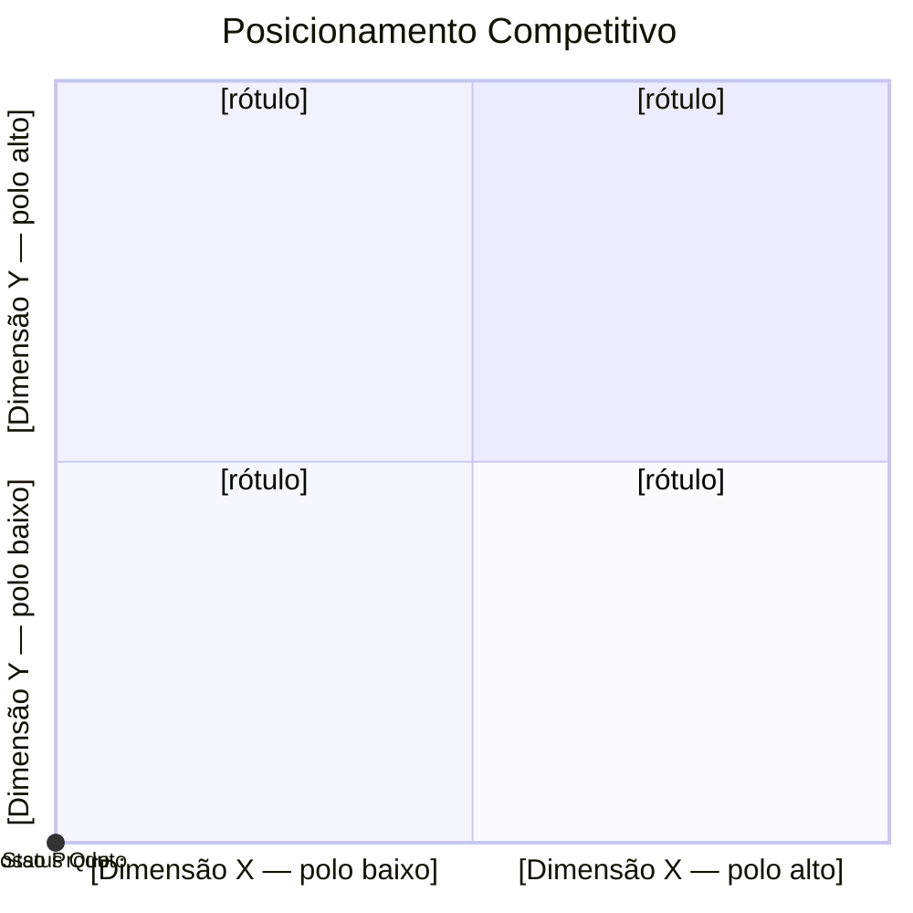

# Análise Competitiva de Mercado — [Nome do Projeto]

Status: draft | validado | aprovado
Última atualização: YYYY-MM-DD
Modo: Full | Degradado-sem-web | Degradado-nicho-sem-fontes
Fonte: legacy.md, inputs/, pesquisa de mercado

<!-- id: block-1-discovery -->

## Bloco 1 — Discovery resumido

*(Referência cruzada a `discovery-document.md` — não duplicar conteúdo aqui.)*

- Problema central: (ver `discovery-document.md`)
- Atores / personas: (ver `discovery-document.md`)
- Candidatos a RF relevantes para o benchmark: (F-xxx)

---

<!-- id: passo-0 -->

## Passo 0 — Pergunta estratégica

**Pergunta que este benchmark responde:** [Posicionamento / Roadmap-paridade de features / Modelo de negócio-pricing / Build-buy / Validação de diferencial]

---

<!-- id: metodo-pesquisa -->

## Método de pesquisa

*(Obrigatório quando houve pesquisa externa — modo Full ou Degradado. Registrar data, queries usadas e URLs-base por concorrente, conforme `SKILL.md` §"Pesquisa externa — método obrigatório".)*

| Data | Queries usadas | Concorrente | URLs-base consultadas |
|------|-----------------|-------------|-------------------------|
| | | | |

---

<!-- id: passo-1 -->

## Passo 1 — Concorrentes identificados

| Tipo | Nome | Por que está na lista |
|------|------|------------------------|
| Direto | | |
| Indireto | | |
| Status Quo | *(sempre presente)* | |

---

<!-- id: passo-2 -->

## Passo 2 — Dimensões de comparação

*(Fontes: transcrições/`F-xxx`, JTBD das personas, ênfase dos próprios concorrentes — não inventar lista genérica.)*

- Funcionalidade Core:
- Integrações:
- UX/Usabilidade:
- Performance:
- Segurança/Compliance:
- Modelo Comercial:
- Suporte:
- Escalabilidade:

---

<!-- id: matrix-weighted -->

## Pesos da matriz (Pontuação Ponderada — Weighted Matrix Score)

*(Peso 1-3 por dimensão, atribuído e justificado a partir da pergunta estratégica do Passo 0. Peso sem justificativa ligada à pergunta estratégica não é válido.)*

| Dimensão | Peso (1-3) | Justificativa (ligação com a pergunta estratégica) |
|----------|------------|------------------------------------------------------|
| | | |

**Fórmula:** `score(alternativa) = Σ(peso_dim × score_dim) / Σ pesos`

| Alternativa | Score ponderado |
|-------------|-------------------|
| Nosso produto | |
| Concorrente A | |
| Status Quo | |

---

<!-- id: passo-3 -->

## Passo 3 — Matriz de features

**Legenda obrigatória:**

| Símbolo | Significado |
|---------|-------------|
| ✅ | Completo / nativo |
| 🟡 | Parcial / workaround |
| ❌ | Ausente |
| 🔷 | Diferenciador único |

**Score por dimensão (0-3):** 0=Ausente · 1=Parcial · 2=Completo · 3=Diferenciado. Não usar média simples como decisão final.

| Dimensão / Feature | Nosso produto | Concorrente A | Concorrente B | Status Quo | Domínio (legacy) | Ref. interna (F-xxx) | Fonte (URL) | Confiança |
|---------------------|----------------|----------------|----------------|-------------|--------------------|------------------------|--------------|-----------|
| FUNCIONALIDADE CORE | | | | | | | | |
| | | | | | | | | |

---

<!-- id: passo-4 -->

## Passo 4 — Modelo de negócio dos concorrentes

| Concorrente | Modelo comercial | Ticket médio estimado | Segmento-alvo | Expansão de receita | Fonte |
|-------------|--------------------|--------------------------|------------------|------------------------|-------|
| | | | | | |
| Status Quo | | | | | |

*(O que analisar: modelo — freemium/assinatura/pay-per-use/licença/serviço; ancoragem de preço; como o concorrente cresce dentro de um cliente; custo oculto do status quo — quantificar quando `F-xxx` tiver dado.)*

---

<!-- id: passo-5 -->

## Passo 5 — Tendências de mercado

*(Obrigatório — não deixar em branco. Mínimo 2 categorias preenchidas.)*

| Categoria | Tendência | Impacto no produto | Fonte |
|-----------|-----------|------------------------|-------|
| Regulatória | | | |
| Tecnológica | | | |
| Comportamental | | | |
| Momentum de mercado | | | |

<!-- id: porter-5-forcas -->

### Porter 5 Forças

| Força | Evidência (A/B/C/D) | Implicação para o produto |
|-------|------------------------|-------------------------------|
| Rivalidade entre concorrentes | | |
| Poder de barganha dos clientes | | |
| Poder de barganha dos fornecedores | | |
| Ameaça de novos entrantes | | |
| Ameaça de produtos/serviços substitutos | | |

---

<!-- id: passo-6 -->

## Passo 6 — Qualidade das fontes

| Nível | Fonte | Como foi usada neste benchmark |
|-------|-------|------------------------------------|
| A | *(documentação oficial, pricing oficial, demo gravada)* | |
| B | *(case público, release note, material comercial)* | |
| C | *(review de usuário, fórum, blog)* | |
| D | *(suposição sem fonte)* | |

---

<!-- id: passo-7 -->

## Passo 7 — Mapa de posicionamento 2×2

**Escolher eixos que distribuam os players heterogeneamente.**



*(Eixos e rótulos derivados pela Objective Axes Rule abaixo — nunca copiar eixos de exemplo.)*

<!-- id: axes-justified -->

### Eixos por Variância (Objective Axes Rule)

*(Os eixos acima não são escolha arbitrária: entre as dimensões do Passo 2/3, escolher as 2 de maior variância — ou amplitude máx-mín como proxy — entre os players mapeados.)*

| Eixo | Dimensão escolhida | Variância/amplitude calculada |
|------|----------------------|----------------------------------|
| X | | |
| Y | | |

---

<!-- id: passo-8 -->

## Passo 8 — Gaps e recomendações

**Nota de escopo:** as três categorias abaixo são uma lente analítica de mercado (paridade/diferenciais/oportunidades), não IDs de backlog — esta skill **não cria** `GAP-XXX`. Suposições sem fonte ou decisões pendentes vão para `## Questões em aberto` (ver [`../../tools/references/task-pipeline.md`](../../tools/references/task-pipeline.md)). Referenciar um `GAP-XXX` já existente permanece permitido.

### Gaps de paridade

*(Sem eles nem somos considerados.)*
- [Feature que todos têm e nós não]

### Diferenciais

*(O que temos que outros não têm.)*
- [Nossa vantagem competitiva]

### Oportunidades

*(Ninguém serve bem ainda.)*
- [Potencial Blue Ocean]

<!-- id: errc-grid -->

### ERRC Grid (Eliminar / Reduzir / Elevar / Criar — Blue Ocean)

*(Cada quadrante deriva das 3 categorias de gaps acima.)*

| Quadrante | Pergunta | Insumo (a partir dos gaps) |
|-----------|----------|-------------------------------|
| Eliminar | Que fatores dados como certos pela indústria devem ser eliminados? | |
| Reduzir | Que fatores devem ser reduzidos bem abaixo do padrão da indústria? | |
| Elevar | Que fatores devem ser elevados bem acima do padrão da indústria? | |
| Criar | Que fatores nunca oferecidos pela indústria devem ser criados? | |

### Recomendações (Pyramid Principle)

```
RECOMENDAÇÃO: [assertiva de posicionamento — não pergunta]
Por quê:
  1. [Evidência do benchmark com F-xxx ou fonte A/B]
  2. [Evidência 2]
Implicações: [qual RF/RNF/Visão isso reforça em spec-product]
```

---

<!-- id: block-3-strategy -->

## Bloco 3 — Estratégia de produto

### Posicionamento

### Escopo — será / não será

### Trade-offs explícitos

### Hipóteses e riscos

### Métricas de sucesso do produto

*(Com baseline — inclusive baseline do status quo, quando houver dado em `legacy.md`.)*

---

## Questões em aberto <!-- id: open-questions -->

*(Suposições sem fonte (nível D), decisões de posicionamento pendentes ou lacunas de evidência. Esta skill não cria IDs `GAP-XXX` — ver [`../../tools/references/task-pipeline.md`](../../tools/references/task-pipeline.md) para como essas pendências alimentam a geração de tasks. Referenciar um `GAP-XXX` já existente permanece permitido.)*

| # | Pergunta | Evidência/contexto | Bloqueia próxima fase? |
|---|----------|---------------------|--------------------------|
| | | | |
