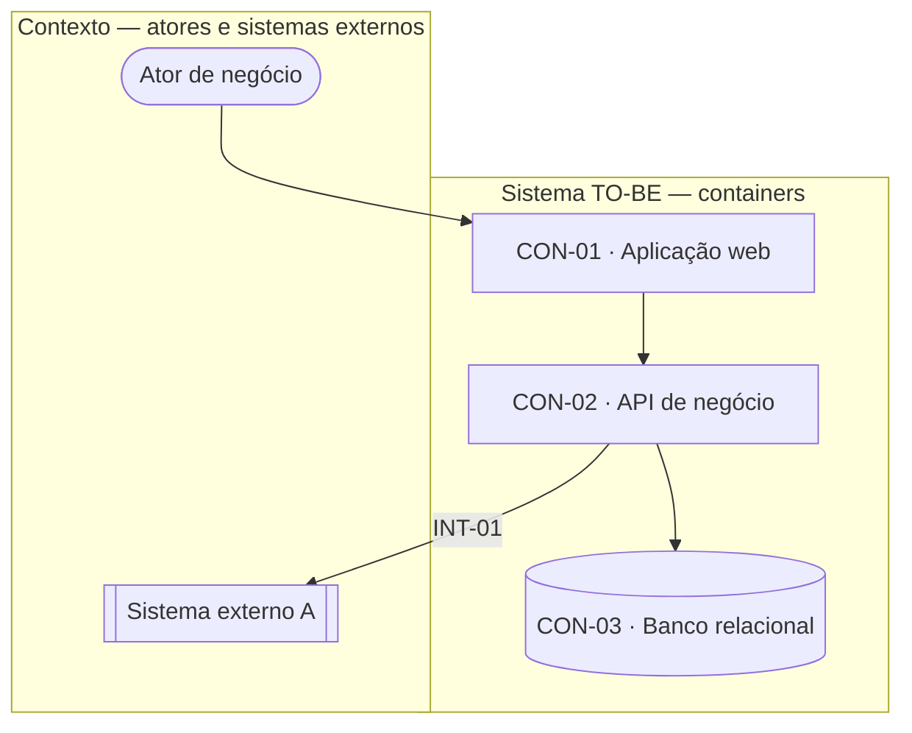

<!--
  hld.md — desenho de alto nível (High-Level Design) do produto TO-BE.

  GRAMÁTICA ESTRITA — este arquivo é validado por `python3 ../tools/check-hld.py` (caminho
  relativo ao SKILL.md que invoca; ver ../tools/references/paths.md).
  - O cabeçalho traz duas linhas que o validador lê: `Modo:` (completo | compacto) e
    `Contexto:` (greenfield | brownfield). Sem elas o validador assume completo/greenfield.
  - Seções obrigatórias em QUALQUER modo: `## Contexto e containers`, `## Decomposição por
    módulo`, `## Integrações externas`, `## Táticas por RNF`, `## Decisões de arquitetura (ADR)`.
    No modo completo também são obrigatórias: `## Fluxos arquiteturais`, `## Topologia de
    implantação`, `## Segurança de alto nível`, `## Riscos técnicos e spikes`.
    `## Delta AS-IS → TO-BE` é opcional na gramática e cobrado por AVISO no brownfield.
  - Cada seção tem UMA tabela de colunas fixas (não renomear, não reordenar, não adicionar nem
    remover colunas). Prosa e diagramas entre as seções são permitidos e ignorados pelo parser.
  - IDs: CON-01 / INT-01 / FLA-01 / TRB-01 / ADR-01 / RSK-01 (dois dígitos, únicos por seção).
  - Célula sem valor NUNCA fica vazia: usar `—`.
  - AS TABELAS SÃO A FONTE DE VERDADE. O diagrama Mermaid é ilustração: quem consome este
    arquivo (relatório consolidado, outras skills) usa `check-hld.py --json`, que lê as tabelas.
    Todo `CON-NN` citado em qualquer lugar do arquivo — inclusive no diagrama — precisa existir
    no inventário de containers, senão o validador falha.
  - Mermaid: usar `flowchart` com `subgraph` (mesmo estilo do `architecture.md` AS-IS). NÃO usar
    `C4Context` — a sintaxe é experimental e não renderiza de forma estável.
-->

# High-Level Design (TO-BE) — [Nome do Projeto]

Status: draft
Última atualização: YYYY-MM-DD
Versão: 1.0
Modo: completo
Contexto: greenfield
Fonte: modules.md, requirements.md, product-requirements.md, flow-map.md, context-map.md, benchmark.md, tech-rules/

<!-- id: hld-summary -->

## Resumo executivo

[Um parágrafo em linguagem de negócio: que peças o sistema novo tem, quem fala com quem e qual é
a decisão de arquitetura que mais condiciona o resto. Sem jargão sem explicação.]

---

<!-- id: hld-containers -->

## Contexto e containers

*(C4 nível 1 — Contexto: quem usa o sistema e com que sistemas externos ele fala. C4 nível 2 —
Containers: as peças executáveis/implantáveis do sistema, cada uma com um `CON-NN`. Um container é
algo que roda e pode ser implantado sozinho: uma aplicação web, uma API, um worker, um banco, uma
fila. Não é classe nem camada interna.)*



### Inventário de containers

| ID | Nome | Responsabilidade | Tecnologia |
|----|------|------------------|------------|
| CON-01 | Aplicação web | Entrega as telas ao usuário e concentra a experiência de uso | [stack do `frontend.mdc`] |
| CON-02 | API de negócio | Onde ficam as regras de negócio e o controle de acesso | [stack do `architecture.mdc`] |
| CON-03 | Banco relacional | Guarda os dados do produto | [stack do `database.mdc`] |

---

<!-- id: hld-decomposition -->

## Decomposição por módulo

*(Uma linha por módulo `MOD-XXX` do `modules.md`. Container = `CON-NN` do inventário acima, ou
`N/A` quando o módulo não vira software nesta entrega — nesse caso a coluna «Papel no módulo»
precisa dizer por quê. Módulo servido por mais de um container: uma linha por container.)*

| Módulo | Container | Papel no módulo |
|--------|-----------|-----------------|
| MOD-EXEMPLO-A | CON-02 | Concentra as regras de cadastro e a validação de duplicidade |
| MOD-EXEMPLO-A | CON-01 | Telas de cadastro e consulta |
| MOD-EXEMPLO-B | N/A | Fora desta entrega — o processo continua manual na onda 1 (decisão de rollout) |

---

<!-- id: hld-integrations -->

## Integrações externas

*(Uma linha por sistema externo do `context-map.md` (seção «Sistemas, integrações, contratos
mencionados») e do `architecture.md` quando há legado. Direção = `entrada` (o externo chama o
sistema), `saída` (o sistema chama o externo) ou `bidirecional`. Estilo = `síncrono` (a resposta
é esperada na hora) ou `assíncrono` (mensagem/fila/arquivo, resposta depois). Falha = o que
acontece quando o sistema externo não responde.)*

| ID | Sistema externo | Container | Direção | Estilo | Protocolo | Falha |
|----|-----------------|-----------|---------|--------|-----------|-------|
| INT-01 | [Sistema externo A] | CON-02 | saída | síncrono | REST/JSON | Tenta mais 2 vezes; se ainda falhar, mostra ao usuário que o dado veio desatualizado |
| INT-02 | [Sistema externo B] | CON-02 | entrada | assíncrono | Arquivo diário | Sem arquivo do dia, o processamento espera e um alerta é aberto |

---

<!-- id: hld-flows -->

## Fluxos arquiteturais

*(Só os fluxos que a arquitetura precisa sustentar — os de maior volume, maior risco ou que
cruzam sistemas. Fluxo = `FLX-xxx` do `flow-map.md`, ou `—` quando o fluxo é puramente técnico e
não aparece lá. Caminho = a sequência de containers e integrações, na ordem em que a informação
passa.)*

| ID | Fluxo | Caminho | Nota |
|----|-------|---------|------|
| FLA-01 | FLX-001 | CON-01 → CON-02 → CON-03 | Caminho de escrita mais frequente do produto |
| FLA-02 | FLX-002 | CON-02 → INT-01 → CON-03 | Depende do sistema externo A; ver a linha de falha em `## Integrações externas` |

---

<!-- id: hld-deployment -->

## Topologia de implantação

*(Onde cada container roda, em cada ambiente que o projeto mantém. Quando a decisão ainda não
existe, escrever a alternativa em avaliação e abrir uma linha em «Questões em aberto» — nunca
inventar um ambiente.)*

| Ambiente | Topologia | Observação |
|----------|-----------|------------|
| Desenvolvimento | [ex.: tudo em contêineres locais via docker compose] | Espelha produção nas versões, não no dimensionamento |
| Homologação | [ex.: uma instância de cada container] | Integrações externas apontam para sandbox |
| Produção | [ex.: CON-02 com 2 instâncias atrás de balanceador; CON-03 gerenciado] | [janela de indisponibilidade aceita, se houver] |

---

<!-- id: hld-nfr-tactics -->

## Táticas por RNF

*(Uma linha por requisito não funcional com métrica (`RNF-...` do `requirements.md`). Para cada
um: a tática de arquitetura que o sustenta OU o registro explícito de que o risco foi aceito.
«Risco aceito» é resposta válida — omitir o RNF não é. Containers = onde a tática mora.)*

| RNF | Métrica | Tática ou risco aceito | Containers | Justificativa |
|-----|---------|------------------------|------------|---------------|
| RNF-DESEMPENHO-001 | [ex.: resposta em até 2 s no percentil 95] | [ex.: cache de leitura no CON-02 + índice pelo campo de busca] | CON-02, CON-03 | Consulta de maior volume; sem cache o banco vira gargalo na onda 2 |
| RNF-SEGURANCA-001 | [ex.: 100% das operações com registro de autoria] | [ex.: trilha de auditoria gravada pelo CON-02 em tabela própria] | CON-02 | Exigência de compliance do cliente |
| RNF-DISPONIBILIDADE-001 | [ex.: 99,5% no horário comercial] | Risco aceito — instância única na onda 1 | CON-02 | Custo de alta disponibilidade não se paga no volume da onda 1; revisar antes da onda 2 |

---

<!-- id: hld-security -->

## Segurança de alto nível

*(Fronteiras de confiança: onde o dado atravessa uma linha em que a origem deixa de ser
confiável — internet → sistema, sistema → sistema externo, usuário comum → área administrativa.
Em brownfield, amarrar cada fronteira às ameaças `THR-xxx` do `threat-model.md` do AS-IS que ela
fecha ou herda. Sem legado, usar `—` na última coluna.)*

| ID | Fronteira | Containers | Controles | Ameaça AS-IS |
|----|-----------|------------|-----------|--------------|
| TRB-01 | Internet → sistema | CON-01, CON-02 | [ex.: sessão em cookie httpOnly, limite de tentativas no login, TLS 1.2+] | THR-001 |
| TRB-02 | Sistema → sistema externo A | CON-02 | [ex.: credencial em cofre de segredos, allowlist de domínio, timeout curto] | — |

---

<!-- id: hld-adr -->

## Decisões de arquitetura (ADR)

*(Uma linha por decisão macro — as que já nasceram no kickoff da `spec-tech-rules` (Fase 6.5) e
as que nasceram aqui. Esta skill NÃO redecide a stack: registra a decisão que já está na rule,
com o que foi descartado e o preço que a escolha cobra. Origem = arquivo de rule que carrega a
decisão (ex.: `architecture.mdc`), ou `—` quando a decisão nasceu no próprio HLD.)*

| ID | Decisão | Contexto | Alternativas rejeitadas | Consequências | Origem |
|----|---------|----------|-------------------------|---------------|--------|
| ADR-01 | [ex.: monólito modular em vez de microsserviços] | [equipe de 4 pessoas, um domínio, sem exigência de escala independente] | [microsserviços — custo operacional alto para o tamanho do time] | [um único deploy; separação por módulo tem de ser mantida por disciplina de código] | architecture.mdc |
| ADR-02 | [ex.: banco relacional gerenciado] | [dados fortemente relacionais e exigência de transação] | [banco de documentos — perderia consistência entre agregados] | [custo fixo mensal; migração de schema exige janela] | database.mdc |
| ADR-03 | [ex.: integração com o sistema externo B por arquivo diário] | [o externo não expõe API] | [scraping da tela — frágil e sem contrato] | [dado do dia anterior; o produto precisa mostrar a data do último arquivo] | integrations.mdc |

---

<!-- id: hld-risks -->

## Riscos técnicos e spikes

*(O que ainda pode derrubar o desenho e o que fazer para descobrir cedo. Cada spike vira
candidato a task do tipo Spike na Fase 8 (`spec-tasks`) — escrever o spike como pergunta com
resposta verificável, não como «estudar X».)*

| ID | Risco | Impacto | Spike sugerido | Alvo |
|----|-------|---------|----------------|------|
| RSK-01 | [ex.: o sistema externo A pode não sustentar o volume de pico] | [fila de espera visível ao usuário na onda 2] | [medir o tempo de resposta do sandbox com 3× o volume estimado] | INT-01 |
| RSK-02 | [ex.: volume do relatório mensal pode estourar o tempo de resposta] | [relatório inutilizável para a operação] | [rodar a consulta contra massa de 12 meses e medir] | CON-03 |

---

<!-- id: hld-delta -->

## Delta AS-IS → TO-BE

*(Só em brownfield — remover a seção inteira em greenfield. Uma linha por componente do
`architecture.md` (inventário de componentes do AS-IS). Tipo = `mantém` (segue como está),
`substitui` (o TO-BE toma o lugar), `absorve` (a função vira parte de um container novo),
`aposenta` (deixa de existir sem substituto) ou `novo` (não existia no AS-IS).)*

| Componente AS-IS | Destino TO-BE | Tipo | Nota |
|------------------|---------------|------|------|
| [Componente legado X] | CON-02 | absorve | [as regras saem do legado e passam a viver na API nova] |
| [Componente legado Y] | — | aposenta | [processo deixa de existir com a nova esteira] |

---

<!-- id: open-questions -->

## Questões em aberto

*(Lacunas do desenho que ainda dependem de decisão. Ver `../tools/references/task-pipeline.md`
§2.16: esta skill **não cria** `GAP-XXX` — quem converte estas linhas em GAP é o `spec-iterate`.)*

| # | Pergunta | Evidência/contexto (RNF, INT-NN, arquivo:linha) | Bloqueia próxima fase? |
|---|----------|--------------------------------------------------|-------------------------|
| 1 | | | |

---

<!-- id: hld-coverage -->

## Cobertura

*(Seção NÃO parseada pelo validador. Após rodar `python3 ../tools/check-hld.py outputs/spec/hld.md`
com exit 0, colar aqui o bloco MÉTRICAS impresso e tratar ou justificar cada aviso.)*

```
[colar aqui a saída MÉTRICAS do check-hld.py]
```
