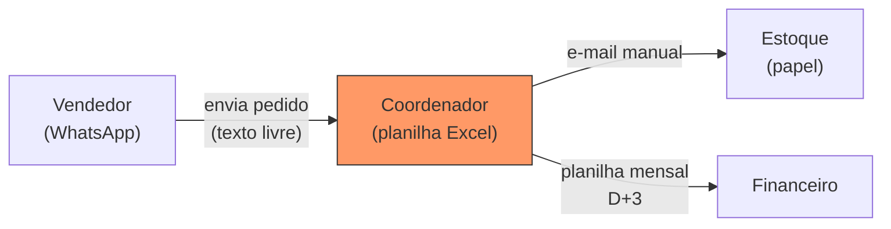

# spec-legacy — AS-IS por Domínio de Negócio

## Papel

Documentar a realidade **AS-IS** com precisão de consultoria, com o **negócio no centro** (linguagem 80% negócio / 20% técnico). O output deve permitir a um PM, executivo (CFO/COO), engenheiro ou novo consultor **tomar decisão sem voltar às fontes brutas** — exceto via `F-xxx` ou evidência técnica citada.

**Você está reconstruindo o negócio do cliente através do código — não recatalogando o repositório.** O código é o meio; o produto é o mapa de negócio (capacidades, entidades, regras, processos, dores, oportunidades) rastreável até a evidência.

**Princípios inegociáveis:**

1. **Evidência antes de escrever (duas fases).** Nada é escrito sem passar pela **Fase A — Descoberta read-only** (Passo A). Proibido produzir os artefatos apenas extrapolando o `context-map.md`/grafo/`ingestion` ou preenchendo genérico sem ler o código. Se algo não pôde ser validado no código no tempo disponível, **declarar a lacuna** (confiança menor / `PENDÊNCIA:`) — nunca inventar detalhe.
2. **Sem escala sintética.** Proibido usar scripts/loops/templates cujo objetivo seja "bater" números (50 regras, 25 processos, 40 oportunidades) com texto intercambiável. Cada item nasce de evidência distinta.
3. **Rastreabilidade em espinha.** Toda capacidade de negócio (`BM-xxx`) liga a código (`MOD-xxx`) e a domínio (`DOM-xxx`); toda regra (`RN-xxx`), processo (`PROC-xxx`) e dor citam arquivo/símbolo/objeto de BD. A cobertura é **validada** (Passo 9).
4. **Grafo como motor de negócio — pré-requisito absoluto.** O Graphify (Passo 0.5) descobre fronteiras de capacidade, o crosswalk entidade×regra×módulo e as cadeias de execução que sustentam a Fase A. No Modo Digital/Híbrido com código, grafo completo e verificado é gate FATAL (`GRAPH_COMPLETED` — regras e única exceção no Passo 0.5). Cair em "DDL + documentação + grep" sem minerar o grafo (Passo 0.6) é exatamente o anti-padrão que esta skill existe para prevenir.
5. **Parágrafo único que "resume" um domínio = falha.** Cada dimensão exige sua tabela.

**Metas de profundidade (proporcionais ao tamanho do legado — proporcionalidade no Passo A.2):** inventário `BM` de 8 (sistemas médios) a 15–35+ (monólitos grandes); ≥ 50 `RN` com evidência distinta; ≥ 25 `PROC` com falha+dor ancoradas; ≥ 40 oportunidades incluindo ≥ 8 agentes de IA. Em legado pequeno, escalar para baixo **e registrar o escopo reduzido** — nunca preencher com genérico.

---

## Linguagem clara — como escrever o que o humano vai ler (OBRIGATÓRIO)

<!-- linguagem-clara:v1 inicio -->
<!-- Bloco canônico. Ao alterar, rodar `python scripts/apply_linguagem_clara.py` para replicar em todas as skills. -->

**Quem lê não é você.** É o desenvolvedor que pegou a task sem ter participado do discovery, o PO
que precisa aprovar, o analista que entrou no time semana passada. Texto correto e ilegível custa
uma reunião — e quem lê desiste e vai perguntar. Escrever difícil não é sinal de rigor: é defeito de
geração, do mesmo peso de um campo obrigatório faltando.

**Alvo verificável:** uma pessoa que nunca viu este projeto entende o que precisa fazer **lendo uma
vez**, sem abrir outro documento e sem precisar procurar o significado de nenhuma palavra.

### As 10 regras

1. **Frase curta, voz ativa, presente.** "O serviço confere o CPF antes de gravar" — não "a
   validação do CPF é realizada previamente à persistência". Alvo: até ~25 palavras por frase, uma
   ideia por frase.
2. **Termo técnico ganha explicação de meia linha na primeira aparição:** "no repository (a classe
   que conversa com o banco)", "um índice único (o banco passa a recusar duplicados sozinho)". Da
   segunda vez em diante, usar o termo puro.
3. **Nenhuma sigla solta.** Expandir na primeira aparição — inclusive as siglas do negócio e as da
   própria metodologia: "IDOR (quando um usuário consegue acessar o registro de outro)",
   "DV (Documento de Visão)", "RN (Regra de Negócio)".
4. **Código de regra ou de requisito nunca substitui o conteúdo dela.** Escrever a regra por extenso
   e pôr o código no fim, entre parênteses: "não deixa cadastrar dois clientes com o mesmo CPF
   (RN-012)". "Implementar a RN-012" não informa nada a quem não tem o documento aberto.
5. **Nome de arquivo, tabela, rota ou classe sempre acompanhado do papel dele.**
   `PedidoService.java` sozinho não diz nada; `PedidoService.java — onde ficam as regras de quando
   um pedido pode ser aprovado` diz. Vale igual para `TB_PEDIDO` e para `POST /pedidos`.
6. **Sem jargão de processo.** "blueprint", "gate", "FATAL", "matriz de cenários", "compact-prose",
   nome de validator, nome de camada de arquitetura: isso é vocabulário interno das skills, não do
   leitor. Traduzir — em vez de "6 cenários da matriz em VERDE", escrever "testei 6 situações, todas
   passaram".
7. **Sem "simplesmente", "basta", "apenas", "trivial", "é só".** Minimizam a dificuldade e afastam
   quem não entendeu de primeira.
8. **Verbo no lugar de substantivo; ativa no lugar de passiva.** "realizar a validação" → "validar";
   "efetuar o cadastramento" → "cadastrar"; "é disponibilizado ao usuário" → "o sistema mostra";
   "deve ser efetuada a persistência" → "grava no banco".
9. **Cenário de teste é uma frase "quando X, o sistema Y"** — nunca o id do cenário, nunca o nome do
   método de teste: "quando o CPF já existe, o sistema recusa e mostra 'CPF já cadastrado'".
10. **Bloco técnico denso abre com uma frase em português dizendo o que ele significa.** Contrato de
    API, colunas de tabela, status HTTP, schema, JSON: o conteúdo continua **completo e preciso** —
    o que muda é que antes dele vem uma linha do tipo "esta rota cria o pedido e devolve o número
    dele; se o CPF não existir, recusa com 404". Precisão técnica e legibilidade não competem: a
    frase de abertura é o mapa, o bloco é o território.

### Antes → depois (referência de tom)

| Complexo (não usar) | Claro (usar) |
|---|---|
| "Implementar validação de unicidade conforme RN-012, com persistência idempotente." | "Impedir o cadastro de dois clientes com o mesmo CPF. Se o CPF já existir, o sistema recusa e mostra 'CPF já cadastrado' — nada é gravado. Se a mesma requisição chegar duas vezes, o resultado é o mesmo da primeira (RN-012)." |
| "A entidade é submetida ao processo de normalização previamente à sua persistência." | "Antes de gravar, o sistema padroniza os dados: tira acento, deixa em maiúscula e remove espaço sobrando." |
| "Realizar o tratamento de exceções no fluxo de integração." | "Se o sistema externo não responder, tentar mais 2 vezes. Se ainda falhar, guardar a solicitação na fila e avisar o usuário que o processamento termina depois." |
| "Garantir a aderência aos padrões arquiteturais definidos." | "Seguir o padrão do projeto: a tela nunca fala direto com o banco, sempre passa pelo serviço." |
| "Disponibilizar endpoint para consulta paginada de pedidos com filtros." | "Criar a busca de pedidos: quem chama informa a página e pode filtrar por cliente, período e situação. A resposta traz 20 pedidos por vez e o total encontrado." |
| "Efetuar refatoração do componente visando redução do acoplamento." | "Separar o componente em dois, para que mudar a regra de desconto deixe de exigir mexer na tela." |

### Como conferir antes de entregar (30 segundos)

1. Leia em voz alta a **primeira frase de cada seção**. Travou a língua? Reescreva.
2. Existe alguma palavra que um analista de primeiro emprego **não usaria numa conversa**? Troque, ou
   explique entre parênteses na primeira aparição.
3. Alguma frase obriga a abrir outro documento para fazer sentido — sigla, código de regra, nome de
   arquivo sem o papel dele? Complete ali mesmo.
4. Algum bloco técnico começa direto no JSON, na tabela ou no YAML? Ponha a frase de abertura.

> **Isto não autoriza cortar conteúdo.** Nenhuma das regras acima permite resumir, omitir campo
> obrigatório ou trocar dado concreto por prosa. Linguagem clara é sobre a **forma**; densidade,
> precisão e auto-suficiência continuam sendo sobre o **conteúdo**. As duas coisas valem juntas.

<!-- linguagem-clara:v1 fim -->

### Aplicação nesta skill

Vale para `legacy.md`, `business-map.md`, `architecture.md`, `threat-model.md` e `domain.md` — e em especial para `business_impact_narrative`, `pain_points[].estimated_cost` e as `user_stories[]` de cada domínio. O alvo declarado da skill (80% negócio / 20% técnico) só se cumpre com as 10 regras aplicadas de fato.

## Sync-log (obrigatório)

Antes de iniciar, ler `outputs/spec/sync-log.md` (Seção A) — inclui a linha de kickoff (ver `../tools/references/task-pipeline.md` §4).
Ao terminar (mesmo se a skill for skip), adicionar UMA linha: `| # | data | <skill> | <resultado-resumo> | <artefatos> | <questões em aberto> | <próximo passo> |` — o `<resultado-resumo>` deve indicar o modo (Digital / Processo-Manual / Híbrido / skip).

**Modo degradado `LEGACY_SKIPPED` (projeto sem legado) — esta skill é a ÚNICA produtora do marcador.**
Nas linhas 2 e 3 da tabela de decisão do Passo 0 (skip: `inputs/` sem legado real), os 4 artefatos do AS-IS
(`legacy.md` com o conteúdo de `legacy-sem-legado.md`, `architecture.md`, `legacy-analysis.md`, `threat-model.md`)
não são gerados. Para que o `check-outputs.py` os trate como «não se aplica» em vez de falta (exit 1), escrever
o marcador na coluna **Modo / contexto** da mesma linha da Seção A — abrindo a célula:

```
| 2 | 2026-07-30 10:00 | spec-legacy | LEGACY_SKIPPED: motivo=<greenfield|só protótipo|só insumo documental> · justificativa=<1 frase> | inputs/… | legacy.md | … |
```

A forma em **linha própria** (fora da tabela) também é aceita, e o `motivo=` tem de vir preenchido de
verdade (placeholder intacto não desliga o gate). Gramática completa — posições válidas, rejeição de
placeholder, precedência do `kickoff:` — em `../tools/README.md` «Precedência dos marcadores de skip»;
mesma do `FLOWMAP_SKIPPED`. *(Kickoff já registrado como `legado=Não` dispensa o marcador — ele é o
registro de último recurso para skip decidido aqui no Passo 0.)*

---

## Passo 0 — Gate obrigatório (antes de qualquer domínio)

Este gate cruza duas informações independentes — **nunca decidir só por uma delas**:

- **Kickoff:** resposta do orquestrador `spec` à pergunta 1 (há legado? Sim / Parcial / Não).
- **Classificação de `inputs/`:** o que os arquivos realmente contêm, **mesmo que o kickoff já tenha respondido**. O kickoff pode ter sido respondido incorretamente se havia protótipo em `inputs/`, ou pode ter sido respondido "Não" sem que o consultor tivesse visto todos os arquivos.

**1. Classificar cada arquivo de `inputs/` como:**

| Tipo detectado | Classificação | Ação |
|---------------|---------------|------|
| React/Vue/Angular SPA sem servidor real (sem Express/Django/etc. no mesmo repo, sem migrações de DB) | Protótipo de validação | **IGNORAR para esta skill** — encaminhar para `spec-prototype` |
| Arquivos `mock*.ts`, `data.json`, seed/fixture files, `localStorage` como persistência | Protótipo de validação | **IGNORAR para esta skill** |
| Figma, wireframes, screenshots, HTML estático | Insumo visual | **IGNORAR para esta skill** — já tratado em `spec-ingest` |
| Documentação normativa (ERS, SRS, leis, portarias) | Insumo documental | **IGNORAR para esta skill** — fonte para `spec-ingest` |
| Documentação de produto prévia (RFs, visão, PRD anterior) | Insumo documental | **IGNORAR para esta skill** — fonte para `spec-ingest` |
| SQL migrations / DDL com dados reais | Sistema legado real | ✅ confirma legado real |
| Código servidor com conexão a DB de produção | Sistema legado real | ✅ confirma legado real |
| Planilhas de operação com dados históricos reais | Processo manual legado | ✅ confirma legado real (Modo Processo-Manual) |

Resultado da classificação: **legado real confirmado** (≥1 arquivo nas 3 últimas linhas) ou **não confirmado** (todos os arquivos caem nas 5 primeiras linhas, ou `inputs/` vazio).

**2. Decisão — cruzar kickoff × classificação:**

| # | Kickoff | Classificação de `inputs/` | Ação |
|---|---------|------------------------------|------|
| 1 | Sim / Parcial | Legado real confirmado | ✅ Prosseguir para «Modo de operação» e Passo 0.5 |
| 2 | Sim / Parcial | **Não** confirmado (só protótipo/insumo) | Kickoff respondido incorretamente → **reverter para skip**: gravar `legacy.md` com `legacy-sem-legado.md`, remover `architecture.md`/`legacy-analysis.md`/`threat-model.md` de corrida anterior, registrar em `sync-log.md` («spec-legacy revertida para skip — inputs/ contém apenas protótipo/insumos, não sistema legado real») e avisar o consultor antes de continuar |
| 3 | Não | Não confirmado | ✅ Consistente — skip normal: copiar `legacy-sem-legado.md` para `outputs/spec/legacy.md`, garantir ausência de `architecture.md`/`legacy-analysis.md`/`threat-model.md`, registrar «spec-legacy skipped — sem legado no kickoff» e **PARAR** (seguir fluxo com `spec-benchmark`) |
| 4 | Não | **Legado real confirmado** | ⚠️ **Conflito** — NÃO decidir sozinho nem fazer skip silencioso. Emitir `⚠️ WARNING` explícito e **perguntar ao consultor**: "o kickoff indicou 'sem legado', mas `inputs/` contém `<arquivo(s)>` classificado(s) como legado real (`<tipo>`). Confirma que é para tratar como legado real (Sim/Parcial) ou os arquivos devem ser ignorados?" — só prosseguir (para linha 1) ou fazer skip (para linha 3) após resposta explícita; registrar a resposta e a linha aplicada no `sync-log.md` |

---

## Modo de operação — identificar antes de começar

| Situação | Modo |
|----------|------|
| Há código, DDL, APIs, sistemas digitais | **Modo Digital** — todas as 12 dimensões, Dim. 12 obrigatória |
| Há processos manuais (planilhas, e-mail, WhatsApp, papel) mas sem sistema | **Modo Processo-Manual** — dimensões 1-11 obrigatórias; Dim. 12 adaptada |
| Mix: sistema legado + processos manuais paralelos | **Modo Híbrido** — 12 dimensões; Dim. 12 para sistema + adaptação para processos manuais |

---

## Entradas obrigatórias

1. **`outputs/spec/context-map.md`** — todos os F-xxx que fundamentam a narrativa de negócio
2. **`inputs/`** — código, DDL, OpenAPI, diagramas (Modo Digital/Híbrido)

---

## Passo 0.5 — Grafo de conhecimento como motor de negócio (Graphify) — GATE BLINDADO

**Quando executar:** Modo **Digital** ou **Híbrido** com código, DDL, scripts ou docs técnicos reais em `inputs/`. **Pular** no Modo Processo-Manual (sem código) e em skip — registrar «grafo N/A — sem código no legado» e seguir.

**Objetivo:** transformar `inputs/` num grafo consultável (`calls`/`imports`/`inherits` resolvidos por AST em ~40 linguagens, além de schema SQL e infra) que **acelera e fundamenta** todo o mapeamento. A ideia central é **entender o negócio**: o grafo é o mecanismo que revela quais capacidades existem, quais entidades cada regra toca e como os domínios se acoplam — sem depender de leitura manual arquivo a arquivo.

> **REGRA ABSOLUTA:** no Modo Digital/Híbrido com código, **em hipótese nenhuma prosseguir para o Passo A (Fase A) sem o grafo completo e verificado.** O grafo não é opcional nem "melhor esforço": é pré-requisito. Só há uma saída legítima sem grafo — o CLI ser **genuinamente indisponível** após tentativas reais de instalação e execução, e o consultor autorizar explicitamente (Passo 0.5.6). Grafo ausente/vazio/truncado = **FALHA que bloqueia** (validador FATAL `GRAPH_COMPLETED`).

Com código em `inputs/` (Modo Digital ou Híbrido), ler [`references/graphify.md`](references/graphify.md)
antes de rodar: instalação sem pedir permissão, staging da fonte, execução resiliente, o gate
`GRAPH_COMPLETED`, os dois grafos por tamanho e o fallback só para CLI genuinamente indisponível.

---

## Passo 0.6 — Mineração do grafo (obrigatório — o que grep/DDL NÃO dão)

Logo depois do `GRAPH_COMPLETED`, minerar o grafo seguindo
[`references/graphify.md`](references/graphify.md) § «Passo 0.6». Obrigatório no Modo
Digital/Híbrido com código; pular no Processo-Manual e no skip.

---

## Passo 0.7 — Sinais determinísticos (enriquecimento — gate WARNING `SIGNALS_COLLECTED`)

No Modo Digital/Híbrido com código, logo após a mineração do grafo (Passo 0.6) e antes da Fase A,
ler [`references/sinais.md`](references/sinais.md): as ferramentas, a rota efêmera, o gate
`SIGNALS_COLLECTED` (WARNING) e o uso obrigatório dos sinais nos artefatos. Pular no
Processo-Manual e no skip — registrar «sinais N/A — sem código» no sync-log.

---

## Execução: sequencial ou por subagentes (janelas de análise)

Para legados médios/grandes, rodar a análise em **subagentes isolados** reduz muito o risco de estourar contexto: cada subagente gasta o **próprio** contexto lendo fontes e consultando o grafo, e devolve ao orquestrador apenas um **fragmento em arquivo + resumo curto** — não as leituras brutas. Em legado pequeno, rodar **sequencial** no mesmo agente basta; as regras das fases (A, B, dimensões, validação) **não mudam** em nenhum dos modos.

### Janelas (1 subagente cada, contexto isolado, em paralelo)

Cada janela executa a **Fase A** dentro do seu escopo e grava um fragmento em `outputs/spec/business-map.parts/`.

| Janela | Escopo (temas A.6) | Fragmento | Alimenta |
|--------|--------------------|-----------|----------|
| **A — Código & Arquitetura** | anti-padrões, acoplamento, testes, observabilidade; inventário `code_modules` | `parts/tech.json` (`code_modules` + subscores técnicos) + notas p/ `architecture.md` | architecture.md · Dim 12 · metade técnica da complexidade |
| **B — Negócio** | o coração: `business_modules`, crosswalk, `domains` (12 dimensões), `business_rules`, `processes`, `opportunities`, `value_chain` | `parts/business.json` + seções de `legacy.md` | negócio por domínio · metade de negócio da complexidade |
| **C — Integrações & Segurança** | integrações, assíncrono, authn/authz, vulnerabilidades | `parts/integ-sec.json` + notas p/ `threat-model.md` | threat-model.md · Dim 11 |
| **D — Banco** | schema: smells, EAV, lógica no BD, lock-in | `parts/db.json` (`database_analysis`) | database_analysis · complexidade |

Legado muito grande: a Janela B pode, por sua vez, fan-out **um subagente por domínio** (fragmento por DOM em `parts/DOM-xxx.json`), mesmo princípio.

### Prompt de cada subagente (auto-suficiência obrigatória)

Como subagentes **não** compartilham contexto, cada prompt deve carregar: o esquema do **Passo 7**, os prefixos de ID, o **modo** e o **vocabulário do cliente**, o caminho do `graph.json`, as regras **anti-fabricação (A.1)** e o **mapa de sourcing (A.5)**, e o escopo da janela. Instrução final fixa: *"grave seu fragmento em `business-map.parts/<janela>.json` e a sua fatia do `legacy-research-log.md`; responda apenas com contagens + lacunas + caminho — nunca cole o JSON inteiro na resposta."*

### Orquestrador (agente principal)

1. Passo 0 (gate), Passo 0.5 (grafo **uma vez**, com `GRAPH_COMPLETED` aprovado), Passo 0.6 (**mineração do grafo** — subagente dedicado grava `graph_findings` + `graph_coverage`) e Passo 0.7 (**sinais determinísticos** em `outputs/spec/signals/`), compartilhados por todas as janelas.
2. Despachar A/B/C/D **em paralelo** (várias chamadas de subagente na mesma mensagem) — cada janela já recebe os `graph_findings` como insumo.
3. **Merge determinístico:** cada janela é dona de chaves **disjuntas** do `business-map.json` (ver tabela) — o merge é união rasa dos fragmentos; o orquestrador só combina os subscores em `complexity.score` e preenche `metadata`. Ownership disjunto = sem escrita concorrente no mesmo arquivo.
4. Rodar **`check-legacy-business.py`** (Passo 9) como portão de reconciliação; se falhar (BM sem DOM, evidência repetida), despachar um subagente de **correção dirigida** em vez de reprocessar tudo.
5. Passo 8 (HTML) e fecho.

### Cuidados

- **Fragmentos pequenos** — a escrita de arquivos grandes pode truncar neste ambiente; um arquivo por janela/domínio.
- **Resumo curto no retorno** — se o subagente devolver o conteúdo inteiro no texto, o ganho de contexto se perde.
- **Fallback:** sem subagentes, rodar tudo sequencial no mesmo agente — artefatos e validações idênticos.

---

## Passo A — Descoberta read-only (Fase A) — obrigatória antes de escrever qualquer artefato

Esta fase é **somente leitura**: não grava nenhum artefato final. Produz um **mapa de trabalho** que fundamenta tudo depois. Pular esta fase e ir direto à autoria é o erro que esta skill existe para prevenir.

### A.1 — Regras anti-fabricação (bloqueantes)

| Proibido | Obrigatório |
|----------|-------------|
| Emitir os catálogos só extrapolando `context-map.md`/grafo/`ingestion` | Confirmar cada capacidade, regra e processo com evidência lida no código/BD |
| Scripts/loops/templates para "bater" metas com texto intercambiável | Cada `RN`/`PROC`/`OPP`/`BM` nasce de evidência distinta |
| Mesmo `example_scenario`, `business_rationale` ou `business_impact` repetido entre itens | Texto específico por item, com papéis e valores concretos |
| Citar tela/arquivo que não foi aberto/verificado | Todo path citado existe sob `inputs/` (conferir por listagem/leitura) |
| > 3 regras apontando o mesmo arquivo como local principal | Diversificar evidência ou marcar confiança menor e apontar o módulo real |

### A.2 — Toque mínimo de fonte (quantitativo, proporcional ao legado)

Salvo escopo explicitamente reduzido pelo consultor (registrar no research log), abrir/citar com evidência rastreável:

- **≥ 40** arquivos de código distintos sob `inputs/` (cobrindo camadas: entrada/web, serviço, domínio, persistência, config).
- **≥ 12** artefatos de UI (telas/templates/componentes) **lidos pelo conteúdo**, não só listados.
- **≥ 2** caminhos de evidência por `BM-xxx`.

Legado pequeno: escalar para baixo mantendo ≥ 15 técnicos + o bastante de negócio para sustentar os `BM` — e **registrar o limite por escrito**.

### A.3 — Cadeias de execução por capacidade (o coração da descoberta)

Para **cada** capacidade candidata (comunidade do grafo / módulo de negócio), traçar **pelo menos uma** cadeia ponta-a-ponta **entrada → regra → persistência → tela/relatório**, usando o grafo (`graphify path`) para achar os saltos e abrindo os arquivos-chave para confirmar. Anotar arquivos/símbolos por capacidade.

**Deep dive por stack (quando o grafo/ingestão indicar):** ex. servlet+Struts → localizar `struts-config*.xml`, ler `BaseAction`/`Invoker`/filtros (entrada e permissão), amostrar ao menos uma cadeia `action → service/negócio → JSP` completa por módulo; ORM/mapeamento para cardinalidade e alinhamento tabela↔entidade. Adaptar o raciocínio a .NET, Node, Python, Go, PHP etc.

> **Empacotamento de contexto para leitura profunda (repomix):** ao precisar ler um módulo grande arquivo a arquivo, empacotar **módulo a módulo** com `npx repomix --include "<módulo>/**" --compress` — o `--compress` remove corpo de implementação preservando assinaturas/estrutura, mantendo a leitura dentro do **orçamento de tokens** (evita estourar o contexto com o repositório inteiro). Quando o ambiente suportar subagentes, **despachar a leitura do pacote para um subagente** (uma janela por módulo — ver «Execução: sequencial ou por subagentes»), que devolve só o resumo + evidências, não o conteúdo bruto.

### A.4 — Research log (trilha de auditoria)

Gravar `outputs/spec/legacy-research-log.md` (texto simples): data, para cada `BM` os arquivos inspecionados, e as lacunas («não validado em código»). Não é consumido pelo HTML — é a prova de que a Fase A ocorreu e a base honesta das confianças declaradas.

### A.5 — Mapa de sourcing por campo (precisão sobre inferência)

Para cada informação, buscar **nesta ordem**: (1) evidência direta no código/BD (`arquivo:linha`, `graphify`), (2) docs de negócio (`inputs/business`, `context-map.md` / `F-xxx`), (3) inferência **explícita** (marcar `confidence: low` + nota), (4) senão `PENDÊNCIA:`. **Nunca** inventar número/nome sem uma dessas origens.

| Informação (campo) | Onde buscar (em ordem) | Se não houver |
|---|---|---|
| Propósito / `capability_summary` | docs de negócio, README, nomes de módulo, rótulos de tela | inferir do código com `confidence: low` |
| `primary_entities` + evidência | ORM/mapeamentos, entidades, DDL, `graphify query` sobre a tabela | `PENDÊNCIA:` |
| Regras (`business_rationale`/`impact`/`scenario`/`location`) | validações, serviços de domínio, máquinas de estado, triggers/procs, `graphify explain` | **não criar a regra**; registrar lacuna no research log |
| KPIs (nome / como mede / dono) | docs de negócio, relatórios/dashboards no código, SLAs no `context-map` | `PENDÊNCIA:` — KPI raramente está no código |
| `estimated_cost` das dores | `context-map` (F-xxx com números), docs, entrevistas | custo **qualitativo** ("risco de auditoria"); nunca placeholder |
| `value_chain` (ciclos + stakeholders) | processos ponta-a-ponta (A.3), papéis em telas/permissões | inferir dos processos com `confidence: low` |
| `relationships` / `coupling_level` | `graphify path` entre domínios + crosswalk | marcar como hipótese |
| `user_stories` | processos + atores reais (papéis das telas/permissões) | manter 3–5 **só** se ancoradas em atores reais |
| subscores de `complexity` | contagens reais (anti-padrões, integrações, regras, procs, telas) | não pontuar sem contagem — declarar `confidence` |

### A.6 — Temas de busca para profundidade técnica (adaptar à stack)

Rodar **todos** os temas (grep / símbolos / grafo), documentando o que foi buscado. São o que dá **precisão** aos achados que alimentam `architecture.md`, a Dimensão 12, o `threat-model.md`, o `database_analysis` e os subscores de complexidade.

| Tema | O que caçar (exemplos — adaptar à linguagem) | Alimenta |
|---|---|---|
| Anti-padrões | God class, transação gigante, domínio anêmico, service locator, config/segredo hardcoded, cópia-cola, dependência circular | Dim 12 · complexidade (dívida) |
| Acoplamento | tipos/módulos mais referenciados (grau no grafo), "o que quebra se mudar" | legacy-analysis (acoplamento) · architecture |
| Integrações | clients HTTP/SOAP/gRPC, filas/mensageria, FTP/arquivos, DB links, endpoints hardcoded em config/IaC | architecture · threat-model · complexidade |
| Assíncrono | schedulers/cron, workers, batch, consumidores de fila; idempotência e reprocesso | processos · architecture |
| Observabilidade | logging e níveis, `catch` silencioso, métricas, health checks, tracing | Dim 12 · threat-model |
| Testes | arquivos de teste, cobertura aproximada, lacunas em lógica crítica | complexidade (gap de testes) |
| Segurança | authn/authz, RBAC, hashing de senha, injeção, segredos, deserialização insegura | threat-model · Dim 11 |
| Banco | tabelas largas, ausência de FK, EAV, procs/triggers com regra de negócio, lock-in de fornecedor | database_analysis · complexidade |

Sempre que um tema não se aplicar à stack, registrar «tema X: N/A» — a ausência é uma decisão consciente, não um esquecimento.

---

## Passo B — Inventário de Negócio → `business-map.json` (a espinha de rastreabilidade)

Só começar **depois** da Fase A. Aqui nasce a fonte de verdade estruturada: `outputs/spec/business-map.json` (esquema canônico no **Passo 7**). Este passo preenche os blocos `code_modules`, `business_modules` e `cross_cutting_views`.

### B.1 — Inventário técnico de módulos (`code_modules`, `MOD-xxx`)

Lista **completa** das raízes de código/artefatos implantáveis, para que domínios liguem a caminhos sem esquecer nenhuma raiz. Cada `MOD-xxx`: `id`, `name` (rótulo técnico curto), `root_paths` (relativos a `inputs/`), e opcionais `layer_hints`, `database_hints`, `ui_root_paths`. Infra pura (build/dist/vendor) entra **uma vez** com `out_of_business_scope: true`, `category: "infrastructure"` e `scope_note` de uma linha — para o revisor ver a cobertura da árvore inteira.

### B.2 — Inventário de negócio (`business_modules`, `BM-xxx`)

Capacidades coerentes para stakeholders (verbo + objeto de negócio), usando pastas/comunidades do grafo **só como pista**. Meta: **≥ 8** BMs; monólitos grandes escalam a **15–35+** para evitar domínios genéricos demais. Cada `BM-xxx`:

| Campo | Conteúdo |
|-------|----------|
| `id` / `name` | `BM-001…`; nome em **linguagem de negócio** |
| `capability_summary` | 1–3 frases para gestor/PO — **sem** nome de stack |
| `primary_entities[]` | `{ name, business_description, evidence[] }` — a entidade em termos de negócio + prova técnica |
| `business_rule_clusters[]` | `{ id: BRC-BM01-01, summary, trigger_or_condition, affected_entities[], evidence[] }` — 3–12 por BM; resume um conjunto coeso de regras (não centenas de métodos) |
| `maps_to_code_module_ids[]` | ponte para `MOD-xxx` (onde a capacidade vive) |
| `overlaps_with[]` | `{ bm_id, relationship: shares_entity\|shared_rule\|dependency\|upstream\|downstream, via }` |
| `confidence` / `scope_boundary` | confiança + o que este BM **exclui** |

Infra pura **não** vira BM. Autochecagem antes de fechar: todo `BM` tem `primary_entities` e `business_rule_clusters` não vazios e ≥ 1 `MOD` referenciado.

### B.3 — Crosswalk entidade × regra × módulo (`cross_cutting_views`)

O mapa de acoplamento de negócio — **onde o Graphify brilha**. Na raiz do JSON:

- `entity_rule_crosswalk[]`: `{ entity, business_module_ids[], rule_cluster_ids[], notes }` para as entidades mais compartilhadas/críticas (ex.: cliente, pedido, pagamento, documento… use os termos do domínio do cliente). Derivar de `graphify query`/`path` sobre a entidade.
- `domain_hypothesis_notes`: 2–5 frases sobre **fronteiras** entre BMs (onde regras e entidades criam acoplamento de negócio) — a base para consolidar os `DOM-xxx` no Passo 1.

---

## Passo 1 — Consolidar e validar lista de domínios

A partir dos candidatos do context-map **e do inventário `BM` (Passo B)**:

1. Usar o **vocabulário que o cliente usa** (não "módulo de pagamentos" se o cliente fala "gestão financeira")
2. Cada domínio deve ter ≥1 F-xxx **ou** evidência técnica (arquivo de código, endpoint de API)
3. Domínio sem evidência → marcar **hipotético** + PENDÊNCIA: "validar nome e limites com cliente"
4. Verificar que domínios não se sobrepõem

### Cobertura BM → DOM (obrigatória)

Cada `DOM-xxx` declara, no `business-map.json`, `source_business_module_ids[]` (os `BM` que cobre) e `source_module_ids[]` (os `MOD` — derivados de `maps_to_code_module_ids` dos BMs cobertos + qualquer MOD extra cujo negócio caiba no domínio). **Regras de cobertura** (validadas no Passo 9):

- Todo `BM-xxx` aparece em **≥ 1** `source_business_module_ids` — ou o texto do domínio justifica explicitamente a fusão (listando todos os BMs agrupados) ou a exclusão (ex.: BM duplicado no inventário).
- Todo `MOD-xxx` com `out_of_business_scope !== true` aparece em **≥ 1** `source_module_ids`.
- Autochecagem: contar BMs vs. BMs referenciados e MODs vs. MODs referenciados; não fechar até baterem ou as lacunas estarem justificadas.

Cada `DOM-xxx` no JSON carrega ainda: `description` (executiva), `business_capability`, `size`, `complexity`, `relationships[]` (com `coupling_level` derivado do grafo), `kpis_domain[]` (só KPIs deste domínio), `pain_points[]` (cada um com `estimated_cost` — quantitativo ou qualitativo, nunca placeholder), `business_impact_narrative` (**deve diferir** entre domínios — o que acontece ao negócio se este domínio parar/não evoluir) e `user_stories[]` (**3–5 por domínio**, "Como… quero… para…", linguagem 100% de negócio, sem nome de arquivo/classe/framework).

**Priorização de domínios:** documentar primeiro os que sustentam:
- Jornadas críticas (receita, compliance, operação essencial)
- Decisões de Reuse/Replace com maior impacto
- GAPs de severidade CRÍTICA já identificados na ingestão

---

## Passo 2 — Para cada domínio, preencher as 12 dimensões

Executar na ordem abaixo. Para cada célula sem dado: `PENDÊNCIA: [pergunta única e fechada ao cliente]`.

**Proibido:** pular dimensão sem PENDÊNCIA explícita (exceto Dim. 12 no Modo Processo-Manual — ver abaixo).

**Consolidação obrigatória:** esta skill **não cria** IDs `GAP-XXX` (essa numeração pertence ao backlog central, gerido em fase posterior). Toda ocorrência de `PENDÊNCIA:` deixada em qualquer dimensão deve ser copiada para a seção `## Questões em aberto` no topo do `legacy.md` (ver Passo 2.1 abaixo e [`../tools/references/task-pipeline.md`](../tools/references/task-pipeline.md) para como essas pendências alimentam a geração de tasks). Referenciar um `GAP-XXX` já existente de fase anterior (rastreabilidade) continua permitido.

### Passo 2.1 — Consolidar Questões em aberto

Ao final de cada domínio, copiar todas as `PENDÊNCIA:` para a tabela da seção `## Questões em aberto <!-- id: open-questions -->` do `legacy.md` (colunas: `# | Pergunta | Evidência/contexto | Bloqueia próxima fase?`). Não deixar pendência apenas dentro da dimensão sem refletir nessa tabela consolidada.

---

Ao preencher as dimensões de cada domínio, ler [`references/dimensoes.md`](references/dimensoes.md):
o que cada uma das 12 exige — Propósito, Histórias, KPIs, Processos, Fluxos, Falhas, Dores, Regras
de Negócio, Impacto, UI/UX, Segurança e Engenharia AS-IS.

---

## Passo 3 — Seção global de Segurança da Informação

No topo do `legacy.md`, preencher as três tabelas globais — estrutura completa (com todas as
linhas pré-listadas) no template:

- **3-A — Postura de SI** (LGPD, classificação, retenção, DPO, certificações, autenticação, segredos, resposta a incidentes)
- **3-B — Cobertura de controles** (9 domínios de controle × presente? × eficácia)
- **3-C — Fluxos de dados críticos cross-domínio** (origem→destino, dado, criptografado/autenticado/logado)

Célula sem dado → `PENDÊNCIA:` (consolidar também na seção `## Questões em aberto`).

---

## Passo 3.5 — Cadeia de valor de negócio + Análise de banco

### Cadeia de valor (`value_chain` no `business-map.json`)

Modelar o negócio como **ciclos** de ponta a ponta (ex.: Planejamento → Execução → Prestação de contas), cada um com `name`, `description`, `stakeholders[]` e `kpis[]`. Isto dá ao executivo o "mapa do negócio" acima dos domínios — de onde o valor entra até onde é entregue/auditado. Derivar das cadeias da Fase A (Passo A.3), não de suposição.

### Análise de banco (`database_analysis` no `business-map.json`)

Quando houver DDL/`database.json`/schema em `inputs/`, avaliar com profundidade — não só listar tabelas:

| Item | O que registrar |
|------|-----------------|
| `total_tables` / prefixos de schema | contagem e agrupamentos por capacidade |
| `complexity_smells[]` | tabelas com colunas demais, ausência de FK, colunas genéricas sugerindo **EAV** |
| `business_logic_in_db[]` | stored procedures/triggers que **contêm regra de negócio** (alimentam RN e o fator "regra no BD" da complexidade) |
| `vendor_lock_in[]` | recursos proprietários que travam migração |
| `complexity.score` (+ justificativa) | nota de complexidade do schema |

O grafo ajuda: `graphify query "o que escreve na tabela X?"` mostra se a lógica está no app ou no BD.

---

## Passo 4 — Gerar `architecture.md` (AS-IS apenas)

**Modo Digital / Híbrido:** diagrama Mermaid C2 com componentes, integrações e anotações Gargalo/Gap/EOL/Risco. Usar o mapa de dependências do grafo (`imports`/`calls`) para fundamentar os componentes e as ligações — não desenhar de memória.

**Modo Processo-Manual:** diagrama de fluxo dos processos manuais, mostrando ferramentas, pontos de handoff e gargalos. Exemplo:



Anotações obrigatórias: `Gargalo:` / `Gap:` / `EOL:` / `Risco:` — aplicar mesmo em processos manuais.

### Inventário de componentes com domínio

Componente/ferramenta × tecnologia × domínio servido × função — tabela no template
(`templates/architecture.md`).

---

## Passo 5 — Gerar `legacy-analysis.md`

### Scorecard de saúde (1-5 por dimensão)

**Modo Digital:** aplicar a cada componente identificado.

> **Números medidos antes de notas qualitativas:** aplicar aqui a tabela «Uso obrigatório dos sinais» do Passo 0.7 — cada nota justificada pelos valores medidos, e sinal ausente → `[estimado — ferramenta indisponível]`. Os hotspots também informam a Decision Matrix: componente com churn alto **e** complexidade alta raramente é candidato limpo a Reuse.

**Modo Processo-Manual:** adaptar as dimensões:

| Dimensão | 1 — Crítico | 3 — Aceitável | 5 — Saudável |
|----------|-------------|---------------|--------------|
| **Manutenibilidade** | Sem documentação, processo informal | Processo parcialmente documentado | SOPs completos, treinamento formal |
| **Segurança** | Dados sensíveis em planilha compartilhada | Acesso parcialmente controlado | Controles formais de acesso |
| **Escalabilidade** | Processo manual não escala | Escala com esforço alto | Processo estruturado para volume |
| **Observabilidade** | Nenhuma métrica, sem histórico | Registros básicos em planilha | Dashboards, histórico auditável |
| **Interoperabilidade** | Dados em silos sem integração | Integração manual parcial | Dados compartilhados formalmente |
| **Suporte / continuidade** | Depende de 1 pessoa | Conhecimento em 2-3 pessoas | Documentado, transferível |

### Método nomeado — TIME Quadrants (Reuse / Replace / Retire)

**`valor_negócio` (0-10)** — média ponderada de:

| Fator | Peso |
|-------|------|
| Frequência de uso | 3 |
| Criticidade da jornada que o componente/processo sustenta | 4 |
| Obrigação legal/regulatória associada | 3 |

**`saúde_técnica` (0-10)** — média simples de:

| Fator | Como calcular |
|-------|---------------|
| Qualidade | Score do scorecard (Passo 5), normalizado de 1-5 para 0-10 |
| Risco de segurança invertido | `10 − (severidade máxima do threat-model.md, normalizada para 0-10: CRÍTICO=10 · ALTO=7 · MÉDIO=4 · BAIXO=1)` — quanto maior o risco, menor a saúde. A base é sempre a severidade Likelihood×Impact/CVSS; em empate, desempatar pelo CVSS estimado e, para dependências, por EPSS/KEV. |
| Acoplamento | 10 = desacoplado/isolado · 0 = fortemente acoplado a múltiplos domínios (usar grau de conexões do grafo — Passo 0.5) |
| Obsolescência da stack | 10 = versão atual e suportada · 0 = EOL/sem suporte |

**Quadrantes (TIME):**

| `valor_negócio` | `saúde_técnica` | Quadrante | Recomendação |
|------------------|-------------------|-----------|--------------|
| ≥ 5 | ≥ 5 | **Invest** | Reuse |
| ≥ 5 | < 5 | **Migrate** | Replace |
| < 5 | ≥ 5 | **Tolerate** | Tolerate (manter, sem novo investimento) |
| < 5 | < 5 | **Eliminate** | Retire |

### Decision Matrix Reuse / Replace / Retire

| Componente / Processo | `valor_negócio` (0-10) | `saúde_técnica` (0-10) | Quadrante (TIME) | Recomendação | Justificativa | Estratégia |
|----------------------|--------------------------|---------------------------|--------------------|---------------|---------------|-----------|
| | | | Invest/Migrate/Tolerate/Eliminate | Reuse/Replace/Retire | | Strangler Fig/Lift&Shift/Rewrite/Buy/Digitalizar |

**Padrão de migração padrão para todo "Replace" — Strangler Fig:** salvo exceção justificada (ver abaixo), toda decisão `Replace` adota o padrão **Strangler Fig**: o componente legado permanece em produção enquanto o novo componente assume, progressivamente, fatias de tráfego ou funcionalidade (por rota, feature flag ou proxy de borda), até a desativação segura do legado. Isso mantém o sistema operável durante toda a migração e permite rollback por fatia, em vez de um corte único de alto risco. **Exceção:** quando o componente é isolado (sem dependentes ativos fora dele), tem `valor_negócio` residual baixo e o custo de operar a convivência em paralelo excede o custo de um corte único — nesse caso, registrar a exceção na Justificativa e usar Rewrite/Lift&Shift direto.

### Complexidade de migração (0–100, 50% tecnologia / 50% negócio)

Score global de complexidade equilibrando as duas metades — registrar em `legacy-analysis.md` e em `complexity` no `business-map.json`. Cada subscore mostra a **fórmula aplicada**, não só o resultado (contagens reais, não estimativas vagas).

**Tecnologia (50 pts):** maturidade arquitetural (10, invertida: 10 − maturidade/10), densidade de dívida técnica (10; anti-padrões críticos × 3), complexidade de banco (10, do Passo 3.5), superfície de integração (10; nº integrações + críticas × 2), dívida de segurança (5; da severidade máxima do threat-model — CRÍTICO/ALTO), gap de cobertura de testes (5).

**Negócio (50 pts):** densidade de regras (10; nº `RN`/10), complexidade de processos (10; processos com > 5 passos × 2), acoplamento entre domínios (10; "tight" 2 pts, "moderate" 1 pt — do crosswalk/grafo), carga regulatória (10; regulações aplicáveis × 3), regra de negócio no BD (5; procs com lógica × 1,5), escopo de modernização de UI (5; nº telas/20).

**Classificação:** 0–25 Baixa · 26–50 Média · 51–75 Alta · 76–100 Crítica. Listar `top_complexity_drivers[]` (fatores > 7/10 com consequência de negócio) e `risk_summary` (domínios/integrações de maior risco, `migration_blockers` específicos, `migration_enablers`).

> **Esforço/prazo:** o cálculo de horas/meses e forecast probabilístico é do **`spec-estimate`**, que consome este score. spec-legacy entrega a complexidade e os drivers; não estima cronograma.

---

## Passo 6 — Gerar `threat-model.md` (STRIDE do AS-IS)

Usar o template em [`templates/threat-model.md`](templates/threat-model.md). As instruções abaixo ampliam e detalham cada seção do template.

Ao gerar o `threat-model.md`, ler [`references/threat-model-passos.md`](references/threat-model-passos.md):
DFD, matriz STRIDE com severidade estilo CVSS, supply chain, pytm (opcional), ameaças de IA
(condicional) e Top Findings.

---

## Passo 7 — `business-map.json` (esquema canônico)

Fonte de verdade estruturada, gravada em `outputs/spec/business-map.json`. Preenchida progressivamente (Passo B → 1 → dimensões → 3.5 → 5) e **validada** no Passo 9. O **esquema canônico completo** (objeto raiz único, campo a campo, todos os blocos) está em [`templates/business-map.md`](templates/business-map.md) — seguir exatamente.

IDs únicos e sequenciais por prefixo. Em Modo Processo-Manual sem código, `code_modules` pode ficar vazio e `graph_source: "none"` — os demais blocos de negócio continuam obrigatórios.

---

## Passo 8 — Gerar o kit HTML do AS-IS

Depois de gravados os artefatos `.md`, o `business-map.json` e (quando aplicável) o grafo, compilar tudo num **HTML único de consultoria com menu lateral** (mesma estrutura do diagnóstico: sidebar colapsável, capa com sumário, negócio agrupado por domínio).

**Não** montar o HTML à mão. Rodar o script pronto — ele lê os `.md` e o `business-map.json`, converte Markdown → HTML semântico, renderiza Mermaid, reaproveita o tema de `spec-report` e embute o grafo:

```bash
python3 ../tools/generate-legacy-report.py
```

Padrões do script (sobrescrevíveis por flag): `--base-dir outputs/spec`, `--graphify-dir outputs/spec/graphify-out`, `--business-map outputs/spec/business-map.json`, saída em `outputs/spec/report/legacy-as-is-kit.html`.

**Estrutura do menu lateral** (espelha o diagnóstico de consultoria):

- **Visão geral** — capa gerada do `business-map.json`: propósito do sistema, meta (modo, nº de módulos/domínios, complexidade), cadeia de valor, domínios de alto risco, drivers de complexidade e um snapshot com as contagens.
- **Negócio** (seção colapsável):
  - **Domínios** (subgrupo) — **um item por domínio** (cada domínio = um módulo de negócio). O painel do domínio **agrega** tudo dele: descrição, cobertura BM/MOD, KPIs, histórias de usuário, **regras** (filtradas por `affected_domains`), **processos** (filtrados por `primary_domain_ids`, com passos/falhas/dores), pontos de dor e acoplamento.
  - Views transversais: Inventário de Negócio (BM + entidades) · Crosswalk · Regras de Negócio (catálogo) · Processos (catálogo) · Oportunidades · Cadeia de Valor.
- **Tecnologia** (seção colapsável): Legado AS-IS · Arquitetura · Análise de Legado · Modelo de Ameaças (capítulos markdown) · **Achados do Grafo** (God classes, seams, ciclos, órfãos, cobertura — de `graph_findings`) · **Grafo do Legado**.

Itens de blocos ausentes são omitidos automaticamente — sem link órfão.

**Aba «Grafo do Legado» (COMPACTAÇÃO OBRIGATÓRIA):** o kit **não** embute o `graph.html` completo via `srcdoc` (o deep chega a dezenas de MB e trava o navegador). Em vez disso, o script:

1. **Embute uma visualização reduzida file/classe-level** (< 5.000 nós), derivada do `graph.json` (agregação por `source_file`), renderizada por um mini-viewer **inline e autocontido** (sem CDN, não quebra o Mermaid).
2. **Linka o grafo completo à parte:** copia `graph.html` para `report/legacy-graph-full.html` e oferece um link "abrir grafo completo" — nunca o embute inteiro.
3. **Serve `graph.min.json`** (JSON compacto, sem indentação) para o viewer e mantém o `graph.json` legível para auditoria.
4. Minifica o HTML/CSS/JS do kit de forma **determinística** (protege `<pre>`/`<script>`/`<style>`/Mermaid) e faz um **smoke check** de validade ao final.

Se não houver `graph.json`/`graph.html`, a aba mostra a instrução de geração — o kit não trava. Avisar o consultor com o caminho do HTML gerado e o seu tamanho.

**Meta de tamanho:** o kit deve **abrir fluido em um navegador comum** — alvo recomendado **≤ 3 MB** para o `legacy-as-is-kit.html`. Acima disso, o script avisa e o grafo completo permanece só no link (`legacy-graph-full.html`). Flags úteis: `--no-minify` (debug), `--gzip` (gera também `.html.gz`/`.json.gz` mantendo as cópias legíveis).

---

## Passo 9 — Validar cobertura e coerência

Antes de registrar concluído, rodar o validador estrutural do `business-map.json` — **passando o grafo** para ativar as checagens de grafo/cobertura:

```bash
python3 ../tools/check-legacy-business.py --graph outputs/spec/graphify-out/graph.json
```

Ele confere (bloqueante): todo `BM` in-scope coberto por algum `DOM` (`source_business_module_ids`); todo `MOD` in-scope coberto (`source_module_ids`); IDs únicos por prefixo; diversidade de evidência das regras (≤ 3 por mesmo `implementation.location`). Com `--graph` (Modo Digital/Híbrido), também confere: **`GRAPH_COMPLETED`** (grafo com nós>0 e arestas>0); **`graph_findings` preenchido** (God classes, seams, ciclos, órfãos, comunidades mapeadas a BM); **evidência que cita o grafo** (relationships com `coupling_level` + fração dos `evidence[]`/`notes` referenciando o grafo); **cobertura de arquivos** (`source_file` do grafo sem `MOD` → `files_without_domain`). Metas mínimas proporcionais permanecem avisos quando o legado é pequeno e o escopo reduzido está declarado. Corrigir o JSON até passar ou justificar as lacunas nas «Questões em aberto».

Para checar **apenas** o gate do grafo (Passo 0.5.4), sem o business-map: `python3 ../tools/check-legacy-business.py --graph-only outputs/spec/graphify-out/graph.json`.

---

## Saídas

| Arquivo | Template / gerador |
|---------|--------------------|
| `outputs/spec/business-map.json` | Espinha de negócio (Passos B/1/dimensões/3.5/5) — esquema em [`templates/business-map.md`](templates/business-map.md) |
| `outputs/spec/legacy-research-log.md` | Trilha de auditoria da Fase A (Passo A.4) |
| `outputs/spec/legacy.md` (+ opcional `domains/*.md`) | [`templates/legacy.md`](templates/legacy.md) |
| `outputs/spec/architecture.md` | [`templates/architecture.md`](templates/architecture.md) |
| `outputs/spec/legacy-analysis.md` | [`templates/legacy-analysis.md`](templates/legacy-analysis.md) |
| `outputs/spec/threat-model.md` | [`templates/threat-model.md`](templates/threat-model.md) |
| `outputs/spec/graphify-out/` (`graph.html` + `graph.json`) | Graphify (Passo 0.5) — só Modo Digital/Híbrido com código |
| `outputs/spec/signals/` (scc.json, lizard.csv, hotspots.json, rules-candidates.json, knip.json, vulture.txt, deptry.json, db-schema/, depcruise.json — conforme stack) | Sinais determinísticos (Passo 0.7) — enriquecimento; insumo do scorecard, das RN e do `spec-estimate` |
| `outputs/spec/signals/pytm/` (`tm.py`, `pytm-report.md`, `dfd.png`) | pytm (Passo 6.4 — **opcional**): modelo executável do AS-IS e enumeração CAPEC por elemento, usada como checklist complementar da matriz STRIDE. Fica em `signals/pytm/` para não colidir com `outputs/spec/threat-model.md` |
| `outputs/spec/report/legacy-as-is-kit.html` | [`../tools/generate-legacy-report.py`](../tools/generate-legacy-report.py) (Passo 8) — minificado, com grafo reduzido embutido |
| `outputs/spec/report/legacy-graph-full.html` | Cópia do grafo completo, **linkada** (não embutida) pelo kit (Passo 8) |
| `outputs/spec/report/graph.min.json` | Grafo compacto servido ao viewer embutido (Passo 8) |

---

## Definição de pronto

A lista de fechamento são os **Validators** abaixo — conferir cada código FATAL e WARNING um a um.
Além deles, três verificações sem validator próprio:

- [ ] `architecture.md`: diagrama AS-IS com anotações `Gargalo:`/`Gap:`/`EOL:`/`Risco:` + inventário de componentes × domínios
- [ ] `legacy-analysis.md`: scorecard adaptado ao modo + complexidade 50/50 com drivers (a Decision Matrix é coberta por `RRR_HAS_SCORES`)
- [ ] **Precisão de sourcing:** todo campo segue o mapa do Passo A.5 — evidência direta > docs > inferência marcada (`confidence`) > `PENDÊNCIA:`; nenhum número/nome fabricado; temas do A.6 varridos ou N/A; pytm (§6.4, opcional) com achados triados na matriz ou `TOOL_UNAVAILABLE:pytm` registrado

---

## Validators (FATAL / WARNING)

### FATAL — bloqueia handoff (não gravar artefato como concluído, não registrar no sync-log, não recomendar próxima skill)

| Código | Verificação |
|--------|-------------|
| `GATE_0_EXECUTED` | Passo 0 (classificação de `inputs/` cruzada com o kickoff, incluindo resolução de conflito na linha 4 da tabela de decisão) executado antes de documentar qualquer domínio como legado |
| `MODE_DECLARED` | Modo (Digital / Processo-Manual / Híbrido / skip) declarado no cabeçalho de `legacy.md` |
| `DIMENSIONS_12_OR_PENDENCIA` | Cada domínio em `legacy.md` tem as 12 dimensões preenchidas **ou** `PENDÊNCIA:` explícita |
| `NO_TOBE_CONTENT` | Nenhum dos 4 artefatos (`legacy.md`, `architecture.md`, `legacy-analysis.md`, `threat-model.md`) contém seção TO-BE |
| `THREAT_MODEL_STRIDE_SEVERITY_OWASP` | `threat-model.md`: matriz STRIDE preenchida com severidade Likelihood×Impact (CVSS) e mapeamento OWASP:2025/CWE em cada linha |
| `RRR_HAS_SCORES` | Toda linha da Decision Matrix Reuse/Replace/Retire tem `valor_negócio` e `saúde_técnica` preenchidos antes da recomendação — decisão sem os 2 scores (TIME quadrants) bloqueia |
| `PHASE_A_EXECUTED` | `legacy-research-log.md` existe com arquivos inspecionados por `BM` e lacunas — prova de que a descoberta read-only precedeu a autoria (Modo Digital/Híbrido) |
| `BUSINESS_MAP_VALID` | `business-map.json` existe e passa no `check-legacy-business.py` (esquema + cobertura BM/MOD→DOM + IDs únicos) — Modo Digital/Híbrido |
| `GRAPH_COMPLETED` | Modo Digital/Híbrido com código: `graphify-out/graph.json` existe e é **não-trivial** (nós>0 **e** arestas>0). Grafo ausente/vazio/truncado **bloqueia** a Fase A e o handoff. Único bypass: fallback 0.5.6 autorizado pelo consultor, registrado no sync-log |
| `GRAPH_FINDINGS_POPULATED` | Modo Digital/Híbrido com grafo: bloco `graph_findings` preenchido (ao menos God classes, seams, ciclos e órfãos investigados — cada lista preenchida ou explicitamente marcada `[]` com nota "nenhum encontrado") e `communities[]` mapeadas a `BM` quando o grafo não foi nomeado por LLM |
| `NO_SYNTHETIC_SCALE` | Sem `example_scenario`/`business_rationale`/`business_impact` duplicados entre itens; sem catálogo gerado por template para bater meta |
| `SYNC_LOG_UPDATED` | Linha adicionada na Seção A do `sync-log.md` (mesmo em modo skip) |

### WARNING — não bloqueia; emitir com banner `⚠️` no topo do artefato listando os avisos

| Código | Verificação |
|--------|-------------|
| `DOMAINS_PRIORITIZED` | Domínios documentados na ordem de prioridade de negócio (Passo 1) |
| `DIM11_ABC_TABLES` | Tabelas 11-A/B/C preenchidas ou com `PENDÊNCIA:` explícita |
| `SECTION3_ABC_TABLES` | Tabelas 3-A/B/C (postura de SI global) preenchidas ou com `PENDÊNCIA:` explícita |
| `SUPPLY_CHAIN_OR_NA` | `threat-model.md` §6.3 Supply Chain preenchida (Modo Digital) ou marcada N/A |
| `AI_LLM_OR_NA` | `threat-model.md` §6.5 Ameaças AI/LLM/agentes (OWASP Agentic 2026 + LLM Top 10) preenchida (se aplicável) ou marcada N/A |
| `TOP5_FINDINGS_DOCUMENTED` | Top 5 findings por severidade (Likelihood×Impact / CVSS; EPSS/KEV p/ dependências) documentados com cenário de exploração + task SEC-NNN sugerida |
| `OPEN_QUESTIONS_CONSOLIDATED` | Seção `## Questões em aberto` consolida todas as `PENDÊNCIA:` das 12 dimensões e do Passo 3 |
| `GRAPH_GENERATED_OR_NA` | Modo Digital/Híbrido com código: `graphify-out/graph.json` gerado ou `PENDÊNCIA:` explícita (CLI indisponível); Processo-Manual/skip: «grafo N/A» declarado |
| `GRAPH_EVIDENCE_CITED` | Achados citam o grafo: `relationships[].coupling_level` preenchido e uma fração dos `evidence[]`/`notes` referencia o grafo (grau, `path`, `query`, `explain`, comunidade). Zero referência ao grafo em legado substancial (≥ 8 BM) vira **erro** (evita cair em DDL+grep); caso contrário, aviso forte |
| `GRAPH_COVERAGE_CLEAN` | `graph_coverage.files_without_domain` vazio ou justificado — todo `source_file` de negócio do grafo cai sob algum `MOD`/`DOM`; pontos cegos declarados |
| `GRAPH_TWO_RESOLUTIONS_OR_SMALL` | Legado ≥ ~150 arquivos: existem o deep método-level (estimativa/migração) e a visão file/classe-level (kit/business-map); legado pequeno: só o deep, com o gate por tamanho registrado |
| `SIGNALS_COLLECTED` | Passo 0.7 executado (Modo Digital/Híbrido): sinais aplicáveis à stack coletados em `outputs/spec/signals/` e linha de sinais no sync-log (coletados vs `TOOL_UNAVAILABLE:<nome>` vs N/A); scorecard cita números medidos e RN de origem ast-grep citam `arquivo:linha` — sinais ausentes seguem via LLM com marcação, sem bloquear a fase |
| `LEGACY_HTML_KIT_GENERATED` | `outputs/spec/report/legacy-as-is-kit.html` gerado pelo `generate-legacy-report.py`, com menu lateral (capa + negócio por domínio + tecnologia) + aba «Achados do Grafo» + aba «Grafo do Legado» com grafo reduzido embutido e completo linkado |
| `KIT_SIZE_UNDER_BUDGET` | `legacy-as-is-kit.html` dentro do teto recomendado (≤ 3 MB) — grafo completo só linkado, minificação aplicada; acima do teto, aviso com o tamanho |
| `DEPTH_TARGETS_OR_SCOPE` | Metas (BM 8–35+, ≥ 50 RN, ≥ 25 processos, ≥ 40 oportunidades c/ ≥ 8 agentes) atingidas proporcionalmente ou déficit + escopo reduzido registrados no research log |
| `CROSSWALK_POPULATED` | `cross_cutting_views.entity_rule_crosswalk` cobre as entidades mais compartilhadas/críticas (ou justificado quando há um único BM) |
| `VALUE_CHAIN_DB_OR_NA` | `value_chain` e `database_analysis` preenchidos (quando há BD/ciclos) ou marcados N/A |

---

## O que NÃO faz

- Não define TO-BE, arquitetura futura ou solução de produto — documenta **apenas** o AS-IS
- Não trata protótipo de validação, insumo visual ou documentação normativa como sistema legado (ver Passo 0)
- Não cria IDs `GAP-XXX` — apenas registra `PENDÊNCIA:` / Questões em aberto para `spec-iterate` converter
- Não prioriza requisitos de produto nem define MoSCoW — isso é do `spec-product`
- Não estima cronograma, horas ou custo — entrega o **score de complexidade** e os drivers; o forecast de esforço é do `spec-estimate`
- Não abre tasks de segurança reais (`SEC-NNN` no backlog) — apenas sugere no `threat-model.md`; a task real nasce em `spec-security-review`
- Não analisa mercado ou concorrência — isso é do `spec-benchmark`
- Não trata o grafo do Graphify como verdade absoluta — aresta `INFERRED` é inferência (nível `INF-xxx`), não fato; o grafo acelera a análise, não substitui a evidência `F-xxx`
- Não gera conteúdo novo no kit HTML — o `generate-legacy-report.py` apenas compila os `.md`/`business-map.json`, deriva a visão reduzida do grafo já produzido (agregação por `source_file`, sem inventar relações) e linka o grafo completo

---

## Skills irmãs

| Skill | Consome | Produz |
|-------|---------|--------|
| `spec-ingest` | — | `context-map.md` (F-xxx que fundamentam os domínios candidatos e o inventário `BM`) |
| `spec-benchmark` | `legacy.md` + `legacy-analysis.md` (contexto AS-IS) | Análise de mercado |
| `spec-product` | `legacy.md` (RN-xxx legado) + `legacy-analysis.md` (Reuse/Replace/Retire) + **`business-map.json`** (BM, entidades, DOM, regras, processos, oportunidades) | Regras de negócio do novo produto, visão, módulos |
| `spec-estimate` | `legacy.md`, `legacy-analysis.md`, `architecture.md`, `threat-model.md` + **`business-map.json`** (`complexity`, acoplamento, drivers) | `legacy_factor`, `gap_risk_factor` e complexidade no forecast |
| `spec-security-review` | `threat-model.md` (THR-xxx e findings sugeridos) | Tasks `SEC-NNN` reais injetadas no backlog |
| `spec-iterate` | Seção «Questões em aberto» / `PENDÊNCIA:` deste artefato | `gaps.md` com `GAP-XXX` numerados |

---

## Próxima etapa

→ **`spec-benchmark`** (sempre; ramo doc-first vs proto-first só **depois** do benchmark).
