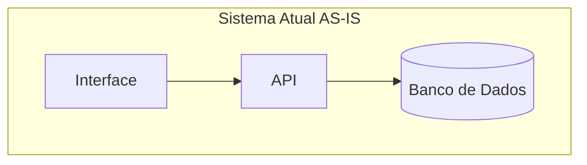

# Arquitetura AS-IS — [Nome do Projeto]

Status: draft
Última atualização: YYYY-MM-DD
Versão: 1.0
Nível padrão: C2 (Container)
Fonte: legacy.md (Dim. 12), inputs/, evidência técnica

<!-- id: arch-summary -->

## Resumo executivo

[1 parágrafo: principais componentes do AS-IS + 3 problemas críticos identificados, em linguagem de negócio.]

---

<!-- id: arch-as-is -->

## Diagrama AS-IS

---

<!-- id: arch-annotations -->

## Anotações de problemas no AS-IS

| Tipo | Componente | Descrição | Severidade | Origem (F-xxx) |
|------|------------|-----------|------------|----------------|
| Gargalo | | | | |
| Gap | | | | |
| EOL | | | | |
| Risco | | | | |

**Convenção de tipos:**
- `Gargalo:` performance/throughput insuficiente
- `Gap:` capacidade ausente
- `EOL:` tecnologia sem suporte
- `Risco:` ponto único de falha ou exposição

---

<!-- id: arch-components -->

## Inventário de componentes (com domínio servido)

| Componente | Tecnologia / versão | Domínio servido (legacy.md) | Função |
|------------|---------------------|-----------------------------|--------|
| | | | |

---

<!-- id: arch-integrations -->

## Integrações externas

| Sistema externo | Protocolo | Direção | Frequência | Owner |
|-----------------|-----------|---------|------------|-------|
| | REST/SOAP/FTP/evento | entrada/saída/bidirecional | | |

---

> **Nota:** este documento cobre apenas o AS-IS. Arquitetura TO-BE é fase técnica futura, fora do escopo atual.
