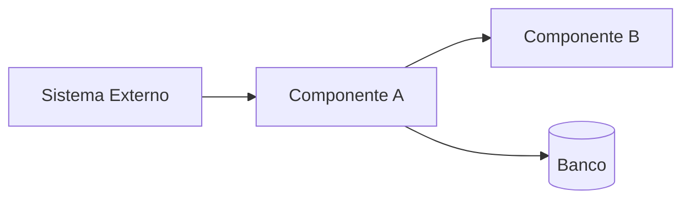

# Análise de Legado — [Nome do Sistema]

Status: draft
Última atualização: YYYY-MM-DD
Versão: 1.0
Escopo: [código / docs / diagramas / schemas]
Fonte: legacy.md (Dim. 12), inputs/, evidência técnica

<!-- id: la-summary -->

## 1. Resumo Executivo

[Pyramid Principle: saúde geral em 1 parágrafo + 3 riscos principais + recomendação macro.]

**Scorecard visual:**
- Saudável (componentes):
- Aceitável (componentes):
- Degradado (componentes):
- Crítico (componentes):

---

<!-- id: la-inventory -->

## 2. Inventário de Componentes

| Componente | Tipo | Tecnologia | Versão | EOL? | Função no negócio |
|------------|------|-----------|--------|------|-------------------|
| | | | | | |

---

<!-- id: la-dependencies -->

## 3. Mapa de Dependências

---

<!-- id: la-scorecards -->

## 4. Scorecards de Saúde por Componente

### Componente: [Nome]

| Dimensão | Score (1-5) | Justificativa |
|----------|-------------|---------------|
| Manutenibilidade | | |
| Segurança | | |
| Escalabilidade | | |
| Observabilidade | | |
| Interoperabilidade | | |
| Suporte tecnológico | | |
| **Score médio** | | Saudável / Aceitável / Degradado / Crítico |

*(Repetir para cada componente do inventário.)*

---

<!-- id: la-debt -->

## 5. Inventário de Dívida Técnica (priorizado)

| Dívida | Componente | Impacto | Esforço | Urgência | Risco se não tratada |
|--------|------------|---------|---------|----------|---------------------|
| | | | | | |

---

<!-- id: la-migration-risks -->

## 6. Riscos de Migração

| Risco | Componente | Probabilidade | Impacto | Mitigação |
|-------|------------|---------------|---------|-----------|
| | | | | |

---

<!-- id: la-decision-matrix -->

## 7. Decision Matrix: Reuse / Replace / Retire (TIME quadrants)

Toda linha precisa dos 2 scores + quadrante **antes** da recomendação (gate `RRR_HAS_SCORES`;
fórmulas de `valor_negócio` e `saúde_técnica` no Passo 5 do SKILL.md).

| Componente / Processo | `valor_negócio` (0-10) | `saúde_técnica` (0-10) | Quadrante (TIME) | Recomendação | Justificativa | Estratégia |
|----------------------|--------------------------|---------------------------|--------------------|---------------|---------------|-----------|
| | | | Invest / Migrate / Tolerate / Eliminate | Reuse / Replace / Tolerate / Retire | | Strangler Fig / Lift&Shift / Rewrite / Buy / Digitalizar |

---

<!-- id: la-modernization -->

## 8. Estratégia de Modernização (recomendação macro)

- **Abordagem principal:** Strangler Fig / Rewrite / Buy / Lift & Shift
- **Valor esperado:** [benefício de negócio da estratégia — qualitativo ou ancorado em dores medidas; prazo, horas e breakeven são do `spec-estimate`, não deste documento]
- **Sequenciamento:** [o que migrar primeiro e por quê]

> **Nota:** desenho técnico do TO-BE é fase futura. Este documento recomenda ESTRATÉGIA, não detalha arquitetura nova.
