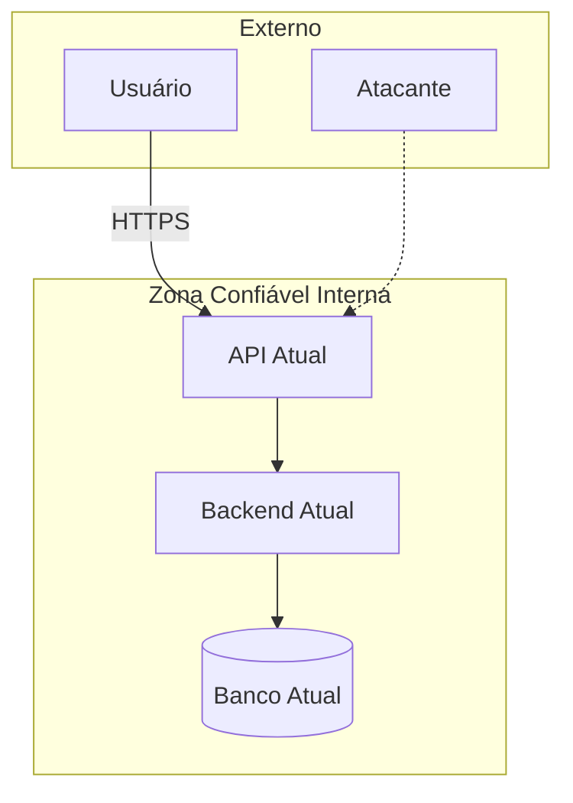

# Modelagem de Ameaças do AS-IS — [Nome do Projeto]

Status: draft
Última atualização: YYYY-MM-DD
Framework: STRIDE (identificação) + severidade Likelihood×Impact/CVSS; EPSS/KEV p/ dependências
Taxonomia: OWASP Top 10:2025 + CWE Top 25 2025 (+ OWASP Agentic 2026 / LLM Top 10 se há IA)
Versão: 2.0
Escopo: **AS-IS apenas** (ameaças e exposições do sistema atual)
Fonte: legacy.md (Dim. 11 SI), architecture.md (AS-IS), legacy-analysis.md, inputs/

<!-- id: tm-scope -->

## 1. Escopo e ativos

- O que estamos protegendo (dados PII, sistemas, usuários do legado):
- Atores legítimos:
- Atacantes considerados:
- Fronteiras de confiança identificadas no AS-IS:

---

<!-- id: tm-dfd -->

## 2. Diagrama de Fluxo de Dados (DFD do AS-IS)



---

<!-- id: tm-attack-surface -->

## 3. Superfície de ataque do AS-IS

| Ponto de entrada | Tipo | Autenticação atual | Exposição | Controle existente | Adequado? |
|------------------|------|--------------------|-----------|--------------------|-----------|
| | | | | | sim/não/parcial |

---

<!-- id: tm-stride-matrix -->

## 4. Matriz STRIDE × componente do AS-IS (severidade Likelihood×Impact)

> **STRIDE identifica; a severidade (Likelihood×Impact / CVSS) é o rating principal.** Para
> dependências, priorizar por EPSS + CISA KEV (§5). Mapeamento OWASP:2025 + CWE Top 25 2025:
> ver critérios completos na SKILL (`../SKILL.md` §6.2). **DREAD não é usado** (a Microsoft o
> abandonou por subjetividade) — o rating único é a severidade Likelihood×Impact / CVSS.

| ID | STRIDE | Componente AS-IS | Descrição da ameaça | Probabilidade | Impacto | Severidade | CVSS | OWASP (2025) | CWE | Existe controle hoje? | Eficácia |
|----|--------|------------------|---------------------|---------------|---------|------------|------|--------------|-----|------------------------|----------|
| THR-S-001 | Spoofing | | | baixa/média/alta | baixo/médio/alto | CRÍTICO/ALTO/MÉDIO/BAIXO | | A07 | | sim/não/parcial | adequada/parcial/ausente |
| THR-T-001 | Tampering (integridade) | | | | | | | A08 | | | |
| THR-T-002 | Tampering (injeção) | | | | | | | A05 | | | |
| THR-R-001 | Repudiation | | | | | | | A09 | | | |
| THR-I-001 | Info Disclosure | | | | | | | A04 | | | |
| THR-D-001 | DoS | | | | | | | A10 | | | |
| THR-E-001 | Elevation | | | | | | | A01 | | | |

> **Defaults OWASP Top 10:2025 por categoria STRIDE:** Spoofing → A07 Authentication Failures ·
> Tampering de integridade → A08 Software or Data Integrity Failures · Tampering por injeção →
> A05 Injection · Repudiation → A09 Security Logging and Alerting Failures · Info Disclosure →
> A04 Cryptographic Failures · DoS → A10 Mishandling of Exceptional Conditions · Elevation →
> A01 Broken Access Control. A02 Security Misconfiguration, A03 Software Supply Chain Failures e
> A06 Insecure Design são transversais. Trocar o default quando a ameaça concreta pertencer a
> outra categoria, justificando na linha.

---

<!-- id: tm-supply-chain -->

## 5. Supply Chain e Dependências do AS-IS *(§6.3 — Modo Digital)*

Se o legado tem código: listar dependências com vulnerabilidades conhecidas (CVEs abertas).
Se não há sistema digital (Modo Processo-Manual sem código), marcar **N/A**.

Priorizar por **EPSS + CISA KEV** além do CVSS (KEV/EPSS alto sobe; CVSS crítico com EPSS
baixíssimo fora do KEV pode ser rebaixado com justificativa). Refs: https://www.first.org/epss/ · KEV CISA.

| Dependência | Versão atual | CVEs conhecidas | CVSS máximo | EPSS | No KEV? | Prioridade final | Ação recomendada |
|-------------|--------------|------------------|-------------|------|---------|------------------|-------------------|
| | | | | X.XX | sim/não | crítica/alta/média/baixa | atualizar/remover/mitigar |

---

<!-- id: tm-existing-controls -->

## 6. Controles existentes no AS-IS

| Controle | Componente protegido | Ameaças mitigadas | Eficácia atual |
|----------|---------------------|-------------------|----------------|
| | | | adequada/parcial/inadequada |

---

<!-- id: tm-gaps -->

## 7. Lacunas de controle (ameaças sem mitigação adequada)

| Ameaça (THR-XXX) | Por que não está mitigada | Impacto se explorada | Urgência |
|------------------|---------------------------|----------------------|----------|
| | | | crítica/alta/média/baixa |

---

<!-- id: tm-residual-risks -->

## 8. Riscos residuais (após controles existentes)

| Risco residual | Probabilidade | Impacto | Aceito pelo negócio? |
|----------------|---------------|---------|----------------------|
| | | | sim/não/em discussão |

---

<!-- id: tm-ai-llm -->

## 9. Produto com IA/agentes — Ameaças AI/LLM no AS-IS *(§6.5 — condicional)*

*(Ativar apenas se o legado/produto usa LLMs, agentes, RAG, IA generativa ou MCP. Caso contrário, marcar N/A.)*
Aplicar **OWASP Top 10 para Agentic Applications 2026 + OWASP LLM Top 10**.

| Framework | Categoria | Aplica ao AS-IS? | Evidência | Mitigação atual |
|-----------|-----------|------------------|-----------|-----------------|
| OWASP LLM | LLM01 — Prompt Injection | sim/não | | |
| OWASP LLM | LLM06 — Excessive Agency | sim/não | | |
| Agentic 2026 | Goal Hijacking (desvio de objetivo) | sim/não | | |
| Agentic 2026 | Tool Misuse / Excessive Agency | sim/não | | |
| Agentic 2026 | Memory / Context Poisoning | sim/não | | |
| Agentic 2026 | Cascading Failures | sim/não | | |
| MCP | Servidor MCP sem autenticação / tool poisoning | sim/não | | |

---

<!-- id: tm-top-findings -->

## 10. Top Findings por severidade *(§6.6)*

Após preencher a matriz da §4, listar os **5 findings de maior severidade** (Likelihood×Impact /
CVSS; EPSS/KEV para dependências) como prioritários — **DREAD não é usado** —, um bloco por finding:

```
### [THR-X-NNN] <nome> — <CRÍTICO/ALTO/MÉDIO>
**Severidade:** <CRÍTICO/ALTO/MÉDIO> (Prob. × Impacto) | **CVSS:** X.X | **EPSS/KEV:** <só p/ dependência> | **OWASP:** AXX (2025) | **CWE:** CWE-NNN | **STRIDE:** X
**Ameaça:** <descrição>
**Cenário de exploração:** <passo a passo realista do ataque>
**Impacto se explorado:** <o que o atacante obtém>
**Controle TO-BE sugerido:** <o que deve ser implementado no novo sistema>
**Task de segurança sugerida:** SEC-NNN — <nome da task>
```

---

> **Nota:** este documento cobre apenas ameaças do AS-IS. Threat-model do TO-BE é fase técnica futura, fora do escopo atual.
