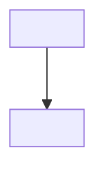

# Especificação Técnica — <produto>

> **Fase:** Explore · **Versão:** 0.1 · **Status:** preliminar
> **Documentos irmãos:** [HLD](./hld-funcional.md) · [Funcional](./especificacao-funcional.md) · [Modelo de Dados](./modelo-de-dados.md) · [GAPs](./gaps.md)
>
> <!-- Hipóteses técnicas, sem contratos nem payloads. É o ancestral do `hld.md` que a spec-hld
>      emite no Plan. Incerteza aqui vira `GAP-nnn`, não texto vago. -->

## Changelog
| Versão | Data | Mudança |
|---|---|---|
| 0.1 | <data> | versão inicial |

## 1. Visão em camadas
<!-- Diagrama Mermaid ou ASCII: Usuário → Frontend → Backend → Dados → Integrações. -->

## 2. Componentes de infraestrutura
| Componente | Tecnologia | Papel |
|---|---|---|
| <componente> | <tecnologia> | <para que serve> |

## 3. Integrações externas
| Sistema | Direção | Dados trafegados | Observabilidade |
|---|---|---|---|
| <sistema externo> | <entrada ou saída> | <que dados> | <como se observa> |

## 4. Premissas técnicas
<!-- Premissa que se revelar falsa muda o desenho. Se você não tem certeza, é GAP, não premissa. -->

| Premissa | Detalhe | GAP relacionado |
|---|---|---|
| <premissa> | <o que se está assumindo> | GAP-<nnn> |
