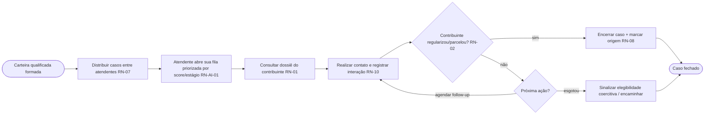
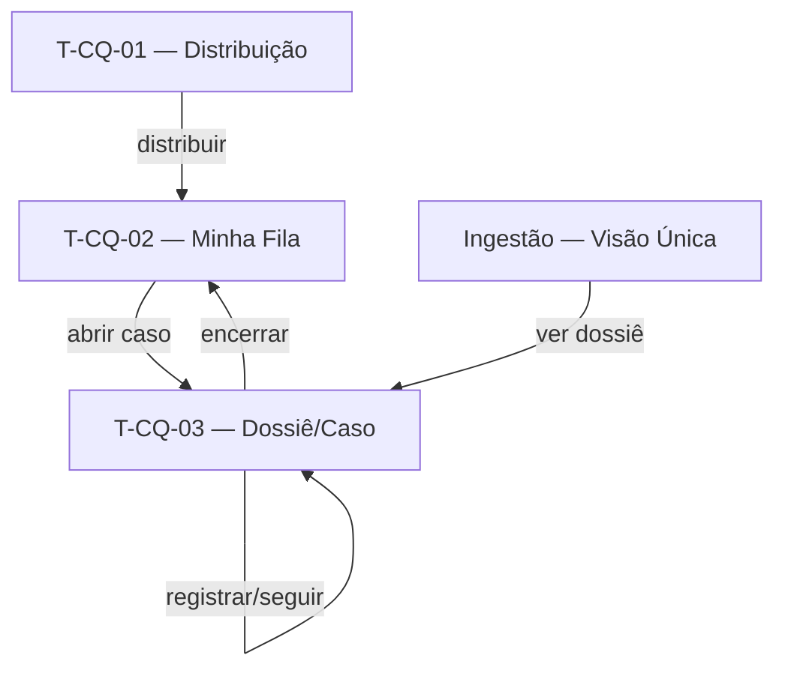

# Cobrança Qualificada — Operação do Atendente — Contrato

> Documento único da Camada de Requisitos desta feature (3 capítulos).
>
> **Pense transversalmente.** Consulte: [Modelo de dados](../modelo-dados.md), [Requisitos transversais](../requisitos-transversais.md), [Telas comuns](../telas-comuns.md).
>
> **Eixo:** `processo` — fluxo de **distribuir casos entre atendentes, consultar o dossiê e conduzir o atendimento individualizado registrando interações**.

> **Regra de não-sobreposição:** persona+objetivo → §2.1; o que faz + RN → §2.2; prova → §2.4; entidades → [modelo-dados](../modelo-dados.md).

---

## 1. Telas & Fluxos

### 1.1 Fluxo (Mermaid)



### 1.2 Telas detalhadas

#### T-CQ-01 — Distribuição de Carteira (coordenador)
- **Arquétipo:** A3 (Formulário de Configuração) + A1 (visão de carga)
- **Objetivo:** configurar regras de distribuição e ver a carga por atendente (RN-07).

```wireframe
# Distribuição de Carteira
card "Regras de distribuição":
  - vínculo contador <-> atendente
  - balanceamento de carga
  - prioridade por score/estágio
(!) atendente sobrecarregado
[[ Atendente A: n | Atendente B: n | Não atribuídos: n ]]
[Distribuir automaticamente] [Reatribuir caso]
```
- **Conteúdo:** regras de vínculo/balanceamento; carga atual por atendente.
- **Ações:** distribuir automaticamente; reatribuir; ver carga.
- **Estados:** carteira não distribuída; desequilíbrio sinalizado.
- **Navegação:** alimenta a fila do atendente (T-CQ-02).
- **Componentes:** toolbar, card, list, banner, button.

#### T-CQ-02 — Minha Fila (atendente)
- **Arquétipo:** A2 (Lista / Fila com Filtros)
- **Objetivo:** trabalhar a fila de casos priorizada (visão individual, RN-11).

```wireframe
# Minha Fila
[Buscar____] [Status v] [Prioridade v] [Tributo v]
| Contribuinte | Valor | Score | Estágio | Status | Ação |
| reg | reg | reg | reg | reg | [Abrir] |
[Abrir caso]
```
- **Conteúdo:** apenas os casos do atendente, ordenados por prioridade (score/estágio).
- **Ações:** abrir caso; filtrar (RF-T-02).
- **Estados:** fila vazia; casos novos; com status atualizado intraciclo.
- **Navegação:** abre T-CQ-03.
- **Componentes:** toolbar, input, select, table, button.

#### T-CQ-03 — Dossiê / Caso
- **Arquétipo:** A4 (Detalhe / Visão 360 com abas)
- **Objetivo:** consolidar o dossiê e operar o caso (consultar contexto + registrar interações).

```wireframe
# Dossiê do Contribuinte
card "Resumo":
  [[ Documento | Segmento | Score | Total em aberto ]]
(!) notificação coercitiva ativa em outra coordenadoria
## Abas: Débitos | Parcelamentos | Comunicações | Interações | Grupo econômico
card "Conteúdo da aba":
  | Coluna | Coluna | Coluna |
  | linha | linha | linha |
[Registrar interação] [Agendar follow-up] [Encerrar caso]
```
- **Conteúdo:** débitos, parcelamentos, histórico de contatos (comunicações da régua + interações), sinalizações coercitivas, grupo econômico/situação patrimonial *(inferência — níveis do dossiê)*.
- **Ações:** registrar interação (campo estruturado + livre); agendar follow-up; encerrar caso; ações são auditadas (RN-10).
- **Estados:** dossiê incompleto (fontes faltantes); caso aberto/encerrado.
- **Navegação:** de T-CQ-02 e de Ingestão (T-ING-03).
- **Componentes:** toolbar, card, tabs, table, list, banner, button.

### 1.3 Diagrama de navegação (Mermaid)



---

## 2. Requisitos & Cenários de Teste

> Origem: RN-07, RN-01, RN-02, RN-08, RN-10, RN-11, RN-AI-01. Horizonte: **H1**.

### 2.1 Personas & objetivos

| Persona | Objetivo | JTBD |
|---|---|---|
| Coordenador de Cobrança | Distribuir casos automaticamente e equilibrar a carga | JTBD-05 |
| Atendente de Cobrança | Acessar dossiê completo e registrar interações por caso | JTBD-04 |
| Atendente de Cobrança | Trabalhar uma fila priorizada por score/estágio | JTBD-04, JTBD-05 |
| Atendente de Cobrança | Encerrar o caso assim que o contribuinte regulariza, sem reabordá-lo | JTBD-07 |

### 2.2 Requisitos Funcionais

| ID | Enunciado | Prioridade | RNs | Persona |
|---|---|---|---|---|
| RF-01 | Distribuir automaticamente casos por regras (vínculo, balanceamento, prioridade) (N1.5, N2.5, US6) | Must | RN-07 | Coordenador |
| RF-02 | Priorizar a fila do atendente por score/estágio (N2.5, US14) | Should | RN-07, RN-AI-01 | Atendente |
| RF-03 | Montar dossiê consolidado automaticamente de múltiplas fontes (N1.5, US7) | Must | RN-01 | Atendente |
| RF-04 | Sinalizar no dossiê notificações coercitivas ativas em outras coordenadorias (US7) | Should | RN-01 | Atendente |
| RF-05 | Registrar interações por caso (campo estruturado + livre) com histórico (N1.5) | Must | RN-10 | Atendente |
| RF-06 | Encerrar caso ao detectar regularização e marcar origem (N1.5) | Must | RN-02, RN-08 | Atendente |
| RF-07 | Restringir a visão do atendente à própria carteira (não comparativa) | Must | RN-11 | Atendente |

**Transversais aplicáveis:** RF-T-01, RF-T-02, RF-T-03 (visão única consumida), RF-T-04 (marcação de origem).

### 2.3 Requisitos Não-Funcionais

#### Segurança
- **RNF-S-01** — Esta feature é a **lar** de RNF-T-SEG-01 (controle de acesso por perfil; atendente vê só a própria carteira — RN-11).

**Transversais aplicáveis:** RNF-T-SEG-01 (lar), RNF-T-AUD-01, RNF-T-PERF-01, RNF-T-DISP-01 (dossiê com fontes faltantes).

### 2.4 Cenários de Teste

#### CT-01 — Distribuição automática equilibrada (verifica RF-01/RN-07)
- **Dado** uma carteira qualificada nova e atendentes com cargas diferentes
- **Quando** o coordenador aciona "distribuir automaticamente"
- **Então** os casos são atribuídos respeitando vínculos e balanceando a carga.

#### CT-02 — Fila priorizada por score (verifica RF-02/RN-AI-01)
- **Dado** casos com diferentes scores de liquidez
- **Quando** o atendente abre a fila
- **Então** os casos de maior probabilidade de recuperação aparecem no topo; sem score, ordena por critérios determinísticos.

#### CT-03 — Dossiê consolidado (verifica RF-03/RF-04/RN-01)
- **Dado** um contribuinte com débitos em CCF e notificação no SNE de outra coordenadoria
- **Quando** o atendente abre o dossiê
- **Então** todos os débitos e a sinalização coercitiva aparecem em tela única.

#### CT-04 — Registro de interação auditado (verifica RF-05/RNF-T-AUD-01)
- **Dado** um caso aberto
- **Quando** o atendente registra uma ligação com resultado
- **Então** a interação é gravada no histórico do caso e um evento de auditoria é criado.

#### CT-05 — Encerramento por regularização (verifica RF-06/RN-02/RN-08)
- **Dado** um contribuinte de caso que parcela o débito
- **Quando** a atualização intraciclo detecta o parcelamento
- **Então** o caso é encerrado e a origem é marcada como "resposta à cobrança qualificada".

#### CT-06 — Isolamento por perfil (verifica RF-07/RNF-T-SEG-01)
- **Dado** dois atendentes com carteiras distintas
- **Quando** um deles acessa "Minha Fila"
- **Então** ele vê apenas seus próprios casos, sem comparativo com outros.

---

## 3. Dados

> Eixo `processo`: entidades derivam das atividades de distribuição/atendimento.

### 3.1 Entidades canônicas usadas
- **Caso** e sub-entidade **Interação** (ver [../modelo-dados.md](../modelo-dados.md)) — esta feature é a **lar**.
- **Dossiê** (read-model) — montado aqui; lar.
- **Contribuinte**, **Débito**, **Parcelamento**, **Comunicação**, **Usuário** — referenciados.

### 3.2 Entidades próprias da feature

#### Regra de Distribuição  <!-- deriva de: atividade "Distribuir casos"; referencia Caso/Usuário -->
| Campo | Tipo | Descrição |
|---|---|---|
| id | identificador | Chave |
| tipo | texto | vínculo / balanceamento / prioridade |
| parametros | composto | Ex.: peso de score, capacidade por atendente |
| ativa | booleano | Vigente |

### 3.3 Relações
- Regra de Distribuição 1:N Caso (origina atribuições); Usuário(atendente) 1:N Caso 1:N Interação (entidades canônicas de ../modelo-dados.md).

---

## Questões em aberto
- ⚠ NÃO IDENTIFICADO — definir: níveis do dossiê efetivamente disponíveis (grupo econômico, situação patrimonial) e fontes; capacidade máxima por atendente.

## Fontes
- Levantamento de Necessidades 2.6 (N1.5, N2.5); Planning_Poker (US 6, 7); DECK Cobrança Inteligente.

## Relacionado
- [Visão do produto](../visao.md)
- [Modelo de dados (transversal)](../modelo-dados.md)
- [Requisitos transversais](../requisitos-transversais.md)
- [Telas comuns (arquétipos)](../telas-comuns.md)
- [Ingestão e Carteira](ingestao-carteira.md)
- [Qualificação da Carteira](qualificacao-carteira.md)
- [Scoring de Liquidez](scoring-liquidez.md)
- [Índice do wiki](../index.md)
