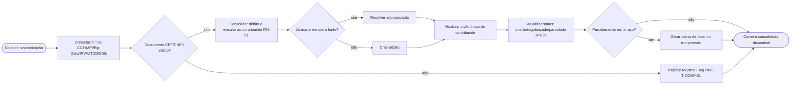
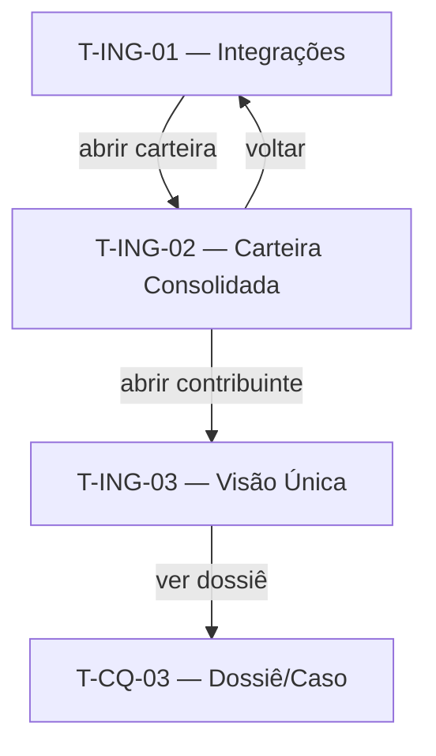

# Ingestão e Carteira Consolidada — Contrato

> Documento único da Camada de Requisitos desta feature (3 capítulos). Responde: *como o usuário interage* (Cap. 1), *o que cumpre, para quem e como provar* (Cap. 2) e *que informação manipula* (Cap. 3).
>
> **Pense transversalmente.** Consulte: [Modelo de dados](../modelo-dados.md), [Requisitos transversais](../requisitos-transversais.md), [Telas comuns](../telas-comuns.md).
>
> **Eixo:** `processo` — a feature é o fluxo de **consolidar débitos de múltiplas fontes em uma carteira/visão única, mantendo o status atualizado intraciclo**.

> **Regra de não-sobreposição:** persona+objetivo → §2.1; o que faz + RN → §2.2; prova → §2.4; entidades canônicas → [modelo-dados](../modelo-dados.md); arquétipos → [telas-comuns](../telas-comuns.md).

---

## 1. Telas & Fluxos

### 1.1 Fluxo (Mermaid)

> Legenda: `[ ]` = informação/ação/resultado · `{ }` = decisões · `([ ])` = gatilho/saídas.



### 1.2 Telas detalhadas

#### T-ING-01 — Integrações & Sincronização
- **Arquétipo:** A6 (Painel de Status de Integração / Execução)
- **Objetivo:** operar e monitorar a consolidação periódica das fontes.

```wireframe
# Integrações & Sincronização
[[ Fontes OK | Última sync | Registros rejeitados ]]
(!) falha de integração em uma fonte
| Fonte | Última sync | Registros | Status |
| CCF | data | n | OK |
| MPI/Big Data | data | n | OK |
[Reprocessar fonte] [Ver log de rejeições]
```
- **Conteúdo:** status por fonte (última sync, volume, erros), fila de transição MPI→Big Data.
- **Ações:** reprocessar uma fonte; abrir log de rejeições (CPF/CNPJ inválidos).
- **Estados:** todas OK; fonte em falha (degradação segura RNF-T-DISP-01); transição em andamento.
- **Navegação:** porta de entrada operacional; leva à carteira consolidada.
- **Componentes:** toolbar, card, table, banner, button.

#### T-ING-02 — Carteira Consolidada (base)
- **Arquétipo:** A2 (Lista / Fila com Filtros)
- **Objetivo:** navegar a base consolidada de débitos/contribuintes.

```wireframe
# Carteira Consolidada
[Buscar contribuinte/documento____] [Tributo v] [Status v] [Atraso v] [Ordenar por v]
| Contribuinte | Tributo | Valor | Atraso | Parcelamento | Status |
| reg | reg | reg | reg | reg | reg |
[Abrir contribuinte] [Exportar]
```
- **Conteúdo:** débitos consolidados; coluna de alerta de parcelamento em atraso.
- **Ações:** filtrar/buscar (RF-T-02), abrir contribuinte, exportar (RF-T-01).
- **Estados:** vazio (sem sync); carregando lote; com alertas.
- **Navegação:** de T-ING-01; abre T-ING-03.
- **Componentes:** toolbar, input, select, table, button.

#### T-ING-03 — Visão Única do Contribuinte
- **Arquétipo:** A4 (Detalhe / Visão 360, somente leitura)
- **Objetivo:** consolidar tudo de um contribuinte (RF-T-03) — base do dossiê.

```wireframe
# Visão Única do Contribuinte
card "Resumo":
  [[ Documento | Segmento | Total em aberto ]]
(!) parcelamento em atraso
## Abas: Débitos | Parcelamentos | Comunicações
card "Conteúdo da aba":
  | Tributo | Valor | Vencimento | Fonte | Status |
  | linha | linha | linha | linha | linha |
[Ver dossiê completo]
```
- **Conteúdo:** débitos por tributo/fonte, parcelamentos, comunicações já enviadas.
- **Ações:** alternar abas; ir ao dossiê (Cobrança Qualificada).
- **Estados:** sem débitos; com sinalização de parcelamento em risco.
- **Navegação:** de T-ING-02; conecta ao Dossiê (T-CQ-03).
- **Componentes:** toolbar, card, tabs, table, banner, button.

### 1.3 Diagrama de navegação (Mermaid)



---

## 2. Requisitos & Cenários de Teste

> Origem: RN-01, RN-02, RN-12. Horizonte: **H1**.
> Antes de escrever: ver [requisitos-transversais](../requisitos-transversais.md).

### 2.1 Personas & objetivos

| Persona | Objetivo | JTBD |
|---|---|---|
| Coordenador de Cobrança | Ter a carteira consolidada e confiável sem varredura manual | JTBD-01 |
| Coordenador de Cobrança | Atualizar o status de regularização intraciclo para não abordar quem já regularizou | JTBD-07 |
| Atendente de Cobrança | Enxergar tudo de um contribuinte em um lugar antes do contato | JTBD-01, JTBD-04 |

### 2.2 Requisitos Funcionais

| ID | Enunciado | Prioridade | RNs | Persona |
|---|---|---|---|---|
| RF-01 | Consolidar automática e periodicamente débitos de CCF, MPI/Big Data, IPVA, ITCD e SNE (N1.1, US2) | Must | RN-01, RN-12 | Coordenador |
| RF-02 | Vincular débitos ao contribuinte e resolver sobreposição entre fontes (visão única, N1.7) | Must | RN-01 | Ambas |
| RF-03 | Atualizar status de regularização/parcelamento intraciclo e encerrar ações ao regularizar (N1.8, US5) | Must | RN-02 | Coordenador |
| RF-04 | Monitorar parcelamentos e alertar inadimplência parcial (risco de rompimento) (N1.8, US1) | Must | RN-02 | Ambas |
| RF-05 | Exibir visão única do contribuinte em tela com abas (N1.7) | Must | RN-01 | Atendente |
| RF-06 | Operar a transição MPI→Big Data sem ruptura da carteira (US12) | Should | RN-12 | Coordenador |
| RF-07 | Expor status de cada integração (última sync, volume, erros) | Should | RN-10 | Coordenador |

**Transversais aplicáveis:** RF-T-02 (busca/filtro), RF-T-03 (visão única — esta feature é a **lar**), RF-T-01 (exportação).

### 2.3 Requisitos Não-Funcionais

#### Performance
- **RNF-P-01** — A consolidação completa da base (~1,8 mi contribuintes) deve caber na janela do ciclo (diária *(inferência)*) sem degradar T-ING-02.

#### Conformidade
- **RNF-C-01** — Esta feature é a **lar** de RNF-T-CONF-01 (validação de CPF/CNPJ na entrada) e RNF-T-CONF-02 (continuidade na transição de fonte).

**Transversais aplicáveis:** RNF-T-PERF-01, RNF-T-PERF-02, RNF-T-DISP-01 (degradação por fonte — esta feature é a lar), RNF-T-OBS-01 (status de integração — lar), RNF-T-AUD-01, RNF-T-CONF-01/02 (lar).

### 2.4 Cenários de Teste

#### CT-01 — Consolidação periódica (verifica RF-01)
- **Dado** fontes CCF e IPVA com débitos novos
- **Quando** o ciclo de sincronização executa
- **Então** os débitos aparecem consolidados na carteira, vinculados aos contribuintes, com fonte de origem registrada.

#### CT-02 — Documento inválido rejeitado (verifica RF-02 / RNF-T-CONF-01)
- **Dado** um registro com CPF de 10 dígitos
- **Quando** a ingestão processa o registro
- **Então** o registro é rejeitado, não gravado, e consta no log de rejeições.

#### CT-03 — Regularização encerra abordagem (verifica RF-03 / RN-02)
- **Dado** um débito em cobrança regularizado no CCF
- **Quando** a atualização intraciclo executa
- **Então** o status muda para regularizado e o contribuinte deixa de ser abordado naquele ciclo.

#### CT-04 — Alerta de parcelamento em risco (verifica RF-04)
- **Dado** um parcelamento com parcelas em atraso acima do limite
- **Quando** o monitoramento roda
- **Então** o sistema gera alerta de risco de rompimento na carteira/visão única.

#### CT-05 — Degradação segura (verifica RNF-T-DISP-01)
- **Dado** o MPI indisponível no ciclo
- **Quando** a sincronização executa
- **Então** as demais fontes consolidam normalmente e a fonte em falha é sinalizada em T-ING-01.

#### CT-06 — Transição de fonte (verifica RF-06 / RN-12)
- **Dado** a fonte ativa alternada de MPI para Big Data
- **Quando** o ciclo executa com a nova fonte
- **Então** a carteira mantém os mesmos contribuintes elegíveis, sem ruptura.

---

## 3. Dados

> Modelo conceitual desta feature — referencia o transversal. Eixo `processo`: entidades derivam das atividades do fluxo (1.1).

### 3.1 Entidades canônicas usadas
- **Contribuinte** (ver [../modelo-dados.md](../modelo-dados.md)) — vinculado e enriquecido (visão única).
- **Débito** — consolidado de múltiplas fontes; esta feature é a **lar**.
- **Parcelamento** — monitorado quanto à inadimplência; lar.

### 3.2 Entidades próprias da feature

#### Execução de Sincronização  <!-- deriva de: atividade "Conectar/Consolidar"; referencia Débito de ../modelo-dados.md -->
| Campo | Tipo | Descrição |
|---|---|---|
| id | identificador | Chave |
| fonte | texto | CCF / MPI / Big Data / IPVA / ITCD / SNE |
| inicio / fim | data | Janela da execução |
| registros_lidos | número | Volume processado |
| registros_rejeitados | número | Inválidos (RNF-T-CONF-01) |
| status | texto | OK / falha / parcial |

#### Log de Rejeição  <!-- deriva de: decisão "Documento válido?" -->
| Campo | Tipo | Descrição |
|---|---|---|
| documento | texto | Identificador rejeitado |
| motivo | texto | Ex.: dígitos inválidos |
| execucao_ref | referência | → Execução de Sincronização |

### 3.3 Relações
- Execução de Sincronização 1:N Débito (consolida) — entidades canônicas de ../modelo-dados.md.
- Execução de Sincronização 1:N Log de Rejeição.

---

## Questões em aberto
- ⚠ NÃO IDENTIFICADO — definir: frequência exata do ciclo (diária assumida) e regra de sobreposição entre fontes.

## Fontes
- Levantamento de Necessidades 2.6 (N1.1, N1.7, N1.8); Planning_Poker (US 1, 5, 12); Potenciais oportunidades P2.6.

## Relacionado
- [Visão do produto](../visao.md)
- [Modelo de dados (transversal)](../modelo-dados.md)
- [Requisitos transversais](../requisitos-transversais.md)
- [Telas comuns (arquétipos)](../telas-comuns.md)
- [Qualificação da Carteira](qualificacao-carteira.md)
- [Cobrança Qualificada](cobranca-qualificada.md)
- [Índice do wiki](../index.md)
