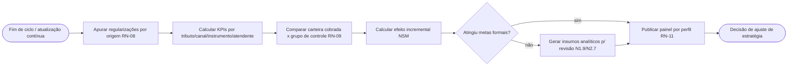
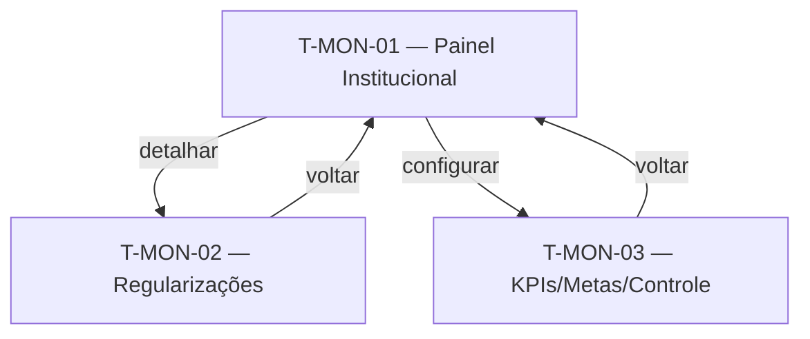

# Monitoramento, KPIs e Grupo de Controle — Contrato

> Documento único da Camada de Requisitos desta feature (3 capítulos).
>
> **Pense transversalmente.** Consulte: [Modelo de dados](../modelo-dados.md), [Requisitos transversais](../requisitos-transversais.md), [Telas comuns](../telas-comuns.md).
>
> **Eixo:** `processo` — fluxo de **apurar KPIs do ciclo, calcular o efeito incremental via grupo de controle e gerar insumos para a revisão da estratégia**.

> **Regra de não-sobreposição:** persona+objetivo → §2.1; o que faz + RN → §2.2; prova → §2.4; entidades → [modelo-dados](../modelo-dados.md).

---

## 1. Telas & Fluxos

### 1.1 Fluxo (Mermaid)



### 1.2 Telas detalhadas

#### T-MON-01 — Painel Institucional de Cobrança
- **Arquétipo:** A1 (Painel de Indicadores)
- **Objetivo:** visão gerencial em tempo quase-real do ciclo do crédito (visão por perfil, RN-11).

```wireframe
# Painel Institucional
[Ciclo v] [Tributo v] [Canal v] [Atendente v]
[[ Identificados | Notificados | Regularizados | Incremental vs controle ]]
(!) meta não atingida (ICMS/IPVA/ITCD)
[~ tendência de regularização por ciclo ~]
card "Por dimensão":
  | Dimensão | Regularizado | Meta | Δ |
  | tributo | valor | meta | delta |
[Exportar] [Trocar visão (coordenador/atendente)]
```
- **Conteúdo:** funil do crédito (identificado→notificado→regularizado→a regularizar); incremental vs. controle; metas por tributo.
- **Ações:** filtrar, exportar (RF-T-01), trocar visão por perfil.
- **Estados:** ciclo inicial (sem histórico); meta atingida/não.
- **Navegação:** detalha em T-MON-02; configura em T-MON-03.
- **Componentes:** toolbar, select, card, chart, table, button.

#### T-MON-02 — Detalhe de Comunicações & Regularizações
- **Arquétipo:** A2 (Lista / Fila com Filtros)
- **Objetivo:** rastrear, no detalhe, a origem das regularizações e o desempenho das ações.

```wireframe
# Regularizações & Origem
[Buscar____] [Origem v] [Canal v] [Instrumento v] [Período v]
| Contribuinte | Valor | Origem | Canal | Instrumento | Data |
| reg | reg | reg | reg | reg | reg |
[Exportar]
```
- **Conteúdo:** regularizações marcadas por origem (espontânea vs. cobrança por canal/instrumento, RN-08).
- **Ações:** filtrar, exportar.
- **Estados:** vazio; consolidado.
- **Navegação:** de T-MON-01.
- **Componentes:** toolbar, input, select, table, button.

#### T-MON-03 — Configuração de KPIs, Metas e Grupo de Controle
- **Arquétipo:** A3 (Formulário de Configuração)
- **Objetivo:** instrumentar KPIs, metas formais por tributo e parâmetros do grupo de controle (RN-09).

```wireframe
# KPIs, Metas & Grupo de Controle
card "Metas por tributo":
  [ICMS meta____] [IPVA meta____] [ITCD meta____]
card "Grupo de controle":
  [Tamanho/% ____] [Critério de sorteio v]
(!) histórico de metas e versões
[Salvar metas] [Configurar grupo de controle]
```
- **Conteúdo:** definição de KPIs e dimensões; metas por tributo; parâmetros do grupo de controle.
- **Ações:** salvar metas (versionado); configurar grupo de controle.
- **Estados:** sem metas definidas; vigente.
- **Navegação:** de T-MON-01; coordena com Qualificação (que executa o sorteio).
- **Componentes:** toolbar, card, input, select, banner, button.

### 1.3 Diagrama de navegação (Mermaid)



---

## 2. Requisitos & Cenários de Teste

> Origem: RN-08, RN-09, RN-11, RN-02. Horizonte: **H1** (grupo de controle automático: **H2** se depender de score).

### 2.1 Personas & objetivos

| Persona | Objetivo | JTBD |
|---|---|---|
| Coordenador de Cobrança | Acompanhar KPIs em tempo real e medir o efeito incremental da cobrança | JTBD-06 |
| Atendente de Cobrança | Ver indicadores individuais (não comparativos) do próprio trabalho | JTBD-06 |

### 2.2 Requisitos Funcionais

| ID | Enunciado | Prioridade | RNs | Persona |
|---|---|---|---|---|
| RF-01 | Gerar painel com KPIs em tempo quase-real do ciclo do crédito (N1.6, US8) | Must | RN-02, RN-11 | Coordenador |
| RF-02 | Instrumentar KPIs por tributo, canal, instrumento e atendente, com metas formais (US9, US10) | Must | RN-08 | Coordenador |
| RF-03 | Identificar a origem da regularização (ativa vs. espontânea) (N1.6) | Must | RN-08 | Coordenador |
| RF-04 | Calcular o efeito incremental comparando carteira cobrada x grupo de controle (US11) | Must | RN-09 | Coordenador |
| RF-05 | Incluir IPVA e ITCD no monitoramento com metas (US10) | Should | RN-08 | Coordenador |
| RF-06 | Oferecer visões distintas por perfil (coordenador completa; atendente individual) (US8) | Must | RN-11 | Ambas |
| RF-07 | Gerar insumos analíticos para revisão da estratégia (N1.9, N2.7) | Should | RN-08 | Coordenador |

**Transversais aplicáveis:** RF-T-01 (exportação), RF-T-02 (busca/filtro), RF-T-04 (marcação de origem — consumida).

### 2.3 Requisitos Não-Funcionais

#### Performance
- **RNF-P-01** — Painel atualizado em tempo quase-real a partir do CCF/Oracle (diverge de RNF-T-PERF-01 ao exigir pipeline contínuo).

**Transversais aplicáveis:** RNF-T-PERF-01, RNF-T-SEG-01 (visão por perfil), RNF-T-OBS-01, RNF-T-AUD-01.

### 2.4 Cenários de Teste

#### CT-01 — KPI em tempo quase-real (verifica RF-01)
- **Dado** regularizações ocorridas no dia
- **Quando** o pipeline atualiza
- **Então** o painel reflete os novos valores sem extração manual.

#### CT-02 — Origem da regularização (verifica RF-03/RN-08)
- **Dado** um contribuinte que regularizou após notificação de e-mail
- **Quando** o KPI é apurado
- **Então** a regularização é contada como "resposta à cobrança / canal e-mail".

#### CT-03 — Efeito incremental (verifica RF-04/RN-09)
- **Dado** uma carteira cobrada e um grupo de controle do mesmo ciclo
- **Quando** o cálculo executa
- **Então** o efeito incremental = taxa da carteira cobrada − taxa do grupo de controle.

#### CT-04 — Visão por perfil (verifica RF-06/RNF-T-SEG-01)
- **Dado** um atendente acessando o painel
- **Quando** ele abre a visão
- **Então** vê apenas indicadores próprios, sem comparativo entre atendentes.

#### CT-05 — Cobertura IPVA/ITCD (verifica RF-05)
- **Dado** metas configuradas para IPVA e ITCD
- **Quando** o painel é apurado
- **Então** os três tributos (ICMS, IPVA, ITCD) aparecem com suas metas e resultados.

---

## 3. Dados

> Eixo `processo`: entidades derivam das atividades de apuração.

### 3.1 Entidades canônicas usadas
- **Indicador (KPI)** (ver [../modelo-dados.md](../modelo-dados.md)) — esta feature é a **lar**.
- **Débito** (origem_regularizacao), **Carteira** (grupo_controle), **Comunicação**, **Contribuinte** — referenciados.

### 3.2 Entidades próprias da feature

#### Apuração de Ciclo  <!-- deriva de: atividade "Apurar/Comparar"; referencia Indicador/Carteira -->
| Campo | Tipo | Descrição |
|---|---|---|
| id | identificador | Chave |
| ciclo | texto | Período |
| taxa_cobrada | número | Regularização da carteira cobrada |
| taxa_controle | número | Regularização do grupo de controle |
| efeito_incremental | número | Diferença (NSM) |

#### Meta  <!-- deriva de: atividade "Metas formais"; referencia Indicador -->
| Campo | Tipo | Descrição |
|---|---|---|
| tributo | texto | ICMS / IPVA / ITCD |
| valor_meta | número | Meta do ciclo |
| versao | texto | Versionada (RNF-T-AUD-02) |

### 3.3 Relações
- Apuração de Ciclo 1:N Indicador; Meta 1:1 Indicador (por dimensão tributo). Entidades canônicas de ../modelo-dados.md.

---

## Questões em aberto
- ⚠ NÃO IDENTIFICADO — definir: modelo de atribuição causal por canal e janela (30d assumido); fonte do pipeline em tempo real (CCF/Oracle confirmado?).

## Fontes
- Levantamento de Necessidades 2.6 (N1.6, N1.9, N2.6, N2.7); Planning_Poker (US 8, 9, 10, 11); Executivo Soluções.

## Relacionado
- [Visão do produto](../visao.md)
- [Modelo de dados (transversal)](../modelo-dados.md)
- [Requisitos transversais](../requisitos-transversais.md)
- [Telas comuns (arquétipos)](../telas-comuns.md)
- [Réguas de Cobrança](reguas-cobranca.md)
- [Qualificação da Carteira](qualificacao-carteira.md)
- [Índice do wiki](../index.md)
