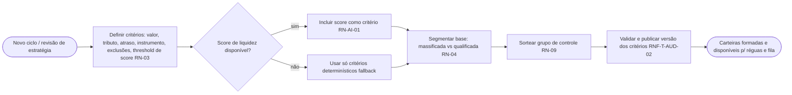
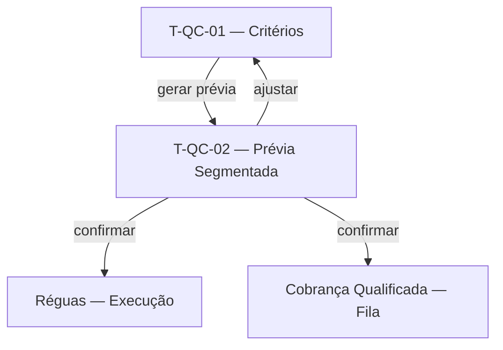

# Qualificação e Parametrização da Carteira — Contrato

> Documento único da Camada de Requisitos desta feature (3 capítulos).
>
> **Pense transversalmente.** Consulte: [Modelo de dados](../modelo-dados.md), [Requisitos transversais](../requisitos-transversais.md), [Telas comuns](../telas-comuns.md).
>
> **Eixo:** `processo` — fluxo de **definir critérios parametrizáveis, segmentar a carteira (massificada vs. qualificada), reservar grupo de controle e publicar versões auditáveis**.

> **Regra de não-sobreposição:** persona+objetivo → §2.1; o que faz + RN → §2.2; prova → §2.4; entidades canônicas → [modelo-dados](../modelo-dados.md).

---

## 1. Telas & Fluxos

### 1.1 Fluxo (Mermaid)



### 1.2 Telas detalhadas

#### T-QC-01 — Configuração de Critérios de Qualificação
- **Arquétipo:** A3 (Formulário de Configuração + versionamento)
- **Objetivo:** parametrizar e versionar os critérios de formação de carteira (RN-03).

```wireframe
# Critérios de Qualificação
card "Parâmetros":
  [Valor mínimo____] [Tributo v]
  [Tempo de atraso (dias)____] [Instrumento v]
  [Threshold de score____]
  - excluir devedores contumazes
  - reservar grupo de controle (%)
(!) regras inválidas/conflitantes
[Tipo alvo v: massificada/qualificada]
[Validar] [Publicar versão] [Ver histórico de versões]
```
- **Conteúdo:** condições parametrizáveis; campo de threshold de score (habilitado se score disponível); % de grupo de controle.
- **Ações:** validar, publicar versão (imutável), ver histórico (RNF-T-AUD-02).
- **Estados:** rascunho; conflito de regras; publicado.
- **Navegação:** abre prévia (T-QC-02).
- **Componentes:** toolbar, card, input, select, checkbox, banner, button.

#### T-QC-02 — Prévia da Carteira Segmentada
- **Arquétipo:** A2 (Lista / Fila com Filtros)
- **Objetivo:** revisar o resultado da aplicação dos critérios antes de publicar.

```wireframe
# Prévia da Carteira
[[ Massificada: n | Qualificada: n | Grupo de controle: n ]]
[Buscar____] [Segmento v] [Tributo v]
| Contribuinte | Tributo | Valor | Score | Segmento | Controle? |
| reg | reg | reg | reg | reg | reg |
[Confirmar segmentação] [Exportar prévia]
```
- **Conteúdo:** contagens por segmento e grupo de controle; lista com segmento atribuído.
- **Ações:** confirmar; exportar (RF-T-01); ajustar e revalidar.
- **Estados:** prévia vazia (critérios muito restritivos); pronta.
- **Navegação:** de T-QC-01; alimenta Réguas e Cobrança Qualificada.
- **Componentes:** toolbar, card, input, select, table, button.

### 1.3 Diagrama de navegação (Mermaid)



---

## 2. Requisitos & Cenários de Teste

> Origem: RN-03, RN-04, RN-09, RN-AI-01. Horizonte: **H1** (score: **H2**).

### 2.1 Personas & objetivos

| Persona | Objetivo | JTBD |
|---|---|---|
| Coordenador de Cobrança | Selecionar quem cobrar por critérios auditáveis e replicáveis | JTBD-02 |
| Coordenador de Cobrança | Medir efeito incremental reservando grupo de controle automaticamente | JTBD-06 |

### 2.2 Requisitos Funcionais

| ID | Enunciado | Prioridade | RNs | Persona |
|---|---|---|---|---|
| RF-01 | Parametrizar critérios de qualificação (valor, tributo, atraso, instrumento, exclusões) (N1.2, US3) | Must | RN-03 | Coordenador |
| RF-02 | Versionar critérios; registrar versão aplicada a cada carteira (N1.2, US3) | Must | RN-03 | Coordenador |
| RF-03 | Segmentar a base entre massificada e qualificada por valor/risco/histórico (N1.4, N2.4) | Must | RN-04 | Coordenador |
| RF-04 | Sortear automaticamente o grupo de controle por ciclo (N — diagnóstico) | Must | RN-09 | Coordenador |
| RF-05 | Incluir o score de liquidez como critério/threshold quando disponível (N1.2, US14) | Should | RN-AI-01 | Coordenador |
| RF-06 | Gerar prévia da carteira segmentada antes de publicar | Should | RN-03, RN-04 | Coordenador |

**Transversais aplicáveis:** RF-T-01 (exportação), RF-T-02 (busca/filtro), RF-T-03 (visão única).

### 2.3 Requisitos Não-Funcionais

#### Auditoria
- **RNF-A-01** — Esta feature é a **lar** de RNF-T-AUD-02 (versionamento de critérios; versão imutável após publicação).

**Transversais aplicáveis:** RNF-T-AUD-01, RNF-T-AUD-02 (lar), RNF-T-SEG-01, RNF-T-PERF-02, RNF-T-DISP-01 (fallback de score).

### 2.4 Cenários de Teste

#### CT-01 — Critério parametrizado forma carteira (verifica RF-01/RF-03)
- **Dado** critérios "ICMS, valor ≥ R$ 500 mil, atraso ≥ 90d, excluir contumazes"
- **Quando** o coordenador gera a prévia
- **Então** apenas contribuintes que atendem os critérios entram na carteira qualificada.

#### CT-02 — Versionamento imutável (verifica RF-02 / RNF-T-AUD-02)
- **Dado** uma versão de critérios publicada e aplicada a uma carteira
- **Quando** o coordenador edita os critérios
- **Então** uma nova versão é criada; a carteira existente mantém a versão original registrada.

#### CT-03 — Grupo de controle sorteado (verifica RF-04 / RN-09)
- **Dado** uma carteira com % de grupo de controle configurado
- **Quando** a segmentação executa
- **Então** o subconjunto sorteado é marcado como controle e excluído das ações de cobrança.

#### CT-04 — Score como critério com fallback (verifica RF-05 / RN-AI-01)
- **Dado** o score de liquidez indisponível
- **Quando** o coordenador publica critérios que usam threshold de score
- **Então** a segmentação opera apenas com os critérios determinísticos e marca os contribuintes como "sem score".

#### CT-05 — Desempate massificada/qualificada (verifica RF-03 / RN-04)
- **Dado** um contribuinte que atende critérios de ambos os eixos
- **Quando** a segmentação executa
- **Então** ele é atribuído a um único eixo conforme a regra de desempate. ⚠ NÃO IDENTIFICADO — definir regra.

---

## 3. Dados

> Eixo `processo`: entidades derivam das atividades de definição/segmentação.

### 3.1 Entidades canônicas usadas
- **Critério de Qualificação** (ver [../modelo-dados.md](../modelo-dados.md)) — esta feature é a **lar**.
- **Carteira** — formada aqui; lar.
- **Contribuinte**, **Débito** — segmentados; referenciados.

### 3.2 Entidades próprias da feature

#### Execução de Segmentação  <!-- deriva de: atividade "Segmentar/Sortear"; referencia Carteira de ../modelo-dados.md -->
| Campo | Tipo | Descrição |
|---|---|---|
| id | identificador | Chave |
| criterio_versao_ref | referência | → Critério de Qualificação (versão) |
| total_massificada | número | Contagem |
| total_qualificada | número | Contagem |
| total_controle | número | Tamanho do grupo de controle |
| data | data | Execução |

### 3.3 Relações
- Critério de Qualificação 1:N Execução de Segmentação 1:N Carteira (entidades canônicas de ../modelo-dados.md).

---

## Questões em aberto
- ⚠ NÃO IDENTIFICADO — definir: regra de desempate massificada↔qualificada (RN-04); tamanho padrão do grupo de controle.

## Fontes
- Levantamento de Necessidades 2.6 (N1.2, N1.4, N2.1, N2.4); Planning_Poker (US 3, 11, 14); Diagnóstico de Situação Atual.

## Relacionado
- [Visão do produto](../visao.md)
- [Modelo de dados (transversal)](../modelo-dados.md)
- [Requisitos transversais](../requisitos-transversais.md)
- [Telas comuns (arquétipos)](../telas-comuns.md)
- [Ingestão e Carteira](ingestao-carteira.md)
- [Réguas de Cobrança](reguas-cobranca.md)
- [Scoring de Liquidez](scoring-liquidez.md)
- [Índice do wiki](../index.md)
