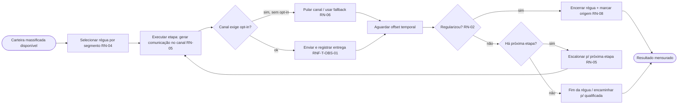
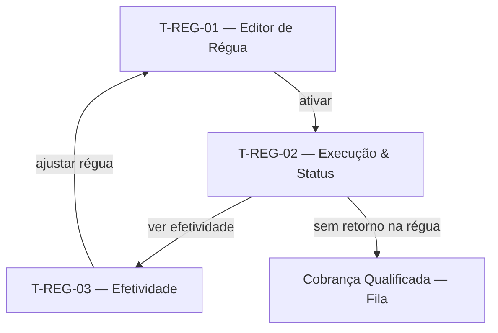

# Réguas de Cobrança Massificada Multicanal — Contrato

> Documento único da Camada de Requisitos desta feature (3 capítulos).
>
> **Pense transversalmente.** Consulte: [Modelo de dados](../modelo-dados.md), [Requisitos transversais](../requisitos-transversais.md), [Telas comuns](../telas-comuns.md).
>
> **Eixo:** `processo` — fluxo de **desenhar uma régua, disparar comunicações escalonadas por múltiplos canais e ajustar conforme o comportamento do contribuinte**.

> **Regra de não-sobreposição:** persona+objetivo → §2.1; o que faz + RN → §2.2; prova → §2.4; entidades → [modelo-dados](../modelo-dados.md).

---

## 1. Telas & Fluxos

### 1.1 Fluxo (Mermaid)



> **Segmentos de régua priorizados** (Executivo Soluções §2.6 — "5 réguas prioritárias"): **Parcelamentos Inadimplentes**, **IPVA**, **ITCD**, **ICMS Normal** e **ICMS Substituição Tributária**. São os perfis-alvo iniciais das réguas massificadas; cada um instancia o Editor de Régua (T-REG-01) com cadência/canais próprios. O IPVA, pelo grande volume (~1,8 mi contribuintes / ~15 mil veículos cobrados quase diariamente), é tratado prioritariamente por estratégia massiva.

### 1.2 Telas detalhadas

#### T-REG-01 — Editor de Régua
- **Arquétipo:** A5 (Editor de Fluxo / Linha do Tempo)
- **Objetivo:** desenhar a sequência de etapas, canais, offsets e condições de escalonamento (RN-05).

```wireframe
# Editor de Régua
[Nome da régua____] [Segmento alvo v] [Tributo v]
card "Etapas (linha do tempo)":
  [[ -5d e-mail | -2d SMS | 0d e-mail | +15d WhatsApp ]]
  - condição: sem pagamento -> intensifica
  - condição: regularizou -> encerra
[Template por etapa____]
[Adicionar etapa] [Simular] [Ativar régua] [Ver histórico de versões]
```
- **Conteúdo:** etapas ordenadas com offset, canal e template; condições de progressão.
- **Ações:** adicionar/editar etapa, simular, ativar/pausar, versionar.
- **Estados:** rascunho; ativa; pausada.
- **Navegação:** ativa → execução (T-REG-02).
- **Componentes:** toolbar, input, select, card, chip, button.

#### T-REG-02 — Execução & Status de Disparo
- **Arquétipo:** A2 (Lista / Fila) combinado com A6 (status de execução)
- **Objetivo:** acompanhar e operar a execução das réguas ativas (status de entrega por comunicação).

```wireframe
# Execução de Réguas
[[ Réguas ativas | Comunicações hoje | Falhas de entrega ]]
[Régua v] [Canal v] [Status entrega v]
| Contribuinte | Etapa | Canal | Status | Data |
| reg | reg | reg | reg | reg |
[Reenviar falhas] [Pausar régua] [Exportar]
```
- **Conteúdo:** comunicações em execução, status (enviado/entregue/aberto/falha).
- **Ações:** reenviar falhas (fallback), pausar régua, exportar (RF-T-01).
- **Estados:** sem disparos; lote em andamento; falhas pendentes.
- **Navegação:** de T-REG-01; KPIs em T-REG-03.
- **Componentes:** toolbar, card, select, table, button.

#### T-REG-03 — Efetividade da Régua
- **Arquétipo:** A1 (Painel de Indicadores)
- **Objetivo:** monitorar taxas de resposta/regularização por segmento e etapa (N2.6).

```wireframe
# Efetividade das Réguas
[Régua v] [Segmento v] [Período v]
[[ Taxa de abertura | Taxa de regularização | Retorno R$ ]]
[~ regularização por etapa ~]
card "Por canal":
  | Canal | Enviados | Regularizados | Taxa |
  | linha | linha | linha | linha |
[Exportar]
```
- **Conteúdo:** taxas por etapa/canal/segmento; retorno financeiro.
- **Ações:** filtrar, exportar; insumo para ajuste da régua (volta a T-REG-01).
- **Estados:** sem dados (ciclo inicial); consolidado.
- **Navegação:** de T-REG-02; compartilha dados com Monitoramento.
- **Componentes:** toolbar, select, card, chart, table, button.

### 1.3 Diagrama de navegação (Mermaid)



---

## 2. Requisitos & Cenários de Teste

> Origem: RN-04, RN-05, RN-06, RN-08, RN-02. Horizonte: **H1** (WhatsApp: **H2**, depende de contratação/opt-in).

### 2.1 Personas & objetivos

| Persona | Objetivo | JTBD |
|---|---|---|
| Coordenador de Cobrança | Disparar comunicação automatizada e escalonada sem confirmação manual | JTBD-03 |
| Coordenador de Cobrança | Ajustar a estratégia da régua com base na efetividade observada | JTBD-06 |

### 2.2 Requisitos Funcionais

| ID | Enunciado | Prioridade | RNs | Persona |
|---|---|---|---|---|
| RF-01 | Desenhar régua parametrizável com etapas, offsets, canais e templates (N2.2) | Must | RN-05 | Coordenador |
| RF-02 | Disparar comunicações automaticamente, sem confirmação manual em lote (N1.3, US4) | Must | RN-05 | Coordenador |
| RF-03 | Escalonar ações conforme comportamento (renotificar/intensificar/encerrar) (N2.3) | Must | RN-05, RN-02 | Coordenador |
| RF-04 | Operar múltiplos canais (e-mail, SMS, WhatsApp, SNE) com fallback (N2.8) | Must | RN-06 | Coordenador |
| RF-05 | Respeitar opt-in/opt-out por canal (WhatsApp) com gestão de consentimento (US13) | Must | RN-06 | Coordenador |
| RF-06 | Registrar status de entrega por comunicação e reenviar falhas (N2.8) | Must | RN-10 | Coordenador |
| RF-07 | Marcar origem da regularização (canal/instrumento) (N — diagnóstico) | Must | RN-08 | Coordenador |
| RF-08 | Monitorar a efetividade por segmento/etapa/canal (N2.6) | Should | RN-08 | Coordenador |
| RF-09 | Encaminhar à cobrança qualificada contribuintes sem retorno na régua | Should | RN-04 | Coordenador |

**Transversais aplicáveis:** RF-T-01, RF-T-02, RF-T-04 (marcação de origem — esta feature é a **lar**).

### 2.3 Requisitos Não-Funcionais

#### Performance
- **RNF-P-01** — Disparo em lote de centenas de milhares de comunicações por ciclo sem degradar telas (diverge para mais que RNF-T-PERF-02).

#### Segurança
- **RNF-S-01** — Esta feature é a **lar** de RNF-T-SEG-02 (consentimento/privacidade — opt-in).

**Transversais aplicáveis:** RNF-T-PERF-01/02, RNF-T-OBS-01 (status de entrega — lar), RNF-T-DISP-01 (canal indisponível → fallback), RNF-T-AUD-01, RNF-T-SEG-02 (lar).

### 2.4 Cenários de Teste

#### CT-01 — Disparo automático escalonado (verifica RF-02/RF-03)
- **Dado** uma régua ativa com etapas -5d, -2d, 0d, +15d
- **Quando** o contribuinte não paga após a 1ª etapa
- **Então** o sistema avança automaticamente para a próxima etapa na data prevista, sem confirmação manual.

#### CT-02 — Encerramento por regularização (verifica RF-03/RF-07/RN-02/RN-08)
- **Dado** um contribuinte em régua que regulariza após uma notificação
- **Quando** a atualização intraciclo detecta a regularização
- **Então** a régua é encerrada para ele e a origem é marcada como "resposta à cobrança" pelo canal correspondente.

#### CT-03 — Opt-in respeitado (verifica RF-05/RNF-T-SEG-02)
- **Dado** um contribuinte sem opt-in de WhatsApp
- **Quando** a etapa de WhatsApp é alcançada
- **Então** o canal é pulado (fallback) e nenhuma mensagem de WhatsApp é enviada.

#### CT-04 — Falha de entrega e reenvio (verifica RF-06/RNF-T-OBS-01)
- **Dado** uma comunicação com falha de entrega de e-mail
- **Quando** o coordenador aciona "reenviar falhas"
- **Então** a comunicação é reenviada e o novo status é registrado.

#### CT-05 — Encaminhamento à qualificada (verifica RF-09)
- **Dado** um contribuinte que esgotou a régua massificada sem regularizar
- **Quando** a régua termina
- **Então** ele é elegível à carteira qualificada conforme RN-04.

---

## 3. Dados

> Eixo `processo`: entidades derivam das atividades de execução da régua.

### 3.1 Entidades canônicas usadas
- **Régua** e sub-entidade **Etapa de Régua** (ver [../modelo-dados.md](../modelo-dados.md)) — esta feature é a **lar**.
- **Comunicação** — gerada aqui; lar.
- **Contribuinte**, **Débito**, **Carteira** — referenciados.

### 3.2 Entidades próprias da feature

#### Template de Comunicação  <!-- deriva de: atividade "Gerar comunicação"; referencia Etapa de Régua -->
| Campo | Tipo | Descrição |
|---|---|---|
| id | identificador | Chave |
| canal | texto | e-mail / SMS / WhatsApp / SNE |
| assunto / corpo | texto | Conteúdo (tom por situação) |
| variaveis | lista | Campos de mesclagem (nome, valor, vencimento) |

#### Consentimento de Canal  <!-- deriva de: decisão "Canal exige opt-in?"; referencia Contribuinte -->
| Campo | Tipo | Descrição |
|---|---|---|
| contribuinte_ref | referência | → Contribuinte |
| canal | texto | WhatsApp / SMS |
| estado | texto | opt-in / opt-out |
| data | data | Última alteração (log) |

### 3.3 Relações
- Régua 1:N Etapa de Régua 1:1 Template de Comunicação.
- Régua 1:N Comunicação; Contribuinte 1:N Consentimento de Canal (entidades canônicas de ../modelo-dados.md).

---

## Questões em aberto
- ⚠ NÃO IDENTIFICADO — definir: ordem de fallback entre canais; janela de atribuição (30d assumido); status do contrato de WhatsApp.

## Fontes
- Levantamento de Necessidades 2.6 (N1.3, N2.2, N2.3, N2.6, N2.8); Planning_Poker (US 2, 4, 13); DECK Cobrança Inteligente.

## Relacionado
- [Visão do produto](../visao.md)
- [Modelo de dados (transversal)](../modelo-dados.md)
- [Requisitos transversais](../requisitos-transversais.md)
- [Telas comuns (arquétipos)](../telas-comuns.md)
- [Qualificação da Carteira](qualificacao-carteira.md)
- [Cobrança Qualificada](cobranca-qualificada.md)
- [Monitoramento e KPIs](monitoramento-kpis.md)
- [Índice do wiki](../index.md)
