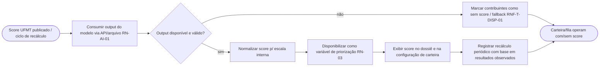
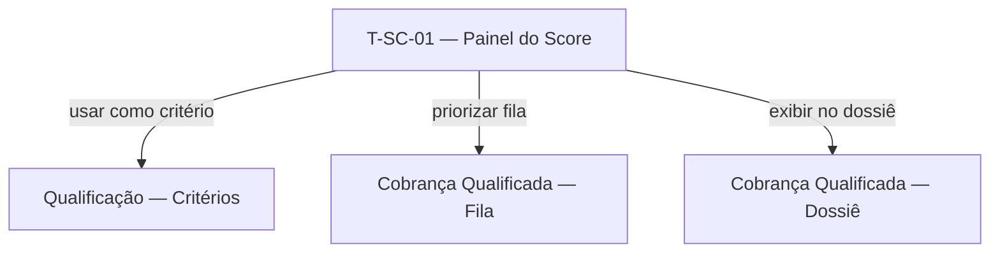

# Scoring de Liquidez (Priorização Inteligente) — Contrato

> Documento único da Camada de Requisitos desta feature (3 capítulos).
>
> **Pense transversalmente.** Consulte: [Modelo de dados](../modelo-dados.md), [Requisitos transversais](../requisitos-transversais.md), [Telas comuns](../telas-comuns.md).
>
> **Eixo:** `processo` — fluxo de **ingerir o score da UFMT, normalizá-lo, disponibilizá-lo como variável de priorização e recalibrar periodicamente**. O **desenvolvimento** do modelo é externo (UFMT) — ver não-objetivos da Visão; esta feature trata da **integração e do uso**.

> **Regra de não-sobreposição:** persona+objetivo → §2.1; o que faz + RN → §2.2; prova → §2.4; entidades → [modelo-dados](../modelo-dados.md). A regra dependente de IA é `RN-AI-01` (Visão §3) — citada por ID, não reescrita.

---

## 1. Telas & Fluxos

### 1.1 Fluxo (Mermaid)



### 1.2 Telas detalhadas

#### T-SC-01 — Painel do Score de Liquidez
- **Arquétipo:** A6 (Painel de Status de Integração / Execução) + A1 (distribuição)
- **Objetivo:** operar a ingestão do score e acompanhar cobertura/qualidade (uso, não desenvolvimento do modelo).

```wireframe
# Score de Liquidez (UFMT)
[[ Versão do modelo | Última ingestão | Cobertura da carteira ]]
(!) score indisponível — operando em fallback
[~ distribuição do score na carteira ~]
card "Cobertura por tributo":
  | Tributo | Com score | Sem score |
  | linha | linha | linha |
[Reimportar score] [Ver log de ingestão]
```
- **Conteúdo:** versão/última ingestão; cobertura (com/sem score); distribuição.
- **Ações:** reimportar; ver log; (configuração do threshold ocorre em T-QC-01).
- **Estados:** sem score (fallback); ingestão parcial; atualizado.
- **Navegação:** alimenta Qualificação (threshold) e Cobrança Qualificada (priorização da fila).
- **Componentes:** toolbar, card, chart, table, banner, button.

> **Minimização de telas:** a feature não cria tela de configuração própria — o **uso** do score como critério é configurado na tela de critérios da Qualificação (T-QC-01) e exibido no Dossiê (T-CQ-03). Esta feature contribui apenas com a tela operacional T-SC-01.

### 1.3 Diagrama de navegação (Mermaid)



---

## 2. Requisitos & Cenários de Teste

> Origem: RN-AI-01, RN-03. Horizonte: **H2** (depende da entrega do modelo pela UFMT; dados de cobrança alimentam o modelo a partir de maio/26).

### 2.1 Personas & objetivos

| Persona | Objetivo | JTBD |
|---|---|---|
| Coordenador de Cobrança | Priorizar a cobrança por probabilidade de recuperação, não por empirismo | JTBD-02 |
| Atendente de Cobrança | Ver o score do contribuinte para orientar a abordagem | JTBD-04 |

### 2.2 Requisitos Funcionais

| ID | Enunciado | Prioridade | RNs | Persona |
|---|---|---|---|---|
| RF-01 | Consumir o output do modelo de score (API ou arquivo) e normalizá-lo (US14) | Must | RN-AI-01 | Coordenador |
| RF-02 | Disponibilizar o score como variável parametrizável de priorização (threshold em T-QC-01) (US14) | Must | RN-AI-01, RN-03 | Coordenador |
| RF-03 | Exibir o score no dossiê e na configuração de carteira (US14) | Should | RN-AI-01 | Atendente |
| RF-04 | Recalibrar/atualizar o score periodicamente com base em resultados observados | Should | RN-AI-01 | Coordenador |
| RF-05 | Operar em fallback (sem score) quando o output estiver indisponível/ inválido | Must | RN-AI-01 | Coordenador |
| RF-06 | Acompanhar cobertura e qualidade da ingestão do score por tributo | Should | RN-10 | Coordenador |

**Transversais aplicáveis:** RF-T-01 (exportação), RF-T-03 (visão única — exibe score no contribuinte).

### 2.3 Requisitos Não-Funcionais

#### Disponibilidade
- **RNF-D-01** — Esta feature reforça RNF-T-DISP-01: a indisponibilidade do score nunca bloqueia a qualificação/priorização (fallback determinístico, RN-AI-01).

#### Observabilidade
- **RNF-O-01** — Versão do modelo, data de ingestão e cobertura são registradas e visíveis (RNF-T-OBS-01).

**Transversais aplicáveis:** RNF-T-DISP-01, RNF-T-OBS-01, RNF-T-AUD-01, RNF-T-PERF-02 (alta volumetria de dados do score).

### 2.4 Cenários de Teste

#### CT-01 — Ingestão e normalização (verifica RF-01)
- **Dado** um arquivo de score da UFMT
- **Quando** a ingestão executa
- **Então** os scores são normalizados e associados aos contribuintes correspondentes.

#### CT-02 — Score como critério (verifica RF-02/RN-AI-01/RN-03)
- **Dado** um threshold de score configurado em T-QC-01
- **Quando** a carteira é qualificada
- **Então** apenas contribuintes acima do threshold entram conforme a regra, além dos demais critérios.

#### CT-03 — Fallback sem score (verifica RF-05/RNF-T-DISP-01)
- **Dado** o output do modelo indisponível
- **Quando** a qualificação/priorização executa
- **Então** opera apenas com critérios determinísticos e marca os contribuintes como "sem score".

#### CT-04 — Score exibido no dossiê (verifica RF-03)
- **Dado** um contribuinte com score ingerido
- **Quando** o atendente abre o dossiê
- **Então** o score aparece no resumo do contribuinte.

#### CT-05 — Recálculo periódico (verifica RF-04)
- **Dado** novos resultados de cobrança acumulados
- **Quando** o ciclo de recálculo ocorre (modelo UFMT atualizado)
- **Então** uma nova versão do score é ingerida e a versão é registrada.

---

## 3. Dados

> Eixo `processo`: entidades derivam das atividades de ingestão/uso do score. A capacidade de IA é a `RN-AI-01` (Visão); aqui só o que é próprio da integração.

### 3.1 Entidades canônicas usadas
- **Contribuinte** (campo `score_liquidez`) (ver [../modelo-dados.md](../modelo-dados.md)) — enriquecido com o score; esta feature alimenta o campo.
- **Critério de Qualificação** (threshold de score) — referenciado.

### 3.2 Entidades próprias da feature

#### Ingestão de Score  <!-- deriva de: atividade "Consumir/Normalizar"; referencia Contribuinte -->
| Campo | Tipo | Descrição |
|---|---|---|
| id | identificador | Chave |
| versao_modelo | texto | Versão do modelo UFMT |
| data_ingestao | data | Quando foi ingerido |
| cobertura | número | % de contribuintes com score |
| status | texto | OK / falha / parcial |

### 3.3 Relações
- Ingestão de Score 1:N Contribuinte (atualiza score_liquidez) — entidade canônica de ../modelo-dados.md.

---

## Questões em aberto
- ⚠ NÃO IDENTIFICADO — definir: contrato técnico do output da UFMT (API vs. arquivo) e escala do score; periodicidade do recálculo; data efetiva de disponibilidade do modelo.

## Fontes
- Potenciais oportunidades P2.6 (Plataforma de priorização Inteligente — Scoring); Planning_Poker (US 14); DECK Cobrança Inteligente (Rating).

## Relacionado
- [Visão do produto](../visao.md)
- [Modelo de dados (transversal)](../modelo-dados.md)
- [Requisitos transversais](../requisitos-transversais.md)
- [Telas comuns (arquétipos)](../telas-comuns.md)
- [Qualificação da Carteira](qualificacao-carteira.md)
- [Cobrança Qualificada](cobranca-qualificada.md)
- [Índice do wiki](../index.md)
