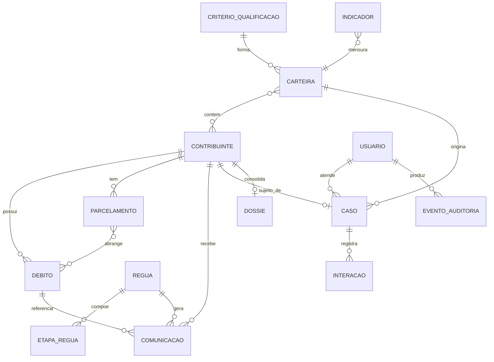

# Modelo de Dados (transversal)

Modelo de dados canônico de **Cobrança Inteligente**, compartilhado por todas as features. Cada feature **referencia** estas entidades; no seu Cap. 3 (Dados) descreve apenas os campos e entidades **próprios** dela (configurações, logs, instâncias de execução), apontando para a entidade canônica de origem aqui. A terminologia segue o [Glossário](visao.md) (Visão §2); valores numéricos são parâmetros de instância (`RN-NN`, Visão §3). Inferências marcadas com `*(inferência)*`.

> **Home feature.** Cada entidade canônica tem uma *feature-lar* que a define/alimenta; as demais apenas referenciam. Tabelas de execução/log de uma única feature **não** são canônicas — vivem no Cap. 3 daquela feature.

---

## Entidades

### Contribuinte

Pessoa física ou jurídica sujeito do crédito; eixo da visão única. Origem cadastral é externa (2.2 B-Cadastro/Big Data); aqui é referenciado e enriquecido com dados de contato e consentimentos.

| Campo | Tipo conceitual | Descrição |
|---|---|---|
| id | identificador | Chave do contribuinte |
| documento | texto | CPF/CNPJ (validado, RN-01) |
| nome | texto | Nome/razão social |
| tipo_pessoa | enum | física / jurídica |
| contatos | lista | E-mail(s), telefone(s) — qualificados pelo 2.2 |
| consentimentos | lista | Opt-in/opt-out por canal (RN-06) |
| segmento_atual | enum | massificada / qualificada (RN-04) |
| score_liquidez | número | Última pontuação UFMT, se houver (RN-AI-01) |

**Usada em:** Ingestão e Carteira (home), Qualificação, Réguas, Cobrança Qualificada, Monitoramento.

### Débito

Crédito tributário em aberto. Consolidado de múltiplas fontes (RN-01).

| Campo | Tipo conceitual | Descrição |
|---|---|---|
| id | identificador | Chave do débito |
| contribuinte_ref | referência | → Contribuinte |
| tributo | enum | ICMS / IPVA / ITCD / outros |
| valor | monetário | Valor atualizado do débito |
| vencimento | data | Data de vencimento |
| tempo_atraso | número | Dias em atraso (derivado) |
| instrumento | enum | Instrumento de constituição (NL, NAI, TAD, ACF…) |
| fonte_origem | enum | CCF / MPI / Big Data / IPVA / ITCD / SNE (RN-12) |
| status | enum | aberto / em_cobranca / regularizado / parcelado |
| origem_regularizacao | enum | espontânea / cobrança-ativa(canal/instrumento) (RN-08) |

**Usada em:** Ingestão e Carteira (home), Qualificação, Réguas, Cobrança Qualificada, Monitoramento.

### Parcelamento

Acordo de parcelamento de débito(s); monitorado quanto à inadimplência (risco de denúncia do contrato).

| Campo | Tipo conceitual | Descrição |
|---|---|---|
| id | identificador | Chave |
| contribuinte_ref | referência | → Contribuinte |
| debitos_ref | lista | → Débito(s) abrangidos |
| status | enum | ativo / em_atraso / rompido |
| parcelas_em_atraso | número | Nº de parcelas vencidas (alerta de risco) |

**Usada em:** Ingestão e Carteira (home), Cobrança Qualificada, Monitoramento.

### Carteira

Recorte de débitos/contribuintes formado pela aplicação de um conjunto de critérios; pode ser massificada ou qualificada.

| Campo | Tipo conceitual | Descrição |
|---|---|---|
| id | identificador | Chave |
| nome | texto | Identificação da carteira/ciclo |
| tipo | enum | massificada / qualificada (RN-04) |
| criterios_ref | referência | → Critério de Qualificação (versão aplicada, RN-03) |
| ciclo | texto | Ciclo de cobrança |
| contribuintes | lista | → Contribuinte (membros) |
| grupo_controle | booleano (por membro) | Marca membro reservado ao grupo de controle (RN-09) |

**Usada em:** Qualificação da Carteira (home), Réguas, Cobrança Qualificada, Monitoramento.

### Critério de Qualificação

Conjunto versionado de regras de formação de carteira (RN-03).

| Campo | Tipo conceitual | Descrição |
|---|---|---|
| id | identificador | Chave |
| versao | texto | Versão (imutável após publicação) |
| condicoes | lista | Valor mínimo, tributo, atraso, instrumento, exclusões, threshold de score |
| tipo_alvo | enum | massificada / qualificada |
| ativo | booleano | Vigente |

**Usada em:** Qualificação da Carteira (home), Scoring, Réguas.

### Régua

Modelo configurado de sequência de ações de cobrança para um segmento (RN-05).

| Campo | Tipo conceitual | Descrição |
|---|---|---|
| id | identificador | Chave |
| nome | texto | Ex.: Régua ICMS Contas-Declaração |
| segmento_alvo | referência | → segmento/critério aplicável |
| etapas | lista | → Etapa de Régua (ordenadas) |
| status | enum | rascunho / ativa / pausada |

**Usada em:** Réguas (home), Monitoramento.

Sub-entidade **Etapa de Régua** (linhas da Régua): `ordem`, `offset_temporal` (ex.: -5d, +15d), `canal` (e-mail/SMS/WhatsApp/SNE), `template_ref`, `condicao_progressao` (RN-05), `acao` (notificar/renotificar/intensificar/encerrar).

### Comunicação

Disparo individual realizado por uma etapa de régua a um contribuinte (instância de execução da régua).

| Campo | Tipo conceitual | Descrição |
|---|---|---|
| id | identificador | Chave |
| contribuinte_ref | referência | → Contribuinte |
| debito_ref | referência | → Débito |
| regua_ref / etapa_ref | referência | → Régua / Etapa |
| canal | enum | e-mail / SMS / WhatsApp / SNE |
| status_entrega | enum | enviado / entregue / aberto / falha (RF-T) |
| data_envio | data | Timestamp do disparo |

**Usada em:** Réguas (home), Cobrança Qualificada (histórico), Monitoramento.

### Caso

Unidade de trabalho da cobrança qualificada: vínculo contribuinte ↔ atendente, com andamento.

| Campo | Tipo conceitual | Descrição |
|---|---|---|
| id | identificador | Chave |
| contribuinte_ref | referência | → Contribuinte |
| atendente_ref | referência | → Usuário (atendente) |
| carteira_ref | referência | → Carteira (qualificada) |
| status | enum | aberto / em_andamento / regularizado / encerrado |
| prioridade | número | Derivada de score/estágio (RN-07) |
| interacoes | lista | → Interação |

**Usada em:** Cobrança Qualificada (home), Monitoramento.

Sub-entidade **Interação** (linhas do Caso): `data`, `tipo` (ligação/e-mail/visita/anotação), `resultado`, `texto_livre`, `autor_ref`.

### Dossiê

Visão consolidada (read-model) de um contribuinte para a cobrança qualificada; montado automaticamente — não é fonte primária, agrega Débito, Parcelamento, Comunicação, Interação e sinalizações coercitivas externas.

| Campo | Tipo conceitual | Descrição |
|---|---|---|
| contribuinte_ref | referência | → Contribuinte |
| debitos | lista | → Débito |
| parcelamentos | lista | → Parcelamento |
| historico_contatos | lista | → Comunicação + Interação |
| sinalizacoes_coercitivas | lista | Notificações ativas em outras coordenadorias (CCF/SNE/SUCOM) |
| completude | enum | indicador de completude p/ encaminhamento |

**Usada em:** Cobrança Qualificada (home), Réguas (contexto).

### Indicador (KPI)

Métrica instrumentada da cobrança (RN-08, RN-09).

| Campo | Tipo conceitual | Descrição |
|---|---|---|
| id | identificador | Chave |
| nome | texto | Ex.: regularização por tributo/canal/instrumento/atendente |
| dimensao | enum | tributo / canal / instrumento / atendente / segmento / etapa |
| valor | número | Valor apurado |
| meta | número | Meta formal (ICMS/IPVA/ITCD) |
| ciclo | texto | Período de apuração |

**Usada em:** Monitoramento (home).

### Usuário (entidade transversal global)

Servidor da SEFAZ que opera a plataforma; perfil define visibilidade (RN-11).

| Campo | Tipo conceitual | Descrição |
|---|---|---|
| id | identificador | Chave |
| nome | texto | Nome do servidor |
| perfil | enum | coordenador / atendente |
| vinculos | lista | Contadores/contribuintes vinculados (RN-07) |

**Usada em:** todas as features (referenciada).

### Evento de Auditoria (entidade transversal global)

Registro imutável de ação relevante (RN-10).

| Campo | Tipo conceitual | Descrição |
|---|---|---|
| id | identificador | Chave |
| ator_ref | referência | → Usuário (ou sistema) |
| acao | texto | Tipo da ação |
| timestamp | data | Momento |
| payload | composto | Dados da ação |
| resultado | texto | Sucesso/erro |

**Usada em:** todas as features (referenciada).

---

## Relações

- **Contribuinte 1:N Débito** — um contribuinte possui vários débitos.
- **Contribuinte 1:N Parcelamento** — um contribuinte pode ter vários parcelamentos.
- **Parcelamento N:N Débito** — um parcelamento abrange um ou mais débitos.
- **Carteira N:N Contribuinte** — uma carteira contém vários contribuintes; um contribuinte pode estar em carteiras de ciclos distintos.
- **Critério de Qualificação 1:N Carteira** — uma versão de critérios forma várias carteiras.
- **Régua 1:N Etapa de Régua**; **Régua 1:N Comunicação** — uma régua gera muitas comunicações.
- **Contribuinte 1:N Comunicação**; **Débito 1:N Comunicação**.
- **Caso 1:1 Contribuinte (por ciclo qualificado)**; **Usuário(atendente) 1:N Caso**; **Caso 1:N Interação**.
- **Dossiê 1:1 Contribuinte** (read-model agregando Débito/Parcelamento/Comunicação/Interação).
- **Usuário 1:N Evento de Auditoria**; toda entidade pode originar Evento de Auditoria.

> Notação `erDiagram`: `||--o{` = 1:N · `}o--o{` = N:N · `||--o|` = 1:1 (opcional).

---

## Relacionado
- [Índice do wiki](index.md)
- [Visão do produto](visao.md)
- [Requisitos transversais](requisitos-transversais.md)
- [Telas comuns (arquétipos)](telas-comuns.md)
