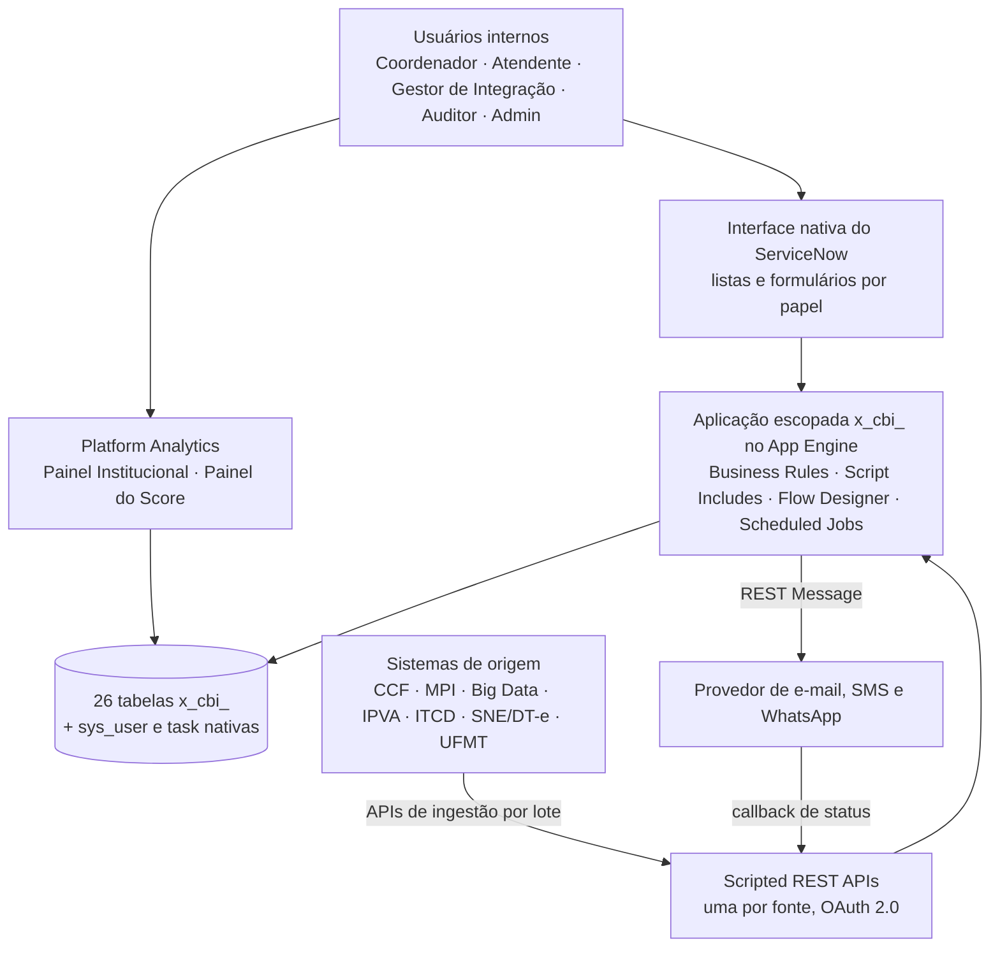

# Especificação Técnica — Cobrança Inteligente (2.6 Cobrança · SEFAZ-MT)

> **CONGELADO em 2026-11-13** — sucedido por `outputs/spec/`. Mudança vai para lá, ou para `spec-scope-change` se for virada de escopo.

> **Fase:** Explore · **Versão:** 0.1 · **Status:** preliminar
> **Documentos irmãos:** [HLD](./hld-funcional.md) · [Funcional](./especificacao-funcional.md) · [Modelo de Dados](./modelo-de-dados.md) · [GAPs](./gaps.md)
>
> Fonte principal: ETF Cobrança Inteligente, seções 1.1, 2, 4 e 6
> (`inputs/especificacoes/etf-cobranca-inteligente.pdf`), e a lista de APIs do plano de implementação
> (slides 22 e 23).

## Changelog
| Versão | Data | Mudança |
|---|---|---|
| 0.1 | 2026-11-13 | versão inicial (simulação do fluxo) |

## 1. Visão em camadas

## 2. Componentes de infraestrutura
| Componente | Tecnologia | Papel |
|---|---|---|
| Aplicação escopada | ServiceNow App Engine (escopo `x_cbi_`, a confirmar) | Tabelas, regras, automação e menus da aplicação |
| Interface | Listas e formulários nativos do ServiceNow | Visão de cada papel, sem tela customizada |
| APIs de ingestão | Scripted REST API + OAuth 2.0 inbound + REST API Access Policy | Uma API por fonte, com o mesmo padrão de lote; cada fonte só acessa a própria |
| Regras e automação | Business Rules, Script Includes, Flow Designer, Scheduled Jobs, Assignment Rules | Consolidação, critérios, motor de réguas, casos, origem da regularização |
| Controle de acesso | Roles, ACL e Query Business Rules | Cinco papéis aplicados na camada de dados |
| Indicadores e painéis | Platform Analytics (indicadores, breakdowns, coleta agendada, dashboards) | Painel Institucional e Painel do Score, calculados direto das tabelas |
| Envio de mensagens | REST Message para o provedor | E-mail, SMS e WhatsApp, com camada que permite trocar de provedor |
| Autenticação de usuários | Login nativo ou SSO corporativo da SEFAZ-MT | Fora do escopo do produto; o produto cuida só da autorização |

## 3. Integrações externas
| Sistema | Direção | Dados trafegados | Observabilidade |
|---|---|---|---|
| Conta Corrente Fiscal (CCF) | Entrada | Débitos de ICMS, parcelamentos e contumazes; carga incremental por data de alteração | Lote por fonte com lidos, aceitos, rejeitados e situação; alerta de falha |
| MPI (em descontinuação) | Entrada | Elegíveis de ICMS; percentual de regras migradas | Idem, mais o percentual de migração |
| Big Data (P2.2) | Entrada | Elegíveis à cobrança, sem duplicar o que veio do MPI | Idem |
| Sistema IPVA | Entrada | Débitos de IPVA, maioria de pessoa física; opt-in do contribuinte | Idem |
| GIA-ITCD | Entrada | Débitos e declarações de ITCD | Idem |
| SNE / DT-e | Entrada | Débitos e sinalizações de cobrança coercitiva | Idem |
| UFMT (modelo de score) | Entrada | Score de liquidez por contribuinte, com versão do modelo | Lote com versão do modelo e cobertura no Painel do Score |
| Provedor de e-mail, SMS e WhatsApp | Saída | Comunicações das réguas | Situação de cada comunicação e reenvio de falhas |
| Provedor de e-mail, SMS e WhatsApp | Entrada (callback) | Status de entrega e respostas | Atualização da comunicação sem duplicar |
| B-Cadastro e Cadastro de Contadores | Entrada (consulta) | Dados cadastrais e vínculo contador–contribuinte | A definir (ver GAP-012) |

## 4. Premissas técnicas
<!-- Premissa que se revelar falsa muda o desenho. -->

| Premissa | Detalhe | GAP relacionado |
|---|---|---|
| Plataforma ServiceNow | A aplicação é escopada no App Engine; o ServiceNow está confirmado como plataforma de desenvolvimento | GAP-013 |
| Sem interface customizada | A visão de cada papel é a interface nativa (listas e formulários); só os dois painéis são dashboards | GAP-005 |
| Fontes empurram os dados | Cada sistema parceiro chama a API da aplicação; o produto não consulta os parceiros | GAP-001 |
| Testes com lotes simulados | Os parceiros ainda não podem ser consumidos; a integração ponta a ponta não está no escopo | GAP-001 |
| Platform Analytics licenciado | Os indicadores e os dois painéis dependem da licença | GAP-002 |
| Volume | Cerca de 1,8 milhão de contribuintes na base e cerca de 22 mil comunicações por dia; o score chega em lotes de cerca de 1,4 milhão de linhas | GAP-010 |
| Ciclo diário | Consolidação e atualização de regularização uma vez por dia | GAP-010 |
| Indicadores sem tabela de fotografia | A tendência por ciclo vem da coleta agendada do Platform Analytics | GAP-002 |
