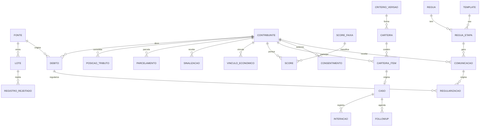

# Modelo de Dados — Cobrança Inteligente (2.6 Cobrança · SEFAZ-MT)

> **CONGELADO em 2026-11-13** — sucedido por `outputs/spec/`. Mudança vai para lá, ou para `spec-scope-change` se for virada de escopo.

> **Fase:** Explore · **Versão:** 0.1 · **Status:** preliminar e **opcional**
> **Documentos irmãos:** [HLD](./hld-funcional.md) · [Funcional](./especificacao-funcional.md) · [Técnica](./especificacao-tecnica.md) · [GAPs](./gaps.md)
>
> Resumo da ETF, seção 4 (26 tabelas no escopo `x_cbi_`, com campos detalhados lá). A autoridade
> definitiva será o `data-model.json` emitido no Plan.

## Changelog
| Versão | Data | Mudança |
|---|---|---|
| 0.1 | 2026-11-13 | versão inicial, resumida da ETF §4 |

## 1. Entidades principais
| Entidade | Papel no sistema | Atributos principais | Usada por |
|---|---|---|---|
| Fonte (`x_cbi_fonte`) | Sistema de origem com API própria | nome, endpoint, usuário de integração, tributo, prazo de recebimento, situação atual, percentual de migração | RF-001, RF-005, RF-006 |
| Lote de carga (`x_cbi_sync_execucao`) | Lote recebido de uma fonte | identificador do lote na fonte, início, fim, situação, pacotes, lidos, aceitos, rejeitados, versão do modelo | RF-001, RF-004, RF-005, RF-022 |
| Registro rejeitado (`x_cbi_registro_rejeitado`) | Registro recusado na validação | lote, chave de origem, motivo, conteúdo original | RF-002, RF-008 |
| Contribuinte (`x_cbi_contribuinte`) | Chave da visão única | documento, tipo (PF ou PJ), nome, segmento atual, situação da cobrança, score atual, total em aberto, maior atraso, contumaz | RF-003, RF-013 |
| Débito (`x_cbi_debito`) | Débito por fonte | contribuinte, tributo, valor, vencimento, instrumento, fonte, situação, atraso, chave de origem | RF-001, RF-003 |
| Posição por tributo (`x_cbi_posicao_tributo`) | Consolidado contribuinte × tributo | total em aberto, maior atraso, quantidade de débitos, situação do parcelamento e da cobrança | RF-003, RF-014 |
| Parcelamento (`x_cbi_parcelamento`) | Parcelamento de débito | número, tributo, parcelas, valor, situação | RF-010 |
| Vínculo econômico (`x_cbi_vinculo_economico`) | Grupo econômico | contribuinte, vinculado, relação | RF-038 |
| Sinalização (`x_cbi_sinalizacao`) | Cobrança coercitiva em outra coordenadoria | contribuinte, débito, tipo, data, ativa | RF-012 |
| Score e faixa (`x_cbi_score`, `x_cbi_score_faixa`) | Score da UFMT e faixas | contribuinte, valor, faixa, lote, vigente; faixa com limites | RF-022, RF-023 |
| Versão de critérios (`x_cbi_criterio_versao`) | Conjunto versionado de critérios | número, estado, versão base, prévia, publicada por, fundamentação | RF-016, RF-017 |
| Carteira e item (`x_cbi_carteira`, `x_cbi_carteira_item`) | Carteira do ciclo e seus contribuintes | versão, ciclo, estado, semente; item com segmento, controle, notificado, regularizado | RF-018 a RF-021, RF-042 |
| Régua, etapa e modelo (`x_cbi_regua`, `x_cbi_regua_etapa`, `x_cbi_template`) | Régua por segmento | régua base, estado; etapa com prazo e canal; modelo com canal e assunto | RF-026 |
| Consentimento (`x_cbi_consentimento`) | Opt-in por canal | contribuinte, canal, opt-in | RF-029 |
| Comunicação (`x_cbi_comunicacao`) | Mensagem enviada | contribuinte, débito, régua, etapa, canal, situação, paga em até 30 dias | RF-027, RF-031, RF-046 |
| Caso (`x_cbi_caso`, estende `task`) | Caso de cobrança qualificada | contribuinte, item da carteira, estágio, prioridade | RF-035 a RF-038 |
| Interação e follow-up (`x_cbi_interacao`, `x_cbi_followup`) | Contato registrado e lembrete | caso, autor, comunicação, tipo, resultado; follow-up com lembrete | RF-039, RF-040 |
| Regularização (`x_cbi_regularizacao`) | Regularização de débito | débito, contribuinte, atendente, comunicação ou interação de origem, origem, canal, instrumento | RF-043, RF-049 |
| Parâmetro, meta e evento de auditoria (`x_cbi_parametro`, `x_cbi_meta`, `x_cbi_auditoria_evento`) | Governança | chave e valor; tributo e ciclo; usuário, ação, data e hora | RF-047, RF-053, RF-054 |

## 2. Relacionamentos

