# Modelo de Dados — Cobrança Inteligente (2.6 Cobrança · SEFAZ-MT)

> **Arquivo derivado de `outputs/spec/data-model.json` — não edite à mão.** A próxima execução da
> `spec-data-model` o reescreve. Para mudar o modelo, mude o JSON e gere de novo:
> `node render-data-model-md.mjs outputs/spec/data-model.json`.
>
> Gerado por `render-data-model-md.mjs` · schema `1` ·
> skill `1.6` · modelo emitido em `2026-11-13T21:00:00Z`

---

## Changelog

| Versão | Data | Estrutural? | Mudança |
|---|---|---|---|
| 1.0 | 2026-11-13 | sim | Modelo inicial greenfield: 26 tabelas x_cbi_ da ETF §4 em 7 contextos (um por módulo), mais a referência nativa sys_user. |

## Entidades

| Entidade | Contexto | Papel | Operação | Colunas | De onde vem (rastreio) |
|---|---|---|---|---|---|
| `Fonte` | Ingestão e Carteira Consolidada | Cada sistema de origem que envia débitos ou score por API; guarda prazo de entrega e situação do último lote | NEW | nome, endpoint, usuario_integracao, tributo_escopo, ativa, prazo_recebimento, status_atual, ultima_execucao, pct_migracao, chave_natural | Cada sistema de origem que envia débitos ou score por API; guarda prazo de entrega e situação do último lote (x_cbi_fonte); Fonte sustenta RF-MOD-INGESTAO-05 (RF-MOD-INGESTAO-05); Fonte sustenta RF-MOD-INGESTAO-11 (RF-MOD-INGESTAO-11); Fonte sustenta RN-NOVO-ING-006 (RN-NOVO-ING-006) |
| `LoteCarga` | Ingestão e Carteira Consolidada | Cada lote recebido de uma fonte, com pacotes, contagens e situação; é a trilha operacional da carga e a chave de idempotência do lote | NEW | fonte, id_lote_origem, inicio, fim, status, origem, pacotes_esperados, pacotes_recebidos, lidos, aceitos, rejeitados, execucao_anterior, versao_modelo, mensagem_erro | Cada lote recebido de uma fonte, com pacotes, contagens e situação; é a trilha operacional da carga e a chave de idempotência do lote (x_cbi_sync_execucao); LoteCarga sustenta RF-MOD-INGESTAO-01 (RF-MOD-INGESTAO-01); LoteCarga sustenta RF-MOD-INGESTAO-04 (RF-MOD-INGESTAO-04); LoteCarga sustenta RN-NOVO-ING-005 (RN-NOVO-ING-005) |
| `RegistroRejeitado` | Ingestão e Carteira Consolidada | Registro recusado na validação, com o motivo e a linha original para reprocesso | NEW | execucao, chave_origem, motivo, conteudo_original | Registro recusado na validação, com o motivo e a linha original para reprocesso (x_cbi_registro_rejeitado); RegistroRejeitado sustenta RF-MOD-INGESTAO-02 (RF-MOD-INGESTAO-02); RegistroRejeitado sustenta RF-MOD-INGESTAO-08 (RF-MOD-INGESTAO-08); RegistroRejeitado sustenta RN-NOVO-ING-004 (RN-NOVO-ING-004) |
| `Contribuinte` | Ingestão e Carteira Consolidada | O contribuinte consolidado, chave da visão única e do isolamento do atendente | NEW | documento, tipo, nome, segmento_atual, status_cobranca, score_atual, total_em_aberto, maior_atraso_dias, contumaz | O contribuinte consolidado, chave da visão única e do isolamento do atendente (x_cbi_contribuinte); Contribuinte sustenta RF-MOD-INGESTAO-03 (RF-MOD-INGESTAO-03); Contribuinte sustenta RF-MOD-INGESTAO-13 (RF-MOD-INGESTAO-13); Contribuinte sustenta RN-NOVO-ING-001 (RN-NOVO-ING-001) |
| `Debito` | Ingestão e Carteira Consolidada | Cada débito recebido de uma fonte, ligado ao contribuinte | NEW | contribuinte, tributo, valor, vencimento, instrumento, fonte, status, data_regularizacao, atraso_dias, id_origem | Cada débito recebido de uma fonte, ligado ao contribuinte (x_cbi_debito); Debito sustenta RF-MOD-INGESTAO-01 (RF-MOD-INGESTAO-01); Debito sustenta RF-MOD-INGESTAO-03 (RF-MOD-INGESTAO-03); Debito sustenta RN-NOVO-ING-001 (RN-NOVO-ING-001) |
| `PosicaoTributo` | Ingestão e Carteira Consolidada | Posição consolidada do contribuinte em cada tributo, gravada na carga para não somar na consulta | NEW | contribuinte, tributo, total_em_aberto, maior_atraso_dias, qtd_debitos, status_parcelamento, status_cobranca | Posição consolidada do contribuinte em cada tributo, gravada na carga para não somar na consulta (x_cbi_posicao_tributo); PosicaoTributo sustenta RF-MOD-INGESTAO-03 (RF-MOD-INGESTAO-03); PosicaoTributo sustenta RF-MOD-INGESTAO-14 (RF-MOD-INGESTAO-14); PosicaoTributo sustenta RN-NOVO-ING-001 (RN-NOVO-ING-001) |
| `Parcelamento` | Ingestão e Carteira Consolidada | Parcelamento de débito, com o alerta de risco quando há parcela vencida | NEW | numero, contribuinte, tributo, parcelas_total, parcelas_pagas, parcelas_em_atraso, valor, status, id_origem | Parcelamento de débito, com o alerta de risco quando há parcela vencida (x_cbi_parcelamento); Parcelamento sustenta RF-MOD-INGESTAO-10 (RF-MOD-INGESTAO-10) |
| `VinculoEconomico` | Ingestão e Carteira Consolidada | Vínculo entre contribuintes do mesmo grupo econômico | NEW | contribuinte, vinculado, relacao, fonte | Vínculo entre contribuintes do mesmo grupo econômico (x_cbi_vinculo_economico); VinculoEconomico sustenta RF-MOD-QUALIFICADA-04 (RF-MOD-QUALIFICADA-04) |
| `Sinalizacao` | Ingestão e Carteira Consolidada | Sinalização de cobrança coercitiva de outra coordenadoria, só informativa | NEW | contribuinte, debito, tipo, fonte, data, ativa, descricao | Sinalização de cobrança coercitiva de outra coordenadoria, só informativa (x_cbi_sinalizacao); Sinalizacao sustenta RF-MOD-INGESTAO-12 (RF-MOD-INGESTAO-12); Sinalizacao sustenta RN-NOVO-ING-007 (RN-NOVO-ING-007) |
| `CriterioVersao` | Qualificação e Parametrização da Carteira | Versão numerada dos critérios de qualificação; imutável depois de publicada | NEW | numero, estado, previa, valor_minimo, tributo, atraso_minimo_dias, instrumento, threshold_score, tipo_alvo, excluir_contumazes, reservar_controle, pct_controle, fundamentacao, versao_base, publicada_por, publicada_em | Versão numerada dos critérios de qualificação; imutável depois de publicada (x_cbi_criterio_versao); CriterioVersao sustenta RF-MOD-QUALIFICACAO-01 (RF-MOD-QUALIFICACAO-01); CriterioVersao sustenta RF-MOD-QUALIFICACAO-02 (RF-MOD-QUALIFICACAO-02); CriterioVersao sustenta RN-NOVO-QUA-001 (RN-NOVO-QUA-001); CriterioVersao sustenta RN-NOVO-QUA-005 (RN-NOVO-QUA-005) |
| `Carteira` | Qualificação e Parametrização da Carteira | Carteira do ciclo formada por uma versão de critérios; imutável depois de confirmada | NEW | ciclo, criterio_versao, estado, semente_sorteio, qtd_massificada, qtd_qualificada, qtd_controle, confirmada_por, confirmada_em | Carteira do ciclo formada por uma versão de critérios; imutável depois de confirmada (x_cbi_carteira); Carteira sustenta RF-MOD-QUALIFICACAO-03 (RF-MOD-QUALIFICACAO-03); Carteira sustenta RF-MOD-QUALIFICACAO-06 (RF-MOD-QUALIFICACAO-06); Carteira sustenta RN-NOVO-QUA-005 (RN-NOVO-QUA-005) |
| `CarteiraItem` | Qualificação e Parametrização da Carteira | Cada contribuinte × tributo da carteira, com segmento, grupo de controle e as marcas de notificado e regularizado | NEW | carteira, contribuinte, tributo, segmento, controle, notificado, regularizado, score_snapshot, valor_snapshot | Cada contribuinte × tributo da carteira, com segmento, grupo de controle e as marcas de notificado e regularizado (x_cbi_carteira_item); CarteiraItem sustenta RF-MOD-QUALIFICACAO-04 (RF-MOD-QUALIFICACAO-04); CarteiraItem sustenta RF-MOD-QUALIFICACAO-05 (RF-MOD-QUALIFICACAO-05); CarteiraItem sustenta RF-MOD-MONITORAMENTO-01 (RF-MOD-MONITORAMENTO-01); CarteiraItem sustenta RN-NOVO-QUA-003 (RN-NOVO-QUA-003) |
| `Score` | Scoring de Liquidez | Score de liquidez recebido da UFMT por lote, com a versão do modelo | NEW | contribuinte, valor, faixa, versao_modelo, lote, vigente | Score de liquidez recebido da UFMT por lote, com a versão do modelo (x_cbi_score); Score sustenta RF-MOD-SCORE-01 (RF-MOD-SCORE-01); Score sustenta RN-NOVO-SCO-001 (RN-NOVO-SCO-001) |
| `ScoreFaixa` | Scoring de Liquidez | Faixas parametrizáveis que classificam o score | NEW | nome, limite_inferior, limite_superior, ordem, ativa | Faixas parametrizáveis que classificam o score (x_cbi_score_faixa); ScoreFaixa sustenta RF-MOD-SCORE-02 (RF-MOD-SCORE-02); ScoreFaixa sustenta RN-NOVO-SCO-002 (RN-NOVO-SCO-002) |
| `Regua` | Réguas de Cobrança Massificada | Régua de cobrança de um segmento | NEW | nome, segmento_alvo, estado, versao, regua_base | Régua de cobrança de um segmento (x_cbi_regua); Regua sustenta RF-MOD-REGUAS-01 (RF-MOD-REGUAS-01); Regua sustenta RF-MOD-REGUAS-08 (RF-MOD-REGUAS-08); Regua sustenta RN-NOVO-REG-003 (RN-NOVO-REG-003) |
| `ReguaEtapa` | Réguas de Cobrança Massificada | Etapa da régua: prazo, canal e modelo de mensagem | NEW | regua, ordem, offset_dias, canal, template, encaminha_qualificada | Etapa da régua: prazo, canal e modelo de mensagem (x_cbi_regua_etapa); ReguaEtapa sustenta RF-MOD-REGUAS-01 (RF-MOD-REGUAS-01); ReguaEtapa sustenta RN-NOVO-REG-003 (RN-NOVO-REG-003) |
| `ModeloMensagem` | Réguas de Cobrança Massificada | Modelo de mensagem por canal, com variáveis | NEW | nome, canal, assunto, corpo, ativo | Modelo de mensagem por canal, com variáveis (x_cbi_template); ModeloMensagem sustenta RF-MOD-REGUAS-01 (RF-MOD-REGUAS-01); ModeloMensagem sustenta RF-MOD-REGUAS-05 (RF-MOD-REGUAS-05) |
| `Consentimento` | Réguas de Cobrança Massificada | Opt-in e opt-out do contribuinte por canal | NEW | contribuinte, canal, opt_in, data_opt_in, origem, data_opt_out | Opt-in e opt-out do contribuinte por canal (x_cbi_consentimento); Consentimento sustenta RF-MOD-REGUAS-04 (RF-MOD-REGUAS-04); Consentimento sustenta RN-NOVO-REG-002 (RN-NOVO-REG-002) |
| `Comunicacao` | Réguas de Cobrança Massificada | Cada mensagem criada pela régua, com situação de entrega, tentativas e a marca de pagamento em até 30 dias | NEW | contribuinte, debito, tributo, regua, etapa, canal, status, data_prevista, data_envio, id_provedor, tentativas, erro, paga_ate_30d | Cada mensagem criada pela régua, com situação de entrega, tentativas e a marca de pagamento em até 30 dias (x_cbi_comunicacao); Comunicacao sustenta RF-MOD-REGUAS-02 (RF-MOD-REGUAS-02); Comunicacao sustenta RF-MOD-REGUAS-06 (RF-MOD-REGUAS-06); Comunicacao sustenta RF-MOD-REGUAS-07 (RF-MOD-REGUAS-07); Comunicacao sustenta RN-NOVO-REG-001 (RN-NOVO-REG-001) |
| `Caso` | Cobrança Qualificada | Caso de cobrança qualificada (estende a tabela nativa task) | NEW | number, contribuinte, carteira_item, origem_caso, estagio, prioridade_ordem, motivo_encerramento | Caso de cobrança qualificada (estende a tabela nativa task) (x_cbi_caso); Caso sustenta RF-MOD-QUALIFICADA-01 (RF-MOD-QUALIFICADA-01); Caso sustenta RF-MOD-QUALIFICADA-02 (RF-MOD-QUALIFICADA-02); Caso sustenta RF-MOD-QUALIFICADA-03 (RF-MOD-QUALIFICADA-03); Caso sustenta RN-NOVO-CQ-003 (RN-NOVO-CQ-003) |
| `Interacao` | Cobrança Qualificada | Contato registrado no caso; não pode ser alterado nem excluído | NEW | caso, tipo, resultado, anotacao, autor, data_hora, comunicacao | Contato registrado no caso; não pode ser alterado nem excluído (x_cbi_interacao); Interacao sustenta RF-MOD-QUALIFICADA-05 (RF-MOD-QUALIFICADA-05); Interacao sustenta RN-NOVO-CQ-002 (RN-NOVO-CQ-002) |
| `Followup` | Cobrança Qualificada | Lembrete de próximo contato do caso (estende a tabela nativa task) | NEW | caso, lembrete | Lembrete de próximo contato do caso (estende a tabela nativa task) (x_cbi_followup); Followup sustenta RF-MOD-QUALIFICADA-06 (RF-MOD-QUALIFICADA-06) |
| `Regularizacao` | Monitoramento e KPIs | Regularização de débito com a origem atribuída (espontânea ou resposta à cobrança) | NEW | debito, contribuinte, valor, data, tributo, origem, canal, instrumento, atendente, comunicacao_origem, interacao_origem, carteira_item, grupo_controle | Regularização de débito com a origem atribuída (espontânea ou resposta à cobrança) (x_cbi_regularizacao); Regularizacao sustenta RF-MOD-MONITORAMENTO-02 (RF-MOD-MONITORAMENTO-02); Regularizacao sustenta RF-MOD-MONITORAMENTO-08 (RF-MOD-MONITORAMENTO-08); Regularizacao sustenta RN-NOVO-MON-001 (RN-NOVO-MON-001); Regularizacao sustenta RN-NOVO-MON-003 (RN-NOVO-MON-003) |
| `Meta` | Monitoramento e KPIs | Meta de regularização por tributo e ciclo | NEW | tributo, ciclo, meta_pct | Meta de regularização por tributo e ciclo (x_cbi_meta); Meta sustenta RF-MOD-MONITORAMENTO-06 (RF-MOD-MONITORAMENTO-06); Meta sustenta RF-MOD-GOVERNANCA-05 (RF-MOD-GOVERNANCA-05) |
| `Parametro` | Governança, Acesso e Auditoria | Parâmetros gerais lidos pelas regras por chave | NEW | chave, valor, grupo, descricao, vigente_desde | Parâmetros gerais lidos pelas regras por chave (x_cbi_parametro); Parametro sustenta RF-MOD-GOVERNANCA-05 (RF-MOD-GOVERNANCA-05); Parametro sustenta RN-NOVO-GOV-003 (RN-NOVO-GOV-003) |
| `EventoAuditoria` | Governança, Acesso e Auditoria | Evento de auditoria imutável; aponta o registro por tabela e identificador | NEW | tabela, registro, acao, usuario, data_hora, detalhe | Evento de auditoria imutável; aponta o registro por tabela e identificador (x_cbi_auditoria_evento); EventoAuditoria sustenta RF-MOD-GOVERNANCA-04 (RF-MOD-GOVERNANCA-04); EventoAuditoria sustenta RN-NOVO-GOV-003 (RN-NOVO-GOV-003) |
| `Usuario` | Governança, Acesso e Auditoria | Usuário nativo do ServiceNow (sys_user): autor de interação, atendente, quem publica e confirma | EXISTING_REF | — | reutiliza sys_user para autoria, atendimento e auditoria (sys_user); controle de acesso por papel (RF-MOD-GOVERNANCA-01) |

## Origem e propriedade

*Quem é dono do dado em tempo de execução — quem escreve nele. Não é o mesmo que a operação de migration.*

| Entidade | Modo | O que isso significa | Fonte | Observações |
|---|---|---|---|---|
| `Fonte` | OWNED | Criada e escrita por nós | aplicação x_cbi_ | — |
| `LoteCarga` | OWNED | Criada e escrita por nós | aplicação x_cbi_ | — |
| `RegistroRejeitado` | OWNED | Criada e escrita por nós | aplicação x_cbi_ | — |
| `Contribuinte` | EXTERNAL_LOADED | Carregada no nosso schema por terceiro — somente leitura | APIs de ingestão das fontes (INT-01 a INT-07) | — |
| `Debito` | EXTERNAL_LOADED | Carregada no nosso schema por terceiro — somente leitura | APIs de ingestão das fontes (INT-01 a INT-07) | — |
| `PosicaoTributo` | EXTERNAL_LOADED | Carregada no nosso schema por terceiro — somente leitura | APIs de ingestão das fontes (INT-01 a INT-07) | — |
| `Parcelamento` | EXTERNAL_LOADED | Carregada no nosso schema por terceiro — somente leitura | APIs de ingestão das fontes (INT-01 a INT-07) | — |
| `VinculoEconomico` | EXTERNAL_LOADED | Carregada no nosso schema por terceiro — somente leitura | APIs de ingestão das fontes (INT-01 a INT-07) | — |
| `Sinalizacao` | EXTERNAL_LOADED | Carregada no nosso schema por terceiro — somente leitura | APIs de ingestão das fontes (INT-01 a INT-07) | — |
| `CriterioVersao` | OWNED | Criada e escrita por nós | aplicação x_cbi_ | — |
| `Carteira` | OWNED | Criada e escrita por nós | aplicação x_cbi_ | — |
| `CarteiraItem` | OWNED | Criada e escrita por nós | aplicação x_cbi_ | — |
| `Score` | EXTERNAL_LOADED | Carregada no nosso schema por terceiro — somente leitura | APIs de ingestão das fontes (INT-01 a INT-07) | — |
| `ScoreFaixa` | OWNED | Criada e escrita por nós | aplicação x_cbi_ | — |
| `Regua` | OWNED | Criada e escrita por nós | aplicação x_cbi_ | — |
| `ReguaEtapa` | OWNED | Criada e escrita por nós | aplicação x_cbi_ | — |
| `ModeloMensagem` | OWNED | Criada e escrita por nós | aplicação x_cbi_ | — |
| `Consentimento` | OWNED | Criada e escrita por nós | aplicação x_cbi_ | — |
| `Comunicacao` | OWNED | Criada e escrita por nós | aplicação x_cbi_ | — |
| `Caso` | OWNED | Criada e escrita por nós | aplicação x_cbi_ | — |
| `Interacao` | OWNED | Criada e escrita por nós | aplicação x_cbi_ | — |
| `Followup` | OWNED | Criada e escrita por nós | aplicação x_cbi_ | — |
| `Regularizacao` | OWNED | Criada e escrita por nós | aplicação x_cbi_ | — |
| `Meta` | OWNED | Criada e escrita por nós | aplicação x_cbi_ | — |
| `Parametro` | OWNED | Criada e escrita por nós | aplicação x_cbi_ | — |
| `EventoAuditoria` | OWNED | Criada e escrita por nós | aplicação x_cbi_ | — |
| `Usuario` | EXTERNAL_PROJECTION | Projeção de API externa | plataforma ServiceNow (SSO da SEFAZ-MT) | — |

## Diagrama de entidades

*Ilustração. A autoridade é o `data-model.json`; as tabelas acima são a leitura dele.*

```mermaid
erDiagram
    Fonte }o--|| Usuario : "usuario_integracao"
    Fonte }o--|| LoteCarga : "ultima_execucao"
    LoteCarga }o--|| Fonte : "fonte"
    LoteCarga }o--|| LoteCarga : "execucao_anterior"
    RegistroRejeitado }o--|| LoteCarga : "execucao"
    Contribuinte }o--|| Score : "score_atual"
    Debito }o--|| Contribuinte : "contribuinte"
    Debito }o--|| Fonte : "fonte"
    PosicaoTributo }o--|| Contribuinte : "contribuinte"
    Parcelamento }o--|| Contribuinte : "contribuinte"
    VinculoEconomico }o--|| Contribuinte : "contribuinte"
    VinculoEconomico }o--|| Contribuinte : "vinculado"
    VinculoEconomico }o--|| Fonte : "fonte"
    Sinalizacao }o--|| Contribuinte : "contribuinte"
    Sinalizacao }o--|| Debito : "debito"
    Sinalizacao }o--|| Fonte : "fonte"
    CriterioVersao }o--|| Carteira : "previa"
    CriterioVersao }o--|| CriterioVersao : "versao_base"
    CriterioVersao }o--|| Usuario : "publicada_por"
    Carteira }o--|| CriterioVersao : "criterio_versao"
    Carteira }o--|| Usuario : "confirmada_por"
    CarteiraItem }o--|| Carteira : "carteira"
    CarteiraItem }o--|| Contribuinte : "contribuinte"
    Score }o--|| Contribuinte : "contribuinte"
    Score }o--|| ScoreFaixa : "faixa"
    Score }o--|| LoteCarga : "lote"
    Regua }o--|| Regua : "regua_base"
    ReguaEtapa }o--|| Regua : "regua"
    ReguaEtapa }o--|| ModeloMensagem : "template"
    Consentimento }o--|| Contribuinte : "contribuinte"
    Comunicacao }o--|| Contribuinte : "contribuinte"
    Comunicacao }o--|| Debito : "debito"
    Comunicacao }o--|| Regua : "regua"
    Comunicacao }o--|| ReguaEtapa : "etapa"
    Caso }o--|| Contribuinte : "contribuinte"
    Caso }o--|| CarteiraItem : "carteira_item"
    Interacao }o--|| Caso : "caso"
    Interacao }o--|| Usuario : "autor"
    Interacao }o--|| Comunicacao : "comunicacao"
    Followup }o--|| Caso : "caso"
    Regularizacao }o--|| Debito : "debito"
    Regularizacao }o--|| Contribuinte : "contribuinte"
    Regularizacao }o--|| Usuario : "atendente"
    Regularizacao }o--|| Comunicacao : "comunicacao_origem"
    Regularizacao }o--|| Interacao : "interacao_origem"
    Regularizacao }o--|| CarteiraItem : "carteira_item"
    EventoAuditoria }o--|| Usuario : "usuario"
    Fonte {
      string_60_ nome
      string_200_ endpoint
      reference usuario_integracao
      choice tributo_escopo
      boolean ativa
      string_5_ prazo_recebimento
      choice status_atual
      reference ultima_execucao
      decimal pct_migracao
      string_60_ chave_natural
    }
    LoteCarga {
      reference fonte
      string_60_ id_lote_origem
      glide_date_time inicio
      glide_date_time fim
      choice status
      choice origem
      integer pacotes_esperados
      integer pacotes_recebidos
      integer lidos
      integer aceitos
      integer rejeitados
      reference execucao_anterior
      string_20_ versao_modelo
      string_1000_ mensagem_erro
    }
    RegistroRejeitado {
      reference execucao
      string_60_ chave_origem
      choice motivo
      string_4000_ conteudo_original
    }
    Contribuinte {
      string_14_ documento
      choice tipo
      string_150_ nome
      choice segmento_atual
      choice status_cobranca
      reference score_atual
      currency total_em_aberto
      integer maior_atraso_dias
      boolean contumaz
    }
    Debito {
      reference contribuinte
      choice tributo
      currency valor
      glide_date vencimento
      choice instrumento
      reference fonte
      choice status
      glide_date data_regularizacao
      integer atraso_dias
      string_40_ id_origem
    }
    PosicaoTributo {
      reference contribuinte
      choice tributo
      currency total_em_aberto
      integer maior_atraso_dias
      integer qtd_debitos
      choice status_parcelamento
      choice status_cobranca
    }
    Parcelamento {
      string_20_ numero
      reference contribuinte
      choice tributo
      integer parcelas_total
      integer parcelas_pagas
      integer parcelas_em_atraso
      currency valor
      choice status
      string_40_ id_origem
    }
    VinculoEconomico {
      reference contribuinte
      reference vinculado
      choice relacao
      reference fonte
    }
    Sinalizacao {
      reference contribuinte
      reference debito
      choice tipo
      reference fonte
      glide_date data
      boolean ativa
      string_300_ descricao
    }
    CriterioVersao {
      integer numero
      choice estado
      reference previa
      currency valor_minimo
      choice tributo
      integer atraso_minimo_dias
      choice instrumento
      decimal threshold_score
      choice tipo_alvo
      boolean excluir_contumazes
      boolean reservar_controle
      decimal pct_controle
      string_2000_ fundamentacao
      reference versao_base
      reference publicada_por
      glide_date_time publicada_em
    }
    Carteira {
      string_7_ ciclo
      reference criterio_versao
      choice estado
      string_40_ semente_sorteio
      integer qtd_massificada
      integer qtd_qualificada
      integer qtd_controle
      reference confirmada_por
      glide_date_time confirmada_em
    }
    CarteiraItem {
      reference carteira
      reference contribuinte
      choice tributo
      choice segmento
      boolean controle
      boolean notificado
      boolean regularizado
      decimal score_snapshot
      currency valor_snapshot
    }
    Score {
      reference contribuinte
      decimal valor
      reference faixa
      string_20_ versao_modelo
      reference lote
      boolean vigente
    }
    ScoreFaixa {
      string_30_ nome
      decimal limite_inferior
      decimal limite_superior
      integer ordem
      boolean ativa
    }
    Regua {
      string_80_ nome
      choice segmento_alvo
      choice estado
      integer versao
      reference regua_base
    }
    ReguaEtapa {
      reference regua
      integer ordem
      integer offset_dias
      choice canal
      reference template
      boolean encaminha_qualificada
    }
    ModeloMensagem {
      string_80_ nome
      choice canal
      string_150_ assunto
      string_4000_ corpo
      boolean ativo
    }
    Consentimento {
      reference contribuinte
      choice canal
      boolean opt_in
      glide_date_time data_opt_in
      string_60_ origem
      glide_date_time data_opt_out
    }
    Comunicacao {
      reference contribuinte
      reference debito
      choice tributo
      reference regua
      reference etapa
      choice canal
      choice status
      glide_date data_prevista
      glide_date_time data_envio
      string_60_ id_provedor
      integer tentativas
      string_500_ erro
      boolean paga_ate_30d
    }
    Caso {
      string_14_ number
      reference contribuinte
      reference carteira_item
      choice origem_caso
      choice estagio
      integer prioridade_ordem
      choice motivo_encerramento
    }
    Interacao {
      reference caso
      choice tipo
      choice resultado
      string_4000_ anotacao
      reference autor
      glide_date_time data_hora
      reference comunicacao
    }
    Followup {
      reference caso
      string_200_ lembrete
    }
    Regularizacao {
      reference debito
      reference contribuinte
      currency valor
      glide_date data
      choice tributo
      choice origem
      choice canal
      choice instrumento
      reference atendente
      reference comunicacao_origem
      reference interacao_origem
      reference carteira_item
      boolean grupo_controle
    }
    Meta {
      choice tributo
      string_7_ ciclo
      decimal meta_pct
    }
    Parametro {
      string_60_ chave
      string_200_ valor
      choice grupo
      string_300_ descricao
      glide_date vigente_desde
    }
    EventoAuditoria {
      string_80_ tabela
      string_32_ registro
      choice acao
      reference usuario
      glide_date_time data_hora
      string_4000_ detalhe
    }
```

## Enumerações

Nenhuma enumeração declarada.

## Canais assíncronos

Nenhum canal assíncrono declarado.

## Delta do modelo

*Estas entidades já existem hoje e este modelo as altera — a coluna "Estado atual (antes)"
descreve o que existe agora, e "Notas de migração" descreve a mudança em prosa; não há uma
segunda estrutura de "estado alvo" no `data-model.json` para desenhar uma seta honesta entre
os dois, então este documento não finge uma.*

Nenhuma entidade alterada — modelo sem delta sobre estrutura existente.

## Estado declarado das migrations

Nenhuma migration declarada.

## Questões em aberto

| Questão | Entidade afetada | O que falta saber |
|---|---|---|
| Nome do escopo da aplicação a confirmar | todas (prefixo x_cbi_) | TI aprova o escopo x_cbi_ (gaps.md GAP-013) |
| Prazo de guarda do conteúdo original dos registros rejeitados e das comunicações | RegistroRejeitado, Comunicacao | Prazos do encarregado de dados (GAP-024) |
| Fonte do consentimento fora do IPVA | Consentimento | Origem do opt-in de SMS e WhatsApp para ICMS, ITCD e parcelamentos (GAP-028) |
| Formato e duração do ciclo da carteira | Carteira (ciclo), Meta (ciclo) | Ciclo mensal ou outro; regra de virada (GAP-023) |
| Origem da marca de contumaz | Contribuinte (contumaz) | CCF ou Credep (GAP-017) |
| Contato-chave do contribuinte não modelado | Contribuinte | Decisão sobre o contato-chave do protótipo (GAP-025) |
| StatusComunicacao ganhou FALHA_DEFINITIVA, que a ETF não lista: a regra de reenvio limitado (RN-NOVO-REG-004) e o cenário 3 de RF-MOD-REGUAS-07 precisam distinguir a falha que ainda será reenviada da que esgotou as tentativas | Comunicacao.status | Confirmar com a Coordenação |
| Listas de opções das telas do product-requirements divergiam da ETF em quatro campos; o modelo segue a ETF e as telas foram alinhadas | Comunicacao.status, Caso.estagio, Interacao.tipo, Interacao.resultado | Confirmar com a Coordenação os valores da ETF |

