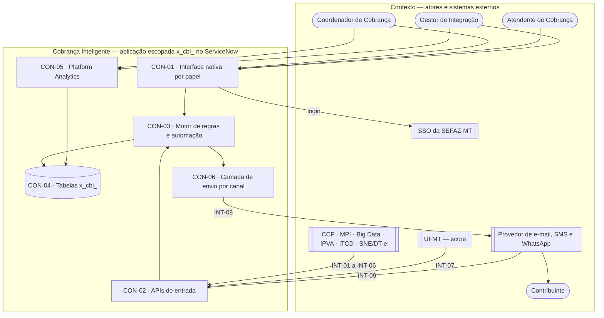

# High-Level Design (TO-BE) — Cobrança Inteligente (2.6 Cobrança · SEFAZ-MT)

Status: draft
Última atualização: 2026-11-13
Versão: 1.0
Modo: completo
Contexto: greenfield
Fonte: modules.md, requirements.md, product-requirements.md, flow-map.md, context-map.md, tech-rules/ (sem benchmark.md — fora da simulação)

<!-- id: hld-summary -->

## Resumo executivo

A Cobrança Inteligente é uma única aplicação dentro do ServiceNow da SEFAZ-MT. Os sistemas de
origem (CCF, MPI, Big Data, IPVA, ITCD, SNE/DT-e) e a UFMT empurram seus dados para APIs da
própria aplicação; um motor de regras consolida a carteira, aplica os critérios, roda as réguas e
cria os casos; os usuários trabalham em telas nativas por papel; e o Platform Analytics calcula os
indicadores direto das tabelas. A decisão que mais condiciona o resto é **ficar dentro da
plataforma**: tudo é publicado junto, como um pacote só, e nenhuma tela é customizada — o que
simplifica a entrega, mas amarra o produto às capacidades nativas do ServiceNow.

---

<!-- id: hld-containers -->

## Contexto e containers

*(Na plataforma ServiceNow os containers abaixo são publicados juntos, como uma aplicação escopada
`x_cbi_` — ver ADR-01. Eles aparecem separados porque têm papel, tecnologia e fronteira de
confiança diferentes.)*



### Inventário de containers

| ID | Nome | Responsabilidade | Tecnologia |
|----|------|------------------|------------|
| CON-01 | Interface nativa por papel | Mostra a cada papel as listas, formulários e filtros salvos das 12 telas de trabalho | Listas, formulários, módulos de menu e filtros salvos nativos do ServiceNow (`frontend.mdc`) |
| CON-02 | APIs de entrada | Recebe os lotes das fontes, o score da UFMT e o status de entrega do provedor, e devolve o resultado por registro | Scripted REST API com OAuth 2.0 por fonte (`integrations.mdc`, `auth.mdc`) |
| CON-03 | Motor de regras e automação | Onde ficam todas as regras: consolidação, critérios, segmentação, sorteio, réguas, casos, prioridade e origem da regularização | Script Includes, Business Rules como gatilho, Flow Designer e Scheduled Jobs (`architecture.mdc`) |
| CON-04 | Tabelas x_cbi_ | Guarda os dados do produto e aplica o controle de acesso no próprio dado | 26 tabelas da plataforma com ACL e Query Business Rules (`database.mdc`, `auth.mdc`) |
| CON-05 | Platform Analytics | Calcula os indicadores direto das tabelas e mostra o Painel Institucional e o Painel do Score | Indicadores, breakdowns, coleta diária e dashboards do Platform Analytics (`frontend.mdc`) |
| CON-06 | Camada de envio por canal | Monta a mensagem e entrega ao provedor de cada canal, isolando o motor de réguas do provedor | Script Include por canal + REST Message (`integrations.mdc`) |

---

<!-- id: hld-decomposition -->

## Decomposição por módulo

| Módulo | Container | Papel no módulo |
|--------|-----------|-----------------|
| MOD-INGESTAO | CON-02 | APIs das seis fontes de débito, com o padrão comum de lote |
| MOD-INGESTAO | CON-03 | Validação de documento, consolidação, fechamento do ciclo, reprocesso |
| MOD-INGESTAO | CON-01 | Telas de integrações, carteira consolidada e visão única do contribuinte |
| MOD-QUALIFICACAO | CON-03 | Versionamento, motor de critérios, segmentação, sorteio do controle e confirmação |
| MOD-QUALIFICACAO | CON-01 | Telas de critérios e de prévia da carteira |
| MOD-SCORE | CON-02 | API de ingestão do score |
| MOD-SCORE | CON-03 | Classificação em faixas e fallback sem score |
| MOD-SCORE | CON-05 | Painel do Score de Liquidez |
| MOD-REGUAS | CON-03 | Motor diário de réguas, consentimento, escalonamento e reenvio |
| MOD-REGUAS | CON-06 | Envio por e-mail, SMS e WhatsApp |
| MOD-REGUAS | CON-01 | Editor de régua e execução dos disparos |
| MOD-QUALIFICADA | CON-03 | Criação, distribuição e prioridade dos casos; follow-up |
| MOD-QUALIFICADA | CON-01 | Minha Fila e Dossiê & Caso |
| MOD-MONITORAMENTO | CON-03 | Marcação de notificado e regularizado e atribuição de origem |
| MOD-MONITORAMENTO | CON-05 | Indicadores e Painel Institucional |
| MOD-MONITORAMENTO | CON-01 | Lista de regularizações por origem |
| MOD-GOVERNANCA | CON-04 | ACL por papel, isolamento do atendente e mascaramento de CPF |
| MOD-GOVERNANCA | CON-03 | Eventos de auditoria e alteração de parâmetros |
| MOD-GOVERNANCA | CON-01 | Telas de parâmetros e de auditoria |

---

<!-- id: hld-integrations -->

## Integrações externas

| ID | Sistema externo | Container | Direção | Estilo | Protocolo | Falha |
|----|-----------------|-----------|---------|--------|-----------|-------|
| INT-01 | Conta Corrente Fiscal (CCF) | CON-02 | entrada | assíncrono | REST/JSON por lote e pacote | Sem lote até o horário-limite, a fonte fica em Falha, vale a última carga válida e o Gestor de Integração é alertado |
| INT-02 | MPI | CON-02 | entrada | assíncrono | REST/JSON por lote e pacote | Idem INT-01; débito repetido com o Big Data conta uma vez |
| INT-03 | Big Data (P2.2) | CON-02 | entrada | assíncrono | REST/JSON por lote e pacote | Idem INT-01 |
| INT-04 | Sistema IPVA | CON-02 | entrada | assíncrono | REST/JSON por lote e pacote | Idem INT-01 |
| INT-05 | GIA-ITCD | CON-02 | entrada | assíncrono | REST/JSON por lote e pacote | Idem INT-01 |
| INT-06 | SNE / DT-e | CON-02 | entrada | assíncrono | REST/JSON por lote e pacote | Idem INT-01 |
| INT-07 | UFMT (modelo de score) | CON-02 | entrada | assíncrono | REST/JSON por lote e pacote | Sem lote novo, vale o último score; quem não tem score segue os critérios fixos |
| INT-08 | Provedor de e-mail, SMS e WhatsApp | CON-06 | saída | síncrono | REST/JSON | A comunicação fica em Falha e é reenviada até o limite de tentativas; depois, falha definitiva |
| INT-09 | Provedor de e-mail, SMS e WhatsApp (status de entrega) | CON-02 | entrada | assíncrono | REST/JSON (callback) | Sem callback, a comunicação fica como Enviada; status repetido não muda nada |
| INT-10 | SSO da SEFAZ-MT | CON-01 | saída | síncrono | SSO da instância | Sem SSO, ninguém entra; a instância é responsável (fora do escopo do produto) |
| INT-11 | B-Cadastro e Cadastro de Contadores | — | entrada | síncrono | REST (API pronta) | Não usada na v1 (GAP-012); sem impacto |
| INT-12 | Credep | — | entrada | assíncrono | a definir | Não integrado na v1 (GAP-017); a exclusão de contumazes usa a marca da CCF |
| INT-13 | ServiceNow (App Engine, Platform Analytics) | CON-01, CON-02, CON-03, CON-04, CON-05, CON-06 | bidirecional | síncrono | plataforma hospedeira | É onde a aplicação roda: indisponibilidade da instância para o produto inteiro; responsabilidade da TI SEFAZ-MT |
| INT-14 | Planilhas e Google Drive | — | entrada | assíncrono | nenhum — processo manual substituído | Não se aplica: a distribuição por planilha deixa de existir (RF-MOD-QUALIFICADA-02) |
| INT-15 | SUCOM | — | entrada | assíncrono | nenhum — consulta manual substituída | Não se aplica: o dossiê do caso substitui a consulta manual (RF-MOD-QUALIFICADA-04) |

*(INT-13 é a própria plataforma; INT-14 e INT-15 são o processo manual de hoje, listado no
`context-map.md` e substituído pelo produto — ficam aqui para registrar que não viram integração.)*

---

<!-- id: hld-flows -->

## Fluxos arquiteturais

| ID | Fluxo | Caminho | Nota |
|----|-------|---------|------|
| FLA-01 | FLX-001 | INT-01 a INT-06 → CON-02 → CON-03 → CON-04 | Maior volume: cerca de 1,8 milhão de contribuintes consolidados por ciclo |
| FLA-02 | FLX-002 | CON-01 → CON-03 → CON-04 | Simulação e confirmação da carteira processadas em lotes |
| FLA-03 | FLX-003 | INT-07 → CON-02 → CON-03 → CON-04 → CON-05 | Lote de score com cerca de 1,4 milhão de linhas |
| FLA-04 | FLX-004 | CON-03 → CON-06 → INT-08; INT-09 → CON-02 → CON-04 | Cerca de 22 mil comunicações por dia; depende do provedor |
| FLA-05 | FLX-005 | CON-03 → CON-04 → CON-01 | Criação e distribuição de casos; isolamento do atendente no CON-04 |
| FLA-06 | FLX-006 | CON-03 → CON-04 → CON-05 | Coleta diária forma a tendência; sem tabela de fotografia |

---

<!-- id: hld-deployment -->

## Topologia de implantação

| Ambiente | Topologia | Observação |
|----------|-----------|------------|
| Desenvolvimento | Instância de desenvolvimento do ServiceNow com a aplicação `x_cbi_` ligada ao GitHub | Fontes e provedor substituídos pelo kit de lotes simulados e pelo provedor de teste |
| Homologação | Instância de homologação com a mesma versão da aplicação | Testes integrados, carga (k6) e homologação com a área de negócio |
| Produção | Instância de produção da SEFAZ-MT, compartilhada com os outros produtos do Profisco, cada um no seu escopo | Release da instância a confirmar (Questões em aberto) |

---

<!-- id: hld-nfr-tactics -->

## Táticas por RNF

| RNF | Métrica | Tática ou risco aceito | Containers | Justificativa |
|-----|---------|------------------------|------------|---------------|
| RNF-DES-001 | consolidação em até 4 horas | Posição por tributo gravada na carga; consolidação em lotes por Scheduled Job; teste de carga com k6 em homologação | CON-03, CON-04 | Evita somar a base inteira na consulta |
| RNF-DES-002 | 100% das comunicações devidas enviadas em até 6 horas | Motor de réguas em lotes e envio por canal desacoplado do motor | CON-03, CON-06 | O provedor lento não trava o cálculo das etapas |
| RNF-CONF-001 | 100% das fontes que entregaram consolidadas; alerta em até 15 minutos | Fechamento do ciclo por fonte, com a última carga válida mantida e alerta por notificação | CON-03, CON-04 | Uma fonte fora do ar não pode parar as outras |
| RNF-SEG-001 | 0 acessos indevidos nos 5 papéis | ACL no próprio dado e Query Business Rule para o atendente | CON-04 | Esconder menu não protege o dado |
| RNF-SEG-002 | 0 envios após o opt-out | Consulta de consentimento no momento do envio | CON-03, CON-06 | O opt-out precisa valer no mesmo dia |
| RNF-USA-001 | 0 erros críticos de acessibilidade nas 14 telas | Risco aceito — as telas são nativas e a acessibilidade depende do ServiceNow; a equipe só verifica e configura rótulos | CON-01, CON-05 | Sem tela customizada, não há código de interface a corrigir |
| RNF-CONF-002 | coleta concluída até 08:00 em 95% dos dias úteis | Coleta diária agendada logo após o fechamento do ciclo | CON-05 | Depende da licença do Platform Analytics (GAP-002) |

---

<!-- id: hld-security -->

## Segurança de alto nível

| ID | Fronteira | Containers | Controles | Ameaça AS-IS |
|----|-----------|------------|-----------|--------------|
| TRB-01 | Sistemas parceiros → aplicação | CON-02 | OAuth 2.0 com um usuário de integração por fonte, REST API Access Policy, limite de requisições, validação de documento, reenvio sem duplicidade | — |
| TRB-02 | Usuário interno → dados | CON-01, CON-04 | SSO da instância, 5 papéis, ACL no dado, isolamento do atendente, CPF mascarado, exportação registrada | — |
| TRB-03 | Aplicação → provedor de mensagens | CON-06 | Credencial fora do código, consentimento conferido antes do envio, dados por canal sujeitos à validação jurídica (GAP-015) | — |
| TRB-04 | Provedor → aplicação (callback) | CON-02 | Credencial por provedor, identificador da comunicação validado, atualização sem duplicidade | — |

---

<!-- id: hld-adr -->

## Decisões de arquitetura (ADR)

| ID | Decisão | Contexto | Alternativas rejeitadas | Consequências | Origem |
|----|---------|----------|-------------------------|---------------|--------|
| ADR-01 | Uma única aplicação escopada `x_cbi_` no ServiceNow | ETF §1.1 prevê aplicação escopada; um time, 7 módulos | Uma aplicação por módulo — dependência entre escopos sem ganho | Tudo é publicado junto; a separação entre módulos depende de disciplina de código | architecture.mdc |
| ADR-02 | Regra de negócio sempre em Script Include, Business Rule só como gatilho | Regras de cálculo precisam valer para APIs, jobs e telas e ser testáveis | Regra dentro de Business Rule ou Client Script | Mais objetos para manter; ganho em teste e auditoria | architecture.mdc |
| ADR-03 | Identificadores em português e API versionada no caminho | ETF usa nomes em português; parceiros externos | Inglês no código (padrão da empresa) | Diferente dos outros projetos da empresa; alinhado à ETF e ao cliente | conventions.mdc |
| ADR-04 | Tabelas da plataforma com posição por tributo gravada na carga | ~1,8 milhão de contribuintes; indicadores direto das tabelas | Somar na consulta; tabela de fotografia | Carga mais pesada; consultas e painéis rápidos | database.mdc |
| ADR-05 | Fontes empurram lotes para APIs da aplicação, com padrão comum | Parceiros ainda sem contrato; volume alto | O produto consultar cada fonte; arquivo diário | Os parceiros precisam desenvolver o envio; contrato único para os sete | integrations.mdc |
| ADR-06 | SSO da instância para usuários e OAuth 2.0 por fonte nas APIs | ETF §1.1 e §2.1 | Usuário e senha locais; uma credencial para todas as fontes | Uma fonte não enxerga a API de outra; login depende da instância | auth.mdc |
| ADR-07 | Telas nativas e dois dashboards, sem tela customizada | ETF §6.6 | Next.js (padrão da empresa); UI Builder | Interface limitada ao que a plataforma oferece; menos código para manter | frontend.mdc |
| ADR-08 | Testes com ATF, kit de lotes simulados e k6 | Volume alto e regras de cálculo críticas | Só testes manuais | Esforço de automação desde o início | test-strategy.mdc |
| ADR-09 | Logs estruturados e métricas nativas, com o lote como correlação | Operação depende de cargas diárias | OpenTelemetry com ferramenta externa | Sem rastreio distribuído; suficiente numa plataforma só | observability.mdc |
| ADR-10 | Aplicação versionada no GitHub, 3 ambientes e um branch por história | Instância compartilhada com outros produtos | Update sets manuais | Exige configurar o controle de versão do Studio | deploy-and-build.mdc |

---

<!-- id: hld-risks -->

## Riscos técnicos e spikes

| ID | Risco | Impacto | Spike sugerido | Alvo |
|----|-------|---------|----------------|------|
| RSK-01 | A consolidação de ~1,8 milhão de contribuintes pode passar de 4 horas na instância | Carteira desatualizada no início do expediente | Rodar a consolidação com lote simulado de 1,8 milhão e medir: termina em até 4 horas? | CON-03 |
| RSK-02 | O provedor pode não sustentar 22 mil envios por dia | Etapas atrasadas e régua fora da cadência | Enviar 22 mil mensagens ao provedor de teste e medir: todas aceitas em até 6 horas? | INT-08 |
| RSK-03 | Platform Analytics sem licença | Sem painéis e sem a métrica principal | Confirmar a licença; se não houver, montar o funil num relatório nativo: atende às 4 visões do painel? | CON-05 |
| RSK-04 | Sem fonte de opt-in fora do IPVA, as réguas de ICMS, ITCD e parcelamentos ficam paradas | Cobrança massificada só para o IPVA | Levantar com a TI se o B-Cadastro ou a DT-e têm consentimento por canal: existe campo utilizável? | CON-03 |
| RSK-05 | Lote de score com ~1,4 milhão de linhas pode estourar o limite de requisição da plataforma | Score atrasado | Enviar um lote simulado de 1,4 milhão em pacotes e medir o tamanho máximo aceito por pacote | INT-07 |

---

<!-- id: open-questions -->

## Questões em aberto

| # | Pergunta | Evidência/contexto (RNF, INT-NN, arquivo:linha) | Bloqueia próxima fase? |
|---|----------|--------------------------------------------------|-------------------------|
| 1 | Qual a release da instância ServiceNow da SEFAZ-MT? | Topologia de implantação; tech-rules-summary.md | não |
| 2 | O Platform Analytics está licenciado? | CON-05; RNF-CONF-002; GAP-002 | não para o backlog |
| 3 | Qual o tamanho máximo de pacote aceito pelas APIs na instância? | INT-01 a INT-07; RSK-05 | não |

---

<!-- id: hld-coverage -->

## Cobertura

```
AVISO: ADR_PER_DECISION: decisões macro das tech-rules sem ADR correspondente: kickoff-proposto.md
GATES:
  MODULES_MAPPED: OK
  EXTERNAL_SYSTEMS_ADDRESSED: OK
  NFR_TACTICS_MAPPED: OK
  CONTAINERS_CONSISTENT: OK
  ADR_PER_DECISION: AVISO
  ASIS_DELTA_PRESENT: N/A (greenfield)
  COMPACT_MODE_DECLARED: N/A (modo completo)
MÉTRICAS:
  modo=completo contexto=greenfield
  containers=6 integrações=15 táticas=7 ADRs=10 riscos=5
  % módulos mapeados: 100.0% (N/A justificado: nenhum)
  % RNF com métrica cobertos: 100.0%
  containers órfãos: nenhum
  RNF com risco aceito: RNF-USA-001
  integrações assíncronas: INT-01, INT-02, INT-03, INT-04, INT-05, INT-06, INT-07, INT-09, INT-12, INT-14, INT-15
  spikes sugeridos: 5
RESULTADO: OK (0 erro(s), 1 aviso(s))
```

**Aviso tratado (1):** `ADR_PER_DECISION` aponta `kickoff-proposto.md`. Ele não é uma rule: é o
registro do quadro de decisões aprovado por Pedro, guardado na mesma pasta. As 9 rules de projeto
estão todas citadas na coluna Origem dos ADR-01 a ADR-10.
